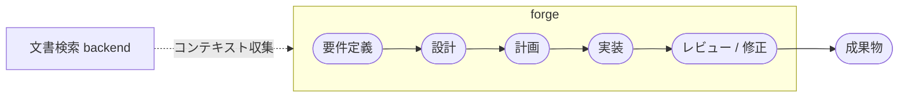
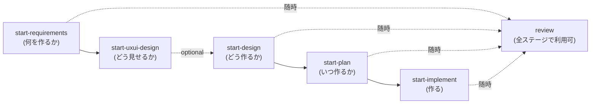

# sdd-forge

[](LICENSE)

**仕様駆動開発（Spec-Driven Development）** のための Claude Code プラグイン — 仕様を先に書き、AI がフルコンテキストで実装・レビューする。

**マーケットプレイスバージョン: 0.1.4**

マーケットプレイスは **forge** プラグインを配布する。forge の検索系スキルは、外部の文書検索 backend を使う。backend の種類・導入・切り替えは [forge backend の導入と切り替え][switch-forge-backend-ja] を参照。

[English README (README_en.md)][readme-en]

## 仕様駆動開発とは

仕様駆動開発は、すべてのコード変更を書かれた仕様に遡れるワークフローである。**forge** が要件定義・設計・計画・実装・レビューの5段階を導き、AI が場当たり的な指示ではなく明文化された意図に基づいて作業する。各段階で文書が生まれ、次の段階の入力になる。結果として追跡可能で監査可能な成果物が得られる — コードがなぜ存在するかを常に説明できる。

→ 哲学と追加開発ワークフローの詳細は [仕様駆動開発ガイド][guide-sdd-ja] を参照。

## 文書検索 backend の役割

プロジェクトが大きくなると、ルール・規約・設計文書が蓄積される。AI がそれらを見つけられなければ活用できない。文書検索 backend はこれらの文書をインデックス化し、forge の重要な場面で自動的に提供する:

- **実装時** — コードを書く前にプロジェクト固有の実装ルールと関連仕様を収集する。
- **レビュー時** — 適用すべきルールをレビュー観点として追加し、汎用的なベストプラクティスではなくプロジェクトの実際の基準で検査する。

forge の `/forge:query-db-rules` / `/forge:query-db-specs` / `/forge:update-db-rules` / `/forge:update-db-specs` は、順序リストに基づいて backend を選択して検索・索引更新を実行する。先位の backend を利用できない場合は理由を通知して後位の backend を利用する。これによりコンテキストの欠損がなくなる — AI がシニアメンバーと同じ知識で実装・レビューできるようになる。

backend の種類と導入方法、切り替えの詳細 — `.claude/.forge.yaml` の書き方、索引更新スキル（`/forge:update-db-rules` / `update-db-specs`）だけが持つ `--backend` 強制指定、および別軸であるレビュー実行主体（`agent-review`）の指定 — は [switch-forge-backend_ja.md][switch-forge-backend-ja] を参照。

## ワークフロー



## プラグイン一覧

| プラグイン | バージョン | 説明                                                                                                                    |
| ---------- | ---------- | ----------------------------------------------------------------------------------------------------------------------- |
| **forge**  | 0.1.4      | AI によるドキュメントライフサイクルツール。要件定義・設計・計画書の作成、コード・文書レビュー、自動修正、品質確定に対応 |

> **文書検索 backend は外部依存**: forge には含まれない。種類と導入方法は [forge backend の導入と切り替え][switch-forge-backend-ja] を参照。

## スキル一覧

### forge

> Feature と文書構造管理の詳細は [文書構造ガイド][guide-doc-structure-ja] を参照。

#### パイプライン



| 段階          | スキル             | 入力                        | 出力                       |
| ------------- | ------------------ | --------------------------- | -------------------------- |
| 要件定義      | start-requirements | 対話 / ソースコード / Figma | 要件定義書（Markdown）     |
| UXUI デザイン | start-uxui-design  | 要件定義書の ASCII アート   | デザイントークン + UI 仕様 |
| 設計          | start-design       | 要件定義書                  | 設計書（Markdown）         |
| 計画          | start-plan         | 設計書                      | 計画書（JSON）             |
| 実装          | start-implement    | 計画書                      | コード + 進捗更新          |
| レビュー      | review             | コード / 文書               | 指摘 + 修正                |

#### はじめかた

```bash
# 1. プロジェクト設定（初回のみ）
/forge:setup-doc-structure

# 2. 要件定義から実装まで
/forge:start-requirements my-feature --mode interactive
/forge:start-design my-feature
/forge:start-plan my-feature
/forge:start-implement my-feature

# 3. レビュー（随時）
/forge:review --files src/foo.py,src/bar.py --auto
/forge:review --dirs docs/specs/my-feature/design/
```

#### スキル一覧

| スキル                                              | 説明                                                                                                                                                                                                                                                                                          | トリガー                            |
| --------------------------------------------------- | --------------------------------------------------------------------------------------------------------------------------------------------------------------------------------------------------------------------------------------------------------------------------------------------- | ----------------------------------- |
| [**review**][guide-review-ja]                       | レビュー依頼の組み立てと所見の評価・修正・再依頼・完了判定をスキルの実行側が駆動し、レビュアーとの往復はレビューバックエンド SKILL へ委譲。`--backend` で指定、未指定なら候補を順に可用性検査（現在の候補は外部依存を持たない agent-review のみ）。`--scope` で到達目標と意図的な未実装を明示 | `"レビューして"`                    |
| **consult**                                         | 利用者と対話するすべての場面で使う。内容を分かりやすく伝え、正しい判断を得ることが主眼で、表示はその手段として用途ごとに組み立てる。論点ごとに調べて要旨と推奨案を述べ、複数あれば一覧で全体を示しながら 1 件ずつ進む。レビュー所見の採否の進行も review から委譲される                       | `"相談したい"`                      |
| [**start-requirements**][guide-create-docs-ja-s]    | 対話・ソース解析・Figma の 3 モードで要件定義書を作成                                                                                                                                                                                                                                         | `"要件定義"`                        |
| [**start-design**][guide-create-docs-ja-2]          | 要件定義書から設計書を作成。要件から組み立て、既存の実装は設計の後に照合して再利用                                                                                                                                                                                                            | `"設計書作成"`                      |
| [**start-plan**][guide-create-docs-ja-3]            | 設計書からタスクを抽出し JSON 計画書を作成                                                                                                                                                                                                                                                    | `"計画書作成"`                      |
| **write-adr**                                       | 設計の context から切り離した ADR ライター（`adr-writer` Agent）に ADR の作成・更新を依頼する。棄却・不足の判定を返し、feature ごとの 1 つの ADR ファイルへ記載する                                                                                                                           | `"ADR を書いて"`                    |
| [**start-implement**][guide-implement-ja]           | 計画書のタスクを選択し、実装・レビュー・計画書更新を一連で実行                                                                                                                                                                                                                                | `"実装開始"`                        |
| [**start-uxui-design**][guide-uxui-design-ja]       | 要件定義書からデザイントークン・UI 仕様を UX 評価付きで創造                                                                                                                                                                                                                                   | `"UXUIデザイン"`                    |
| **create-requirements-from-plan-mode**              | Claude plan mode の Markdown plan から要件定義書を作成。plan の内容は詳細設計も含めて取り込む（設計書は作らない。forge 実装計画書 `{feature}_plan.json` は対象外）                                                                                                                            | `"plan mode から要件作成"`          |
| **merge-specs**                                     | 2 つの仕様 DIR（基本 / 追加）の齟齬を内容単位で解消。追加側を正として基本側を更新し、同一スコープの新規分のみ移す（別スコープは分離維持）                                                                                                                                                     | `"spec をマージ"`                   |
| [**setup-doc-structure**][guide-doc-structure-ja-s] | `.doc_structure.yaml` 生成 + ディレクトリ scaffold                                                                                                                                                                                                                                            | `"初期設定"`                        |
| [**setup-version-config**][guide-setup-ja-s]        | `.version-config.yaml` 生成・更新                                                                                                                                                                                                                                                             | `"バージョン設定"`                  |
| [**update-version**][guide-setup-ja-2]              | バージョン一括更新。patch/minor/major/直接指定                                                                                                                                                                                                                                                | `/forge:update-version`（手動のみ） |
| [**help**][guide-setup-ja-3]                        | インタラクティブヘルプ                                                                                                                                                                                                                                                                        | `"ヘルプ"`                          |
| **onboarding**                                      | セッション起動直後に 1 回実行。スキルを経由しない直接作業でも守るべき基盤文書を全件 Read し、規範をプロジェクトの CLAUDE.md へ承認のうえ転記する                                                                                                                                              | `"作業をやって"`                    |
| [_doc-structure_][guide-doc-structure-ja]           | `.doc_structure.yaml` のパース・パス解決                                                                                                                                                                                                                                                      | ※ 各オーケストレーターが呼び出し    |
| [_next-spec-id_][guide-create-docs-ja]              | 全ブランチをスキャンして仕様書 ID の次番を取得                                                                                                                                                                                                                                                | ※ start-requirements が呼び出し     |

> **太字** = ユーザー起動可能、_斜体_ = AI 専用（他スキルから内部的に呼び出される）

### 文書検索 backend（外部）

文書検索は、外部の backend が提供する。forge の `/forge:query-db-rules` 等が順序リストに基づいて選択して呼び出す。種類と導入方法は [forge backend の導入と切り替え][switch-forge-backend-ja] を参照。

## インストール

### 方法 A: マーケットプレイス経由（永続）

Claude Code セッション内で:

```
/plugin marketplace add BlueEventHorizon/sdd-forge
/plugin install forge@sdd-forge
```

文書検索 backend は、forge とは別に導入する。手順は [forge backend の導入と切り替え][switch-forge-backend-ja] を参照。

`/plugin install` を実行するとインストールスコープの選択を求められます（`--scope` で直接指定することも可能）:

```bash
/plugin install forge@sdd-forge --scope user     # 自分の全プロジェクトで使う
/plugin install forge@sdd-forge --scope project  # このリポのチーム全員で使う
/plugin install forge@sdd-forge --scope local    # このリポで自分だけ使う
```

| スコープ    | 対象範囲                 | チーム共有           | 設定保存先                    |
| ----------- | ------------------------ | -------------------- | ----------------------------- |
| **user**    | 自分・全プロジェクト     | なし                 | `~/.claude/settings.json`     |
| **project** | このリポジトリの全員     | あり（git コミット） | `.claude/settings.json`       |
| **local**   | 自分・このリポジトリのみ | なし（gitignore）    | `.claude/settings.local.json` |

- **全プロジェクトで常に使いたい** → **user**
- **このリポジトリのチーム全員に配布したい** → **project**
- **このリポジトリで自分だけ使いたい** → **local**

> **注意**: 同じプラグインをすでにインストール済みの場合、別スコープで再インストールはできません。スコープを変更するには先にアンインストールしてから再インストールしてください。

特定のプロジェクトで無効化したい場合は `/plugin disable forge@sdd-forge` を実行してください。

無効化したプラグインを再有効化するには、ターミナルから:

```bash
claude plugin enable forge@sdd-forge
```

`marketplace add` は GitHub リポジトリをプラグイン取得元として登録します（ユーザーごとに1回）。

### 方法 B: ローカルディレクトリ（セッション限定）

```bash
git clone https://github.com/BlueEventHorizon/sdd-forge.git
claude --plugin-dir ./sdd-forge/plugins/forge
```

> **注意**: `--plugin-dir` はセッション限定です。Claude Code を起動するたびに指定が必要です。解除するには、フラグなしで起動するだけです。

### 更新

ターミナルから（スコープはインストール時に選択したものを指定）:

```bash
claude plugin update forge@sdd-forge --scope user    # user スコープの場合
claude plugin update forge@sdd-forge --scope project  # project スコープの場合
claude plugin update forge@sdd-forge --scope local    # local スコープの場合
```

## 文書構造管理 (.doc_structure.yaml)

`.doc_structure.yaml` はプロジェクトのドキュメント配置場所と種別を宣言する設定ファイル。forge が参照する（`/forge:update-db-rules` 等が対象パスを解決して、選択した文書検索 backend に渡す）。`/forge:setup-doc-structure` で生成する。
→ [文書構造ガイド][guide-doc-structure-ja] | [スキーマ仕様][doc-structure-format]

## Git 情報キャッシュ (.git_information.yaml)

GitHub リポジトリの情報（既定のベースブランチ等）をキャッシュするファイル。forge の `/forge:review` がブランチ差分の基点を解決するときに参照します。

## 動作要件

- [Claude Code](https://claude.ai/code) CLI
- Python 3.14 以上（Python スクリプト実行用。Python 3.13 以下はサポート対象外）
- 文書検索を使う場合は、文書検索 backend のいずれか（[forge backend の導入と切り替え][switch-forge-backend-ja]）

## ライセンス

[MIT](LICENSE)

[switch-forge-backend-ja]: docs/readme/switch-forge-backend_ja.md
[readme-en]: README_en.md
[guide-sdd-ja]: docs/readme/guide_sdd_ja.md
[guide-doc-structure-ja]: docs/readme/guide_doc_structure_ja.md
[guide-review-ja]: docs/readme/forge/guide_review_ja.md
[guide-create-docs-ja-s]: docs/readme/forge/guide_create_docs_ja.md#start-requirements
[guide-create-docs-ja-2]: docs/readme/forge/guide_create_docs_ja.md#start-design
[guide-create-docs-ja-3]: docs/readme/forge/guide_create_docs_ja.md#start-plan
[guide-implement-ja]: docs/readme/forge/guide_implement_ja.md
[guide-uxui-design-ja]: docs/readme/forge/guide_uxui_design_ja.md
[guide-doc-structure-ja-s]: docs/readme/guide_doc_structure_ja.md#forgesetup-doc-structure
[guide-setup-ja-s]: docs/readme/forge/guide_setup_ja.md#setup-version-config
[guide-setup-ja-2]: docs/readme/forge/guide_setup_ja.md#update-version
[guide-setup-ja-3]: docs/readme/forge/guide_setup_ja.md#help
[guide-create-docs-ja]: docs/readme/forge/guide_create_docs_ja.md
[doc-structure-format]: plugins/forge/docs/doc_structure_format.md
