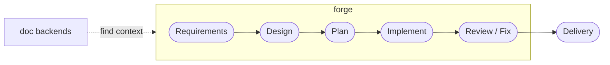
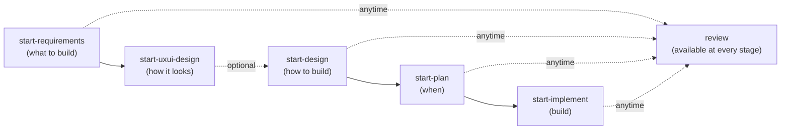

# sdd-forge

Claude Code plugins for **Spec-Driven Development** — write specs first, then let AI implement and review with full context.

**Marketplace version: 0.1.2**

The marketplace ships the **forge** plugin. forge's search skills use an external document-search backend. For the available backends, how to install them, and how to switch, see [Installing and switching forge backends][switch-forge-backend].

[Japanese README (README.md)][readme]

## What is Spec-Driven Development?

Spec-Driven Development is a workflow where every code change traces back to a written specification. **forge** guides you through five stages — requirements, design, plan, implement, and review — so that AI always works from explicit, reviewable intent rather than ad-hoc instructions. Each stage produces a document; each document feeds the next stage. The result is traceable, auditable delivery: you can always answer _why_ a piece of code exists.

## The Role of the Document-Search Backends

Large projects accumulate rules, standards, and design documents that AI cannot use if it cannot find them. The document-search backends index these documents and automatically supply the relevant ones to forge at the moments that matter:

- **During implementation** — project-specific coding rules and related specs are collected before a single line is written.
- **During review** — applicable rules are added as review perspectives, so reviews check against your actual standards, not generic best practices.

forge's `/forge:query-db-rules` / `query-db-specs` / `update-db-rules` / `update-db-specs` select a backend from an ordered list and run search / index updates against it. If the preferred backend is unavailable, forge notifies you and uses the other one. This eliminates context gaps: AI implements and reviews with the same knowledge a senior team member would have.

For the available backends, how to install them, and the details of switching — the `.claude/.forge.yaml` syntax, the `--backend` forcing argument that only the index-update skills (`/forge:update-db-rules` / `update-db-specs`) accept, and the separate review-executor axis (`agent-review`) — see [switch-forge-backend.md][switch-forge-backend].

## Workflow



## Plugins

| Plugin    | Version | Description                                                                                              |
| --------- | ------- | -------------------------------------------------------------------------------------------------------- |
| **forge** | 0.1.2   | AI-powered document lifecycle tool. Create, review, and auto-fix requirements/design/plan docs and code. |

> **The document-search backends are external dependencies**: they are not part of forge. For the available backends and how to install them, see [Installing and switching forge backends][switch-forge-backend].

## Skills

### forge

> For Feature management and document structure details, see the [Document Structure Guide][guide-doc-structure].

#### Pipeline



| Stage          | Skill              | Input                        | Output                       |
| -------------- | ------------------ | ---------------------------- | ---------------------------- |
| Requirements   | start-requirements | Dialog / source code / Figma | Requirements docs (Markdown) |
| UXUI Design    | start-uxui-design  | ASCII art from requirements  | Design tokens + UI specs     |
| Design         | start-design       | Requirements docs            | Design docs (Markdown)       |
| Plan           | start-plan         | Design docs                  | Plan (JSON)                  |
| Implementation | start-implement    | Plan                         | Code + progress updates      |
| Review         | review             | Code / documents             | Findings + fixes             |

#### Getting Started

```bash
# 1. Project setup (first time only)
/forge:setup-doc-structure

# 2. Requirements through implementation
/forge:start-requirements my-feature --mode interactive
/forge:start-design my-feature
/forge:start-plan my-feature
/forge:start-implement my-feature

# 3. Review (anytime)
/forge:review --files src/foo.py,src/bar.py --auto
```

#### Skills

| Skill                                            | Description                                                                                                                                                                                                                                                                                                                                                                                                        | Trigger                                 |
| ------------------------------------------------ | ------------------------------------------------------------------------------------------------------------------------------------------------------------------------------------------------------------------------------------------------------------------------------------------------------------------------------------------------------------------------------------------------------------------ | --------------------------------------- |
| [**review**][guide-review]                       | Whatever runs the skill drives request assembly, finding evaluation, fixing, re-request, and completion; the round-trip with the reviewer is delegated to a review backend SKILL. Pick one with `--backend`, or let forge probe the candidates in order (the only current candidate is agent-review, which has no external dependencies). `--scope` states the intended goal and deliberate omissions              | `"review"`                              |
| **consult**                                      | Used in every dialogue with the user. Its aim is to convey content clearly and obtain the right judgment; the display is a means to that end, built per use. Investigates each point and states a summary and a recommendation; with several points, shows the whole picture in a list and walks through them one at a time. Also drives the accept/reject dialogue on review findings when review delegates to it | `"I want to consult"`                   |
| [**start-requirements**][guide-create-docs-s]    | Create requirements via dialog, reverse-engineering, or Figma                                                                                                                                                                                                                                                                                                                                                      | `"requirements"`                        |
| [**start-design**][guide-create-docs-2]          | Create design docs from requirements. Builds from the requirements first, then matches and reuses existing implementations                                                                                                                                                                                                                                                                                         | `"start design"`                        |
| [**start-plan**][guide-create-docs-3]            | Extract tasks from design docs into a JSON plan                                                                                                                                                                                                                                                                                                                                                                    | `"start plan"`                          |
| **write-adr**                                    | Ask the isolated ADR writer (`adr-writer` Agent) to create or update an ADR; it may reject or report missing information, and records decisions in one ADR file per feature                                                                                                                                                                                                                                        | `"write adr"`                           |
| [**start-implement**][guide-implement]           | Select tasks from plan, implement, review, and update                                                                                                                                                                                                                                                                                                                                                              | `"start implement"`                     |
| [**start-uxui-design**][guide-uxui-design]       | Create design tokens & UI specs with UX evaluation                                                                                                                                                                                                                                                                                                                                                                 | `"UXUI design"`                         |
| **create-requirements-from-plan-mode**           | Turn a Claude plan-mode Markdown plan into a requirements document, carrying over all of its content including detailed design (no design doc is created; forge's own `{feature}_plan.json` is out of scope)                                                                                                                                                                                                       | `"create requirements from plan mode"`  |
| **merge-specs**                                  | Reconcile two spec DIRs (base / additional) at content granularity. Additional is canonical; base is updated; only same-scope new content moves (different scopes stay separate)                                                                                                                                                                                                                                   | `"merge spec"`                          |
| [**setup-doc-structure**][guide-doc-structure-s] | Generate `.doc_structure.yaml` + scaffold directories                                                                                                                                                                                                                                                                                                                                                              | `"setup"`                               |
| [**setup-version-config**][guide-setup-s]        | Generate/update `.version-config.yaml`                                                                                                                                                                                                                                                                                                                                                                             | `"version config"`                      |
| [**update-version**][guide-setup-2]              | Bump version across files. patch/minor/major/direct                                                                                                                                                                                                                                                                                                                                                                | `/forge:update-version` (explicit only) |
| [**help**][guide-setup-3]                        | Interactive help wizard                                                                                                                                                                                                                                                                                                                                                                                            | `"help"`                                |
| **onboarding**                                   | Run once right after session start. Reads all foundational documents that even direct, non-skill work must follow, and copies the norms into the project CLAUDE.md after approval                                                                                                                                                                                                                                  | `"do the work"`                         |
| [_doc-structure_][guide-doc-structure]           | Parse and resolve paths from `.doc_structure.yaml`                                                                                                                                                                                                                                                                                                                                                                 | ※ Called by orchestrators               |
| [_next-spec-id_][guide-create-docs]              | Scan all branches for spec IDs and return the next available number                                                                                                                                                                                                                                                                                                                                                | ※ Called by start-requirements          |

> **Bold** = user-invocable, _Italic_ = AI-only (called internally by other skills)

### Document-search backends (external)

Document search is provided by external backends. forge's `/forge:query-db-rules` etc. select one from an ordered list. For the available backends and how to install them, see [Installing and switching forge backends][switch-forge-backend].

## Installation

### Option A: Marketplace (persistent)

Inside a Claude Code session:

```
/plugin marketplace add BlueEventHorizon/sdd-forge
/plugin install forge@sdd-forge
```

Install a document-search backend separately from forge. For the steps, see [Installing and switching forge backends][switch-forge-backend].

To re-enable a disabled plugin, from your terminal:

```bash
claude plugin enable forge@sdd-forge
```

`marketplace add` registers the GitHub repo as a plugin source (once per user). Once installed, the plugin is always available.

### Option B: Local directory (per session)

```bash
git clone https://github.com/BlueEventHorizon/sdd-forge.git
claude --plugin-dir ./sdd-forge/plugins/forge
```

> **Note**: `--plugin-dir` is session-only. You must specify it every time you start Claude Code. To unload, simply start without the flag.

### Update

From your terminal:

```bash
claude plugin update forge@sdd-forge --scope local
```

## Document Structure (.doc_structure.yaml)

`.doc_structure.yaml` declares where documents live and what types they are. forge reads it (e.g. `/forge:update-db-rules` resolves the target paths and passes them to the selected document-search backend). Generate it with `/forge:setup-doc-structure`.
→ [Document Structure Guide][guide-doc-structure] | [Schema reference][doc-structure-format]

## Git Information Cache (.git_information.yaml)

Caches GitHub repository information (such as the default base branch). forge's `/forge:review` reads it to resolve the base of a branch diff.

## Requirements

- [Claude Code](https://claude.ai/code) CLI
- Python 3.14 or later (for running the Python scripts; Python 3.13 and earlier are not supported)
- For document search, one of the document-search backends ([Installing and switching forge backends][switch-forge-backend])

## License

[MIT](LICENSE)

[switch-forge-backend]: docs/readme/switch-forge-backend.md
[readme]: README.md
[guide-doc-structure]: docs/readme/guide_doc_structure.md
[guide-review]: docs/readme/forge/guide_review.md
[guide-create-docs-s]: docs/readme/forge/guide_create_docs.md#start-requirements
[guide-create-docs-2]: docs/readme/forge/guide_create_docs.md#start-design
[guide-create-docs-3]: docs/readme/forge/guide_create_docs.md#start-plan
[guide-implement]: docs/readme/forge/guide_implement.md
[guide-uxui-design]: docs/readme/forge/guide_uxui_design.md
[guide-doc-structure-s]: docs/readme/guide_doc_structure.md#forgesetup-doc-structure
[guide-setup-s]: docs/readme/forge/guide_setup.md#setup-version-config
[guide-setup-2]: docs/readme/forge/guide_setup.md#update-version
[guide-setup-3]: docs/readme/forge/guide_setup.md#help
[guide-create-docs]: docs/readme/forge/guide_create_docs.md
[doc-structure-format]: plugins/forge/docs/doc_structure_format.md
