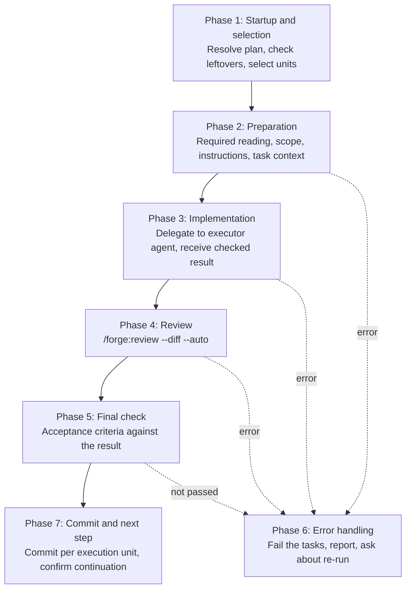

# Implementation Guide

Select tasks from a plan, then execute preparation → implementation → review → final check → plan update in a single workflow.

## start-implement

```
/forge:start-implement [feature] [-n N]
```

| Argument  | Description                                                                                                          |
| --------- | -------------------------------------------------------------------------------------------------------------------- |
| `feature` | Feature name (omit for interactive)                                                                                  |
| `-n`      | Number of tasks to select by priority (default 1; independent task execution units that do not wait run in parallel) |

### Usage Examples

```bash
/forge:start-implement login          # Auto-select 1 task by priority
/forge:start-implement login -n 3     # Select 3 tasks by priority and execute them
```

### When to Use

- After a plan (`{feature}_plan.json`) is complete
- To implement runnable tasks one at a time or several at once

### Task Execution Units

`select_tasks.py` returns a list of **task execution units** in execution order. A unit is one of two kinds.

| Kind    | Meaning                                                                                               |
| ------- | ----------------------------------------------------------------------------------------------------- |
| `task`  | A task that does not belong to a task group                                                           |
| `group` | A task group (tasks sharing a `group_id`). Members are implemented one at a time, in dependency order |

Each unit also lists the members that are already implemented and remain (`done_task_ids`). They are not implemented again, but they are included in the review and the completion.

### Task Status

A task is in one of five states.

| Status        | Meaning                                                                                             |
| ------------- | --------------------------------------------------------------------------------------------------- |
| `pending`     | Not started                                                                                         |
| `in_progress` | Being executed                                                                                      |
| `implemented` | Implemented. Only task group members stay here until every member is implemented. Not yet completed |
| `completed`   | Completed. Passed the review and the final check                                                    |
| `failed`      | Failed                                                                                              |

Status changes are made only by `update_plan_status.py`. The plan is never edited by hand, and the executor agent never writes to it.

### Execution Flow



### Phase 1: Startup and Selection

- Confirm the feature (interactive if omitted) and resolve the plan path `specs/{feature}/plan/{feature}_plan.json`
- `check_startup.py` reports whether the plan exists and whether `in_progress` tasks are left over. When some are left, you are asked whether they are leftovers of a previous run or another run in progress. Another run in progress stops the startup. Leftovers are marked `failed` first (implemented tasks stay). When `failed` tasks exist, they are listed and only those you choose to "clear and resume" go back to `pending` and become selectable again (reverting the implementation is up to you). If the working tree has uncommitted changes, they are listed and you are asked whether to continue (review and the final check look at uncommitted changes)
- `select_tasks.py` picks runnable tasks by priority and returns the units. A task is runnable when it is `pending` and every `depends_on` task is `completed` (or `implemented` within the same task group). Waiting tasks do not take a slot, and tasks that are `in_progress`, `implemented`, `failed` or `completed` are not selected

| Method  | Behavior                                                                                                                              |
| ------- | ------------------------------------------------------------------------------------------------------------------------------------- |
| No `-n` | Select the runnable unit with the highest priority                                                                                    |
| `-n N`  | Select N tasks by priority. When one belongs to a task group, its runnable group members join the same unit without counting toward N |

A task that depends on a task completed in this run is selected by the next start, not by this one.

When two or more units are selected, only **different units** may run in parallel. Units whose change targets overlap, depend on each other, or cannot be estimated run one after another. A task group with already-implemented members runs alone, because the review target of its uncommitted changes could not be isolated otherwise. Members of one task group are never run in parallel.

### Phase 2: Preparation

For each task of a unit (group members one at a time, in dependency order):

1. Mark the task `in_progress`
2. Collect the required reading with `collect_required_reading.py`, then add existing code and implementation rules found by search (`/forge:query-db-rules`)
3. Read the collected documents in full and grasp the task: description, acceptance criteria, in-scope and out-of-scope items, and the design and requirement documents
4. Classify the collected paths by kind (design, requirements, strategy, rules, reference code, additional)
5. List out-of-scope candidates with `derive_scope.py` and write `scope_in` / `scope_out`
6. Write the task-specific implementation instructions and decide whether tests are required
7. Create the task context with `build_task_context.py`. It returns a `context_id`. The context is placed in `tasks/` next to the plan and shares the lifecycle of the plan and the strategy document

The strategy document (`{feature}_strategy.md`), when it exists, is part of the required reading so the executor understands the approach and risk mitigation before working on its single task.

### Phase 3: Implementation

The orchestrator starts the **executor agent** (`forge:executor`) and passes only the identifiers (the plan path and `context_id`). The agent definition owns how to read, implement, verify and report.

Executor behavior:

1. Read the required reading in full
2. Implement according to the instructions, within the in-scope items
3. Verify with build and tests as the task context requires
4. Return a result

#### Constraints

- **One task per execution** — no touching adjacent tasks
- **Plan updates are the orchestrator's responsibility** — the executor does not modify the plan or the design and requirement documents

The returned result is checked by `receive_executor_result.py` before it is interpreted. A result that violates the contract becomes a `FAILURE` result. On `SUCCESS`, a task group member is marked `implemented`; a task outside a group goes to the review. The task context is deleted after the check.

#### Parallel Execution

When several independent units were confirmed to be parallel, each unit is prepared first, then the executors are started in the same message. Plan status changes are still made one call at a time. After all executors return, the units are reviewed one by one, because a review may edit the working tree and ask you questions.

### Phase 4: Review

Only a successfully implemented unit is reviewed.

- A task outside a group is reviewed as soon as it is implemented
- A task group is reviewed **once, after every member is implemented**. A member not selected because its predecessor is unfinished stays pending, and the group is not reviewed yet

`/forge:review --diff --auto` runs on the uncommitted changes (for a unit that ran in parallel, on its `files_modified`). Findings that are certain are fixed without asking; uncertain ones are shown to you.

**The target completeness is handed to the reviewer.** The scope each task must reach, and the out-of-scope items owned by other tasks (with their task IDs), are derived by `derive_scope.py` from the plan and passed to both the executor and the reviewer. Reviewing a staged task in isolation makes the reviewer report items planned for later tasks as defects, costing a round trip on every review to explain the scope.

For a task group, items owned by **other members of the same group are subtracted** from the out-of-scope list. Without that, items just implemented in this batch would be declared deliberate omissions.

> Implementation instructions, reference code, and verification requirements go to the executor but **not** to the reviewer. Passing the instructions degrades the review into checking conformance to them, so an error in the instructions themselves becomes undetectable; reference code invites "it matches the existing code, so it is fine"; and verification requirements (build/test skips) would excuse the legitimate finding that tests are missing.

If the review ends without approval, the unresolved findings are reported and you choose: complete, review again, or give up. The orchestrator does not decide. If the review changed files, build and tests are run again before the final check.

### Phase 5: Final Check

A review approval is not a substitute for the final check. For every task of the unit (all members of a task group), the orchestrator checks each acceptance criterion and each in-scope item against the change diff and the verification results, and marks it `ok` or `gap`, with a reason. It does not check against its own implementation instructions.

- **No `gap`**: the tasks become `completed` in one call (a task group in a single call for all members). Completed requirements are reported
- **Any `gap`**: the gaps are shown and handled as an error. Only the tasks with gaps are failed

### Phase 6: Error Handling

An executor failure, a contract violation, a preparation error, a failed re-verification, a review given up, or a failed final check stops the run at that point. The affected tasks are marked `failed`; implemented tasks that depended on a failed task go back to `pending` and are reported. You are then asked whether to re-run. A re-run starts from Phase 2 for the failed and reverted tasks only, at most once in the same session per unit. If the cause is a mistake in the design or requirement document, the document is not changed by this skill; the mistake and a proposed fix are shown for your approval.

| Situation                            | Response                                                                         |
| ------------------------------------ | -------------------------------------------------------------------------------- |
| Executor failure (build error, etc.) | Fail the task → report → re-run only if you choose it (max 1 in a session)       |
| Dependency not completed             | Not selected. It becomes runnable after the dependency is completed              |
| Plan not found                       | Suggest running `/forge:start-plan`                                              |
| Interrupted run                      | Found at the next start as `in_progress` leftovers (see Phase 1)                 |
| Resuming a `failed` task             | Revert the implementation, start again, and choose "clear and resume" in Phase 1 |

### Phase 7: Commit and Next Step

1. Each time a unit is completed, you go to the commit confirmation flow (units that ran in parallel go through it once, after all of them are completed; failed units are not included). When no skill for that flow is available, the steps to review and commit the changes are shown. The commit content is not decided by this skill
2. If tasks other than `completed` remain, you are asked whether to continue (back to the selection). When everything is completed, you are asked whether to keep or discard the plan, `tasks/` and the strategy document (the three are kept together or discarded together). They are never deleted automatically
