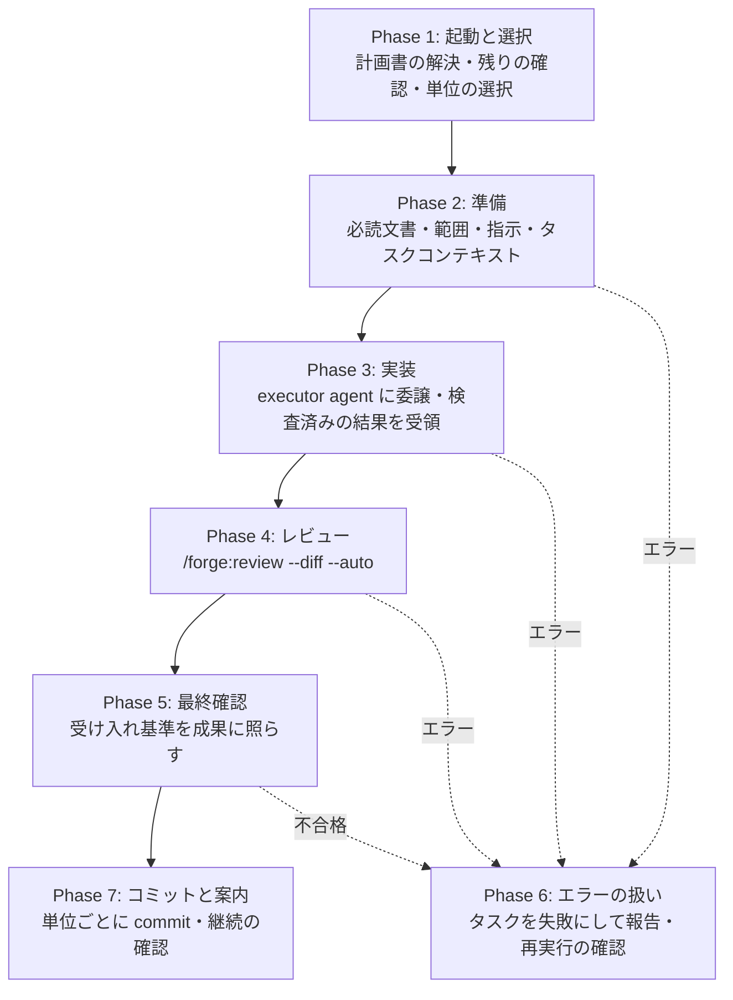

# 実装ガイド

計画書からタスクを選択し、準備 → 実装 → レビュー → 最終確認 → 計画書更新を一貫して実行する。

## start-implement

```
/forge:start-implement [feature] [-n N]
```

| 引数      | 説明                                                                                              |
| --------- | ------------------------------------------------------------------------------------------------- |
| `feature` | Feature 名（省略時は対話で確定）                                                                  |
| `-n`      | 優先度順で選択するタスク数（省略時は 1 件。依存せず待たない独立なタスク実行単位は並列に実行する） |

### 使用例

```bash
/forge:start-implement login              # 優先度順で 1 件自動選択
/forge:start-implement login -n 3         # 優先度順で 3 件を選択して実行
```

### いつ使うか

- 計画書（`{feature}_plan.json`）が完成した後
- 実行可能なタスクを 1 つずつ、または複数同時に実装するとき

### タスク実行単位

`select_tasks.py` は、実行する順に並べた**タスク実行単位**の一覧を返す。単位は次の 2 種類である。

| 種別    | 意味                                                                                     |
| ------- | ---------------------------------------------------------------------------------------- |
| `task`  | タスクグループに属さないタスク                                                           |
| `group` | タスクグループ（`group_id` が同じタスクの集まり）。メンバーは依存の順に 1 件ずつ実装する |

単位には、すでに実装済みのまま残るメンバー（`done_task_ids`）も載る。再び実装はしないが、レビューと完了の対象に含まれる。

### タスクの状態

タスクの状態は 5 値である。

| 状態          | 意味                                                                             |
| ------------- | -------------------------------------------------------------------------------- |
| `pending`     | 未着手                                                                           |
| `in_progress` | 実行中                                                                           |
| `implemented` | 実装済み。タスクグループのメンバーが、全員の実装が終わるまで留まる。完了ではない |
| `completed`   | 完了。レビューと最終確認を通った                                                 |
| `failed`      | 失敗                                                                             |

状態を変えるのは `update_plan_status.py` だけである。計画書を手で編集せず、executor agent も計画書を書かない。

### 実行フロー



### Phase 1: 起動と選択

- Feature を確定し（引数なしなら対話）、計画書のパス `specs/{feature}/plan/{feature}_plan.json` を解決する
- `check_startup.py` が、計画書の有無と、`in_progress` のタスクが残っていないかを返す。残っているときは、前回の残りか別の実行が進行中かを確認する。別の実行が進行中なら起動を中止する。前回の残りなら、先に `failed` にする（実装済みのタスクは残る）。`failed` のタスクがあれば一覧が示され、利用者が「クリアして再開」を指示したものだけが `pending` に戻って次の選択の対象になる（実装の取り消しは利用者が行う）。作業ツリーに未コミットの変更があれば一覧が示され、続行するかを確認される（レビューと最終確認は未コミットの変更を対象にするため）
- `select_tasks.py` が、実行可能なタスクを優先度順に選び、単位にして返す。`pending` で、すべての `depends_on` が `completed`（同じタスクグループ内なら `implemented` でもよい）のものが実行可能である。待つタスクは枠を占めず、`in_progress`・`implemented`・`failed`・`completed` のタスクは選ばれない

| 指定方法  | 動作                                                                                                                |
| --------- | ------------------------------------------------------------------------------------------------------------------- |
| `-n` なし | 優先度が最も高い実行可能な単位を選ぶ                                                                                |
| `-n N`    | 優先度順で N 件選択。タスクグループに属するときは、同じグループの実行可能なメンバーが、N に数えずに同じ単位へ加わる |

今回の実行で完了したタスクに依存するタスクは、今回ではなく、次の起動で選ばれる。

単位が 2 つ以上選ばれたときに並列にしてよいのは、**異なる単位**だけである。変更する対象が重なるもの、互いに依存するもの、対象を推定できないものは、順に実行する。実装済みのメンバーを持つタスクグループは、未コミットの変更からレビュー対象を切り分けられないため、単独で実行する。同じタスクグループのメンバーは並列にしない。

### Phase 2: 準備

単位のタスクごとに（タスクグループは依存の順に 1 件ずつ）、次を行う。

1. タスクを `in_progress` にする
2. `collect_required_reading.py` で必読文書を集め、検索で見つけた既存コードと実装ルール（`/forge:query-db-rules`）を補う
3. 集めた文書を全文読み、タスクの説明・受け入れ基準・範囲と範囲外・設計書と要件定義書を把握する
4. 集めたパスを種別（設計書・要件定義書・戦略書・ルール・参照コード・その他）に分ける
5. `derive_scope.py` で範囲外の候補を列挙し、`scope_in` / `scope_out` を書く
6. タスク固有の実装の指示を書き、テストの要否を決める
7. `build_task_context.py` でタスクコンテキストを作る。`context_id` が返る。置き場は計画書と同じディレクトリの `tasks/` で、計画書・実装戦略書と同じライフサイクルで扱う

実装戦略書（`{feature}_strategy.md`）があれば、必読文書に含まれる。executor が、割り当てられた 1 タスクに着手する前に、実装方針とリスク対策を把握するためである。

### Phase 3: 実装

オーケストレーターが **executor agent**（`forge:executor`）を起動し、識別値（計画書パスと `context_id`）だけを渡す。読み方・実装・検証・報告の仕方は agent 定義が持つ。

executor の動作:

1. 必読文書を全文読む
2. 指示に従い、今回の範囲の中で実装する
3. タスクコンテキストが求める範囲で、ビルド・テストを実施して検証する
4. 結果を返す

#### 制約

- **1 回の実行で 1 タスクのみ** — 隣接タスクへの着手禁止
- **計画書の更新はオーケストレーターの責務** — executor は、計画書も設計書・要件定義書も変更しない

返された結果は、解釈する前に `receive_executor_result.py` が検査する。契約に反する結果は `FAILURE` の結果に置き換わる。`SUCCESS` のとき、タスクグループのメンバーは `implemented` になり、タスクグループに属さないタスクはレビューへ進む。検査のあと、タスクコンテキストは削除される。

#### 並列実行

独立な単位が並列にしてよいと確かめられたときは、各単位の準備を済ませてから、同じメッセージで executor を起動する。計画書の状態遷移は、並列でも 1 回ずつ直列に呼ぶ。全 executor が戻ったあと、単位を 1 つずつ順にレビューする。レビューは作業ツリーを修正し、利用者に確認を求めることがあるためである。

### Phase 4: レビュー

実装に成功した単位だけをレビューに出す。

- タスクグループに属さないタスクは、実装できた時点でレビューする
- タスクグループは、**全メンバーが実装済みになってから 1 回**レビューする。先行が未完了のため選ばれなかったメンバーは未着手のまま残り、そのグループはまだレビューしない

`/forge:review --diff --auto` を未コミットの変更に対して実行する（並列に実行した単位は、その結果の `files_modified` に対して）。確信のある所見は確認なしに修正し、確信の無い所見は利用者に提示する。

**今回の到達目標をレビュアーへ渡す**。`derive_scope.py` が計画書から「このタスクで到達すべき範囲」と「他のタスクが担当する範囲外の項目（担当タスク ID 付き）」を導出し、executor とレビュアーの両方へ渡す。段階分割したタスクを単体でレビューさせると、後続タスクで実装予定の項目が欠陥として報告され、スコープを説明する往復が毎回発生するためである。

タスクグループでは、範囲外の項目から**同じグループの他メンバーが担当する分を差し引く**。差し引かないと、今回すでに実装した項目を「意図的な未実装」として宣言してしまう。

> 実装指示・参照コード・検証要件は executor には渡すが**レビュアーには渡さない**。実装指示を渡すとレビューが「指示どおりか」の確認に退化して指示自体の誤りを検出できなくなり、参照コードは「既存と同型だから妥当」という追認の材料になり、検証要件（ビルド・テストのスキップ指定）は「テストがない」という正当な指摘の免罪符になるためである。

承認なしでレビューが終わったときは、未対応の所見を報告し、完了・再レビュー・断念のどれにするかを利用者が決める。オーケストレーターは決めない。レビューがファイルを修正したときは、最終確認の前に、ビルドとテストを再実行する。

### Phase 5: 最終確認

レビューの承認は、最終確認の代わりにならない。オーケストレーターは、単位の各タスク（タスクグループは全メンバー）について、受け入れ基準の各項目と `scope_in` の各項目を、変更差分と検証結果に照らし、根拠を添えて `ok` か `gap`（不足）にする。自分が書いた実装の指示には照らさない。

- **`gap` が無い**: タスクを `completed` にする（タスクグループは全メンバーを 1 回の呼び出しにまとめる）。完了になった要件を報告する
- **`gap` がある**: 不足を示し、エラーとして扱う。不足のあるタスクだけを失敗にする

### Phase 6: エラーの扱い

executor の失敗、契約違反、準備でのエラー、検証の再実行の失敗、レビューの断念、最終確認の不合格は、そこで実行を止める。該当するタスクを `failed` にし、失敗にしたタスクに依存していた実装済みのタスクは `pending` に戻して報告する。そのあと、再実行するかを利用者に確認する。再実行は、失敗にしたタスクと戻したタスクだけを Phase 2 からやり直し、同じ起動の中では単位ごとに 1 回までである。原因が設計書・要件定義書の誤りのときは、このスキルは文書を変更せず、誤りと修正案を示して承認を得る。

| 状況                            | 対応                                                                            |
| ------------------------------- | ------------------------------------------------------------------------------- |
| executor 失敗（ビルドエラー等） | タスクを失敗にする → 報告 → 利用者が選んだときだけ再実行（同じ起動で 1 回まで） |
| 依存タスク未完了                | 選ばれない。依存タスクが完了した後に実行可能になる                              |
| 計画書が見つからない            | `/forge:start-plan` の実行を案内                                                |
| 実行が中断した                  | 次の起動で、残った `in_progress` として見つかる（Phase 1）                      |
| `failed` のタスクを再開したい   | 実装を取り消してから起動し、Phase 1 で「クリアして再開」を指示する              |

### Phase 7: コミットと案内

1. 単位を完了にするたびに、commit の確認フローへ進む（並列に実行した単位は、すべて完了してから 1 回。失敗にした単位は含めない）。そのフローを担うスキルが無いときは、変更を確認してコミットする手順を案内する。コミットの内容はこのスキルが決めない
2. `completed` でないタスクが残るときは、継続するかを確認する（選択へ戻る）。すべて完了したときは、計画書・`tasks/`・実装戦略書を残すか破棄するかを確認する（3 つは一緒に残すか、一緒に破棄する）。自動では削除しない
