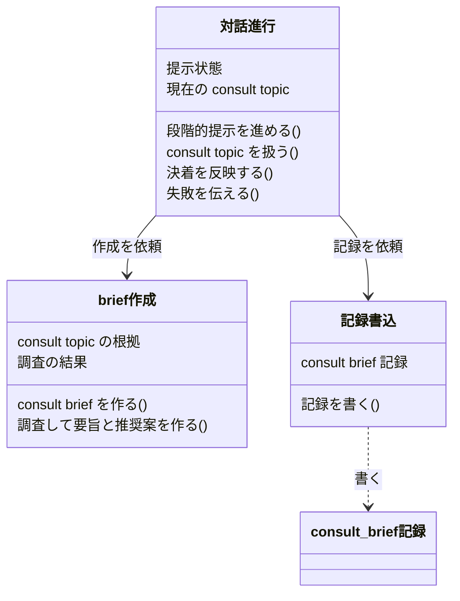
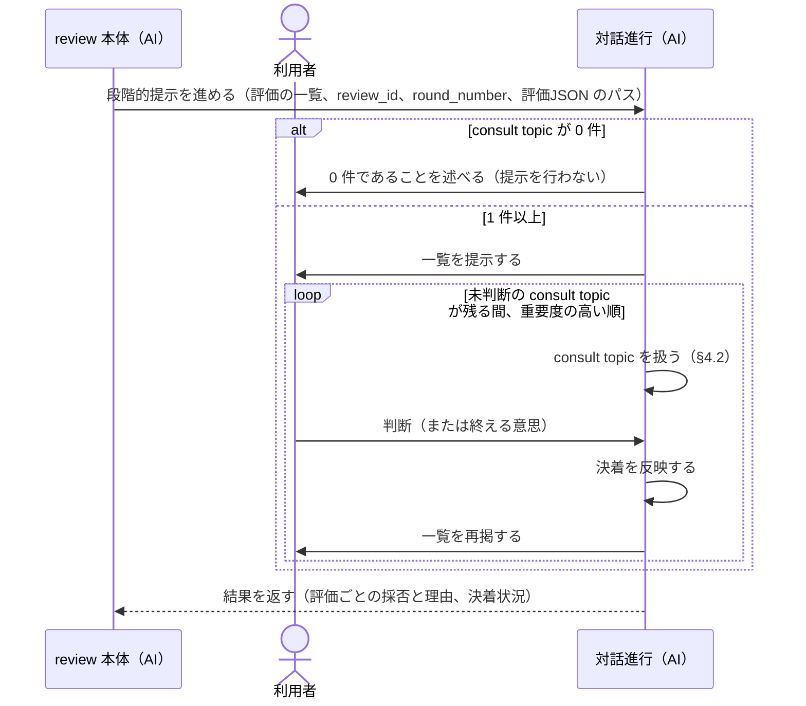
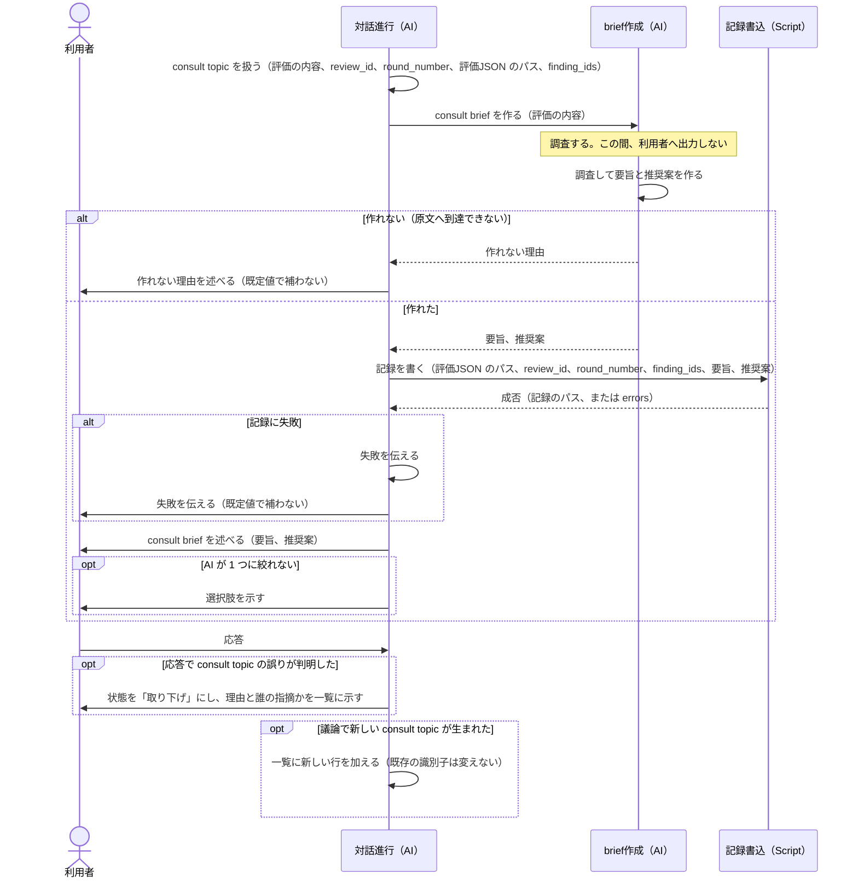

# DES-078 consult 対話進行フロー設計書

## 1. 概要

REQ-017 を実現する設計である。consult の主たる責務は、利用者に内容を分かりやすく伝え、正しい結果（判断）を得ることである（REQ-017 §1）。

対話の情報は次々に流れ、利用者は、流れた情報を探し出すことが難しい。そこで consult は、利用者が提示から判断できるように、2 つを担う。どちらも、用途ごとに定めた表示形式で示す（review は §6.6）。

- **全体の提示**: すべての consult topic・現在位置・前回から変わったことを、一覧（進捗表）として、進むたびに更新して再掲する（§4.1）
- **個別の提示**: consult topic ごとに、調べられることを調べ終えてから consult brief（要旨と推奨案）を述べ、その値を記録する（§4.2）

設計の範囲は、一覧による進行、consult brief の作成・提示の順序・記録、review に固有の処理の分離である。

consult の用途は、review から委譲される場合と、それ以外の対話（対話の用途）の 2 つである（REQ-017 §1）。本書の §4〜§6 は review から委譲された場合を設計している。対話の用途の設計（文脈から取り出す表示の材料、HTML を作る script、コンソールの概観、手順文書）は §8 の TBD-001 であり、まだ書いていない。

用語は REQ-017 §2（evaluation・consult topic・consult brief・提示状態）に従う。

## 2. シナリオ

| シナリオ ID | 要件 ID | 型       | きっかけ・条件                        | 応答                                                                                                                  | 関係する非機能要件 |
| ----------- | ------- | -------- | ------------------------------------- | --------------------------------------------------------------------------------------------------------------------- | ------------------ |
| S-01        | FNC-002 | イベント | review 本体が consult に委譲した      | 一覧を提示し、重要度の高い順に consult topic を扱う。進むたびに、現在位置と前回から変わった行を区別して一覧を再掲する | NFR-001            |
| S-02        | FNC-003 | イベント | consult が consult topic に入る       | consult brief（要旨と推奨案の 2 欄）を述べる                                                                          |                    |
| S-03        | FNC-006 | 常時     | consult brief を述べる                | 要旨と推奨案を合わせて 10 行程度に収める                                                                              |                    |
| S-04        | FNC-012 | 常時     | consult brief を作る                  | 作るのはメインの claude で、review 本体と同じ会話の中で作る                                                           |                    |
| S-05        | FNC-013 | イベント | consult topic に入る直前              | 調査を含めて consult brief を作り終える。作り終えるまで利用者に話しかけない。表示してから応答を待つ                   |                    |
| S-06        | FNC-014 | イベント | consult brief を作り終えた            | 要旨と推奨案を、識別子と対にして、script で JSON に記録する                                                           | NFR-002            |
| S-07        | NFR-005 | 異常     | 記録に失敗した                        | 既定値で補わず、失敗を利用者に伝える                                                                                  | NFR-005            |
| S-08        | FNC-003 | 任意機能 | AI が 1 つに絞れない                  | 選択肢を示す（AI が正しいと判断した案だけ）                                                                           |                    |
| S-09        | NFR-004 | 常時     | consult brief と記録                  | 機密情報の値を含めない                                                                                                | NFR-004            |
| S-10        | NFR-002 | 常時     | 実装                                  | review に固有の処理を、consult の対話の方法から分離する                                                               | NFR-002            |
| S-11        | FNC-008 | イベント | 利用者が consult topic の扱いを決めた | 一覧の状態を「決着」にし、採否と理由を結果へ書く。次の consult topic へ自分で進む                                     |                    |
| S-12        | FNC-009 | イベント | 利用者が終える意思を示した            | その時点までの判断を確定し、未判断の件数を示し、結果を review 本体へ返す                                              |                    |
| S-13        | FNC-007 | 異常     | 議論で consult topic が誤りと判明した | 一覧から消さず、状態を「取り下げ」にし、理由と誰の指摘かを示す                                                        |                    |
| S-14        | FNC-001 | 異常     | consult topic が 0 件である           | 提示を行わず、その旨を述べて終える                                                                                    | NFR-005            |
| S-15        | FNC-005 | 常時     | 過去のやり取りや識別子を再び用いる    | 参照で済ませず要点を再掲し、識別子・案の名前には何を指すかを添える                                                    |                    |
| S-16        | FNC-002 | イベント | 議論で新しい consult topic が生まれた | 一覧に新しい行を加える。既存の行の識別子は変えない                                                                    |                    |
| S-17        | FNC-001 | 常時     | consult brief の主張を確かめる        | 調べる手段があるものは調べてから述べる。調べずに「未確認」と述べない                                                  |                    |

常時型（S-03・S-04・S-09・S-10・S-15・S-17）は図にせず、§5.2 のモジュール表の事前条件・事後条件に書く。S-13 と S-14 は異常型であり、独立した図にせず、S-13 は §4.2、S-14 は §4.1 の中で演じる。S-16 は §4.2 の中で演じる。

## 3. 責務（構造）

### 3.1 クラス定義

| 責務名    | 保持データ（実質保持を含む）                                                | メソッド                                                               | 協調相手                                 | 要件 ID                                                                |
| --------- | --------------------------------------------------------------------------- | ---------------------------------------------------------------------- | ---------------------------------------- | ---------------------------------------------------------------------- |
| 対話進行  | 提示状態（一覧と各 consult topic の状態。会話に持つ）、現在の consult topic | 段階的提示を進める、consult topic を扱う、決着を反映する、失敗を伝える | brief作成、記録書込、利用者、review 本体 | FNC-002、FNC-003、FNC-007〜FNC-010、FNC-013、FNC-014、NFR-001、NFR-005 |
| brief作成 | consult topic の根拠（評価の内容と原文）、調査の結果                        | consult brief を作る、調査して要旨と推奨案を作る                       | なし                                     | FNC-001、FNC-003、FNC-006、FNC-012、NFR-004                            |
| 記録書込  | `<<file>>` consult brief 記録（正本はこのファイル）                         | 記録を書く                                                             | なし                                     | FNC-014、NFR-002、NFR-005                                              |

- **記録書込** は review に固有の責務である。review の値（`review_id`・`round_number`・`finding_ids`・評価JSON のパス）と、自分で採る通し番号から、置き場と識別子を決めて書く。評価JSON の中身は読まず、パスは置き場の基準にだけ使う（評価の内容は、親の claude が会話に持っているため）。他の用途の記録は、その用途の記録書込を足して扱う。
- **対話進行** は、用途に依らない記録のルール（作り終えたら記録する、AI は JSON を組み立てない、失敗は利用者に伝える）を持つ。review に固有の扱い（採否を聞く評価の範囲、一覧と consult brief の表示形式、まとめて直す申し出、結果の返し方、記録の呼び方）は、review から委譲されたときの手順（文書）が持つ。review に固有の部分は、どちらも consult の SKILL とは別のファイルに置く（NFR-002）。
- **brief作成** と **対話進行** は、どちらも同じ主体（メインの claude）が担う。責務を分けるのは、作り終えるまで話しかけないという順序（S-05）を、構造の上で表すためである。

### 3.2 クラス図



## 4. 振る舞い

### 4.1 一覧による進行（S-01・S-11・S-12・S-14）

一覧は、consult topic の目次であり、進捗表である。出しっぱなしにせず、進むたびに更新して再掲する。一覧が示すのは、すべての consult topic が何か、現在位置はどこか、前回の一覧から何が変わったか、である。

| 列     | 値                                                                                              |
| ------ | ----------------------------------------------------------------------------------------------- |
| #      | consult が振る識別子。議論の途中で振り直さない。新しく生まれた consult topic は末尾の番号を採る |
| 論点   | その行だけで何の論点か分かる短い名前。位置だけで表さない                                        |
| 重要度 | 🔴 critical / 🟡 major / 🟢 minor（レビュー所見と同じ語彙）                                     |
| 状態   | 未着手 / 進行中 / 決着 / 保留 / 対象外 / 取り下げ（採否を聞かない評価は「報告のみ」）           |
| 結果   | 決まったこと。決着なら採否と理由、保留・対象外・取り下げ・報告のみなら、その理由                |
| 課題   | まだ解決していないこと。決着していても残る課題があれば書く                                      |

結果と課題は 1 つの列にまとめない。1 つの列が状態によって違う意味を持つと、読み手が行ごとに意味を読み分けることになるためである。課題を含め、やっていないこと・解決していないことは、やるべき（推奨として次の行動に入れる）・判断が要る（推奨付きで判断を求める）・やらない（理由を添えるか示さない）のどれかに分けて示す（REQ-017 FNC-002）。書くことの無い欄は `—` とする。

一覧は、全体の状況（件数・現在位置・前回からの変更）を先に示し、すべての項目を横の表で 1 行ずつ簡略に並べ、いま扱っている consult topic だけを、表にせず箇条書きで詳しく示す。上下にセパレータラインを入れ、一覧と見分けられるようにする。consult brief は、この箇条書きの中で述べる（§4.2）。位置を表に入れないのは、表の中のパスをクリックして開けないためである。横の表では、いま扱っている行と、前回の一覧から変わった行を、他の行と区別する。区別の記号と表の書式は、用途ごとの手順が表示形式として持つ（review は §6.6）。AI は、提示のたびに形式を作らない。



- 決着を決めるのは利用者である。利用者が決めるまで次の consult topic へ進まず、決着したら対話進行が自分で次へ進む（FNC-010）。
- 利用者が終える意思を示したときは、ループを抜け、その時点までの判断を確定する。未判断の件数は、未判断のまま残った件数として示し、「対応不要」へ畳み込まない（S-12）。
- 提示状態は会話にだけあり、永続化されない。中断した提示を続きから再開する経路は持たない。

### 4.2 consult topic の提示と記録（S-02・S-05・S-06・S-07・S-08・S-13）



- consult brief を述べるときは、一覧を再掲し、いま扱っている consult topic の詳細（箇条書き）の中で述べる（§4.1）。
- 作成の完了までは、利用者への出力が発生しない。利用者への最初の出力は、作れない理由の通知、記録の失敗の通知、consult brief のいずれかである（S-05）。
- 記録に失敗しても、consult brief の提示は続ける。記録の読み手が無くても consult は動作するため（REQ-017 FNC-014）、記録の失敗が議論を止める理由にならない。ただし失敗は隠さない（S-07）。
- 利用者の応答が理解を求めるもの（「詳しく」「なぜ」）であれば、判断を促さずに答える。応答が何であっても、その consult topic にとどまり、決着は利用者が決めたときに成立する（FNC-007・FNC-010）。

## 5. 契約

### 5.1 共有データ定義

| データ名          | 意味                                                      | 正本                                                              | 書き手              | 読み手                                                                | ライフサイクル                                                                                                                 | 同時アクセスの約束                                     |
| ----------------- | --------------------------------------------------------- | ----------------------------------------------------------------- | ------------------- | --------------------------------------------------------------------- | ------------------------------------------------------------------------------------------------------------------------------ | ------------------------------------------------------ |
| 評価JSON          | review の evaluator が書いた評価の配列（REQ-029 DM-201）  | review が置く評価のファイル                                       | evaluator（review） | review 本体。consult は中身を読まず、置き場の基準としてパスだけを使う | review が管理する。consult は書かない・消さない                                                                                | 読み取りのみ                                           |
| consult_brief記録 | 1 つの consult topic の要旨と推奨案を、識別子と対にした値 | 評価JSON と同じディレクトリに置く、consult topic ごとのファイル   | 記録書込            | 将来の読み手（現在は無い）                                            | consult brief が完成したときに 1 回だけ作られ、更新されない。review が終端で review のディレクトリを削除するとき、一緒に消える | 通し番号は記録書込が採り、既存の記録は上書きしない     |
| 受け渡し本文      | 要旨と推奨案の本文を、AI から記録書込へ渡すファイル       | 対話進行（AI）が書く、セッションごとに一意な名前のファイル（6.2） | 対話進行（AI）      | 記録書込                                                              | 書く直前に作られ、記録書込が成功したときに削除される。失敗して残ったときは、次の consult topic が上書きしてよい                | consult topic は順に進むため、同じ名前を同時に使わない |
| 提示状態          | 一覧と各 consult topic の状態・結果                       | 会話                                                              | 対話進行            | 対話進行、利用者                                                      | 会話の間だけ存在し、永続化されない                                                                                             | なし                                                   |

識別子は、`review_id`・`round_number`・記録書込が採る通し番号の組である（REQ-017 FNC-014）。通し番号は、置き場にある既存の記録の最大の番号に 1 を足した値（なければ 1）で、AI は数えない。評価は finding と 1 対 1 ではなく、同じ `finding_ids` の組を持つ評価が複数ありうるため、`finding_ids` は識別子にしない（記録には入れる）。

### 5.2 モジュール表

| ID   | アクター  | 区分 | 処理                       | 呼び出し元          | 種別   | 入力（何を・取得元）                                                                                  | 処理概要                                                                                                        | 出力（何を・保存先）                                   | 事前条件                                 | 事後条件                                                                                                                                                                                                                                                                                      | 失敗時                                                                                                                                                                                       | 要件 ID                                              |
| ---- | --------- | ---- | -------------------------- | ------------------- | ------ | ----------------------------------------------------------------------------------------------------- | --------------------------------------------------------------------------------------------------------------- | ------------------------------------------------------ | ---------------------------------------- | --------------------------------------------------------------------------------------------------------------------------------------------------------------------------------------------------------------------------------------------------------------------------------------------- | -------------------------------------------------------------------------------------------------------------------------------------------------------------------------------------------- | ---------------------------------------------------- |
| M-01 | 対話進行  | 契約 | 段階的提示を進める         | review 本体（委譲） | AI     | 評価の一覧（会話）、`review_id`、`round_number`、評価JSON のパス                                      | 一覧を提示し、重要度の高い順に consult topic を扱い、決着を反映し、一覧を再掲し、結果を review 本体へ返す       | 利用者への一覧（会話）、上流への結果（会話）、提示状態 | 評価が 1 件以上ある                      | 全件が決着した、または利用者が終えた。未判断の件数が示されている。決着の内容（採否と理由）が review 本体へ返っている。各 consult topic の識別子は、議論の途中で変わっていない（番号を振り直していない）。再掲した一覧は、用途の表示形式に従い、件数・現在位置・前回から変わった行を示している | 評価が 0 件、または対象が不明なとき、既定値で補わず、述べて終える                                                                                                                            | FNC-001、FNC-002、FNC-008〜FNC-010、NFR-001、NFR-005 |
| M-02 | 対話進行  | 内部 | consult topic を扱う       | 対話進行            | AI     | 評価 1 件の内容（会話）、`review_id`、`round_number`、評価JSON のパス、`finding_ids`                  | consult brief を作り、記録し、述べ、利用者の応答を受ける                                                        | 利用者への consult brief（会話）、consult_brief記録    | 評価は利用者に採否を聞くものである       | 利用者への最初の出力は、作れない理由・記録の失敗の通知・consult brief のいずれかである。作れたときは、記録を試み、成否のいずれも利用者に分かる。過去のやり取り・識別子・案の名前を再び用いた発言は、参照で済ませず要点と何を指すかを添えている                                                | 作成できないとき、既定値で補わず、理由を利用者へ述べる                                                                                                                                       | FNC-003、FNC-005、FNC-007、FNC-013、FNC-014          |
| M-03 | 対話進行  | 内部 | 決着を反映する             | 対話進行            | AI     | 利用者の判断（会話）                                                                                  | 一覧の状態を更新し、採否と理由を結果へ、残る課題を課題へ書く。AI が決めたときは、その旨が判別できるように書く   | 提示状態                                               | 利用者が決めた                           | 一覧が更新されている。利用者が決めていない consult topic は、既定値で埋められていない                                                                                                                                                                                                         | —                                                                                                                                                                                            | FNC-007、FNC-008、FNC-009                            |
| M-04 | 対話進行  | 内部 | 失敗を伝える               | 対話進行            | AI     | M-07 の失敗（`errors`）                                                                               | 失敗の内容を利用者へ述べる                                                                                      | 利用者への通知（会話）                                 | M-07 が失敗した                          | 失敗が利用者に伝わっている。既定値で補っていない                                                                                                                                                                                                                                              | —                                                                                                                                                                                            | NFR-005                                              |
| M-05 | brief作成 | 契約 | consult brief を作る       | 対話進行            | AI     | 評価の内容と原文（会話。原文へは位置から到達する）                                                    | 調査し、要旨と推奨案を作る。各主張に確信度を付ける                                                              | 要旨、推奨案（会話）                                   | 原文へ到達できる                         | §6.8 の出力を満たす。作り終えるまで利用者へ出力しない                                                                                                                                                                                                                                         | 原文へ到達できないとき、作らず、作れない理由を返す                                                                                                                                           | FNC-001、FNC-003、FNC-006、FNC-012、FNC-013、NFR-004 |
| M-06 | brief作成 | 内部 | 調査して要旨と推奨案を作る | brief作成           | AI     | 評価の内容と原文（会話）                                                                              | 原文を読み、実行・確認などの調査をして、要旨と推奨案を組み立てる                                                | 要旨、推奨案（会話）                                   | M-05 の事前条件を満たす                  | 各主張の確信度が、調査の結論として付いている。調べる手段がある主張は調べてある（調べずに「未確認」としていない）                                                                                                                                                                              | M-05 の失敗時と同じ                                                                                                                                                                          | FNC-001、FNC-003、FNC-006、FNC-013、NFR-004          |
| M-07 | 記録書込  | 契約 | 記録を書く                 | 対話進行            | Script | 評価JSON のパス（絶対パス）、`review_id`、`round_number`、`finding_ids`、受け渡し本文（要旨・推奨案） | パスの親ディレクトリを置き場とし、通し番号を採って、識別子と対にした consult_brief記録 を、1 回の操作で公開する | consult_brief記録                                      | 置き場（パスの親ディレクトリ）が存在する | 識別子と、`finding_ids`・要旨・推奨案の本文が、そのまま入った記録が 1 つ増えている。成功したとき、受け渡し本文は削除されている                                                                                                                                                                | 引数が不正（絶対パスでない・実在しない・`finding_ids` が不正）・置き場が無い・公開できない（ハードリンクを作れない等）とき、失敗する（`errors`）。部分的な記録を残さない。受け渡し本文は残る | FNC-014、NFR-002、NFR-005                            |

- 契約の行（M-01・M-05・M-07）は、シーケンス図でアクターに向かう矢印と一致する。内部の行（M-02・M-03・M-04・M-06）は、自己メッセージと一致する。
- M-07 は評価JSON の中身を読まず、置き場の基準としてパスだけを使う。置き場と識別子は、渡された review の値と、M-07 が採る通し番号から決める。AI は通し番号を数えず、パスも組み立てない。
- M-01 の入力のうち、`review_id`・`round_number`・評価JSON のパス・`finding_ids` は、review 本体が会話に持っている値をそのまま使う。consult が組み立て直さない。review の SKILL は、同一コンテキストのため構造化した受け渡しは要らないと定めており（Step 7.5）、委譲の契約として前提にするのは、review 本体がこれらの値を会話に持っていることだけである。
- 同じ `finding_ids` の組を持つ評価が複数あっても、通し番号が異なるので、識別子は衝突しない。記録から評価を辿るときは、記録に入れた `finding_ids` を使い、同じ組のものは記録の内容で判別する。同じ consult topic を誤って 2 度記録すると、2 件できる。
- **M-05・M-06（AI）の出力の検証方法と、結果が揺れたときの対策**:
  - 検証方法: 作り終えた時点で、AI が §6.8 の構成要件（2 欄、10 行程度、確信度、機密値の不在）を自分で点検する。提示後は、利用者が読んで判断する。
  - 揺れたときの対策: 点検で満たさないものが見つかれば、話しかける前に作り直す（作り終えてから話しかける構造のため、直すのが間に合う）。調査しても確信に届かない主張は、無印のまま出す。
  - 運用での確認: AI の判断を試す手動のテスト（`ai_tests/`）で、実際の書類について確かめる。

## 6. 詳細設計

### 6.1 手段

| 責務・資産                      | 手段                                                 | 置き場                                                        | 理由                                                                                                   |
| ------------------------------- | ---------------------------------------------------- | ------------------------------------------------------------- | ------------------------------------------------------------------------------------------------------ |
| 対話進行、brief作成             | AI（メインの claude）。consult の SKILL が手順を持つ | `plugins/forge/skills/consult/SKILL.md`                       | 要件が、作るのはメインの claude と定めている（FNC-012）                                                |
| 記録書込                        | Script（Python、標準ライブラリのみ）                 | `plugins/forge/skills/consult/scripts/record_review_brief.py` | consult だけが使う資産は、そのスキルの配下に置く。外部依存は原則持たない（使うにはユーザの許諾が要る） |
| review から委譲されたときの手順 | 文書                                                 | `plugins/forge/skills/consult/docs/review_handling.md`        | review に固有の扱い全体を、consult の SKILL とは別ファイルに置く（NFR-002）                            |
| 記録書込のテスト                | unittest                                             | `tests/forge/consult/test_record_review_brief.py`             | `plugins/` 配下の Python にはテストが必須。テストの置き場はスキル名と一致させる                        |

**consult の SKILL の構成**: SKILL は、この設計に合わせて次のとおり書く。

- 提示の作法は、要旨と推奨案の 2 欄・合わせて 10 行程度・調査して作り終えてから話しかける（記録も含めて、作り終えるまで利用者へ出力しない）とする（§6.6・§6.8）。
- frontmatter の `allowed-tools` に `Write` を含める。AI が受け渡し本文を Write ツールで書くため（`write-adr`・`review` の SKILL も `Write` を含む）。
- 「状態ファイル・作業ディレクトリ・DB・コマンドも持たない」と、禁止事項の「提示状態をファイルや記録機構へ書き出す」は、対象を提示状態（一覧と各 consult topic の状態）に限る。記録（consult brief の値）は提示状態ではなく、記録の手順は用途ごとの手順文書が持つので、SKILL 自身はコマンドの呼び出しを持たない。
- review 固有の記述は、手順文書が持ち、SKILL は持たない。対象は、上流から渡される評価の種類と「報告のみ」の扱い、✅ の評価へのまとめて直す申し出と `flawed_premise` の除外、採否と決着状況の返し方である（§6.6）。
- 用途に依らない記録のルール（§6.6）と、review から委譲されたときの手順文書への案内を持つ。案内には、手順文書・記録 script・受け渡し本文の 2 つのファイルのパスを、SKILL が置換済みの絶対パスで示す。`docs/` 内の文書は直接 Read されるため、プレースホルダが置換されないからである（文書スタイル指針 §5.1）。

**使える既存資産を使わない理由**: review の script の部品（出力・失敗の返し方・一時ファイルを経由した公開）は、記録書込と同じ役割を持つ。しかし受け渡しの規範が、各機能に自分の script を持たせ、仕組みの実装を 1 つに共有することを求めていない。review の部品を import すると、他のコンポーネントの内部へ依存する。同種の機能（ADR の受け渡し）も、自前の部品を持つ。agenda の記録（REQ-019）は、スキーマが要旨と推奨案の 2 欄と一致しないため、使わない。

### 6.2 構造

**記録書込の呼び出し**

```text
python3 {記録 script のパス} {評価JSON のパス} {review_id} {round_number} \
  --finding-ids {id}... --summary-file {要旨のファイル} --recommendation-file {推奨案のファイル}
```

| 引数                                     | 内容                                                                                                 |
| ---------------------------------------- | ---------------------------------------------------------------------------------------------------- |
| `{記録 script のパス}`                   | SKILL が示す絶対パス（`${CLAUDE_SKILL_DIR}/scripts/record_review_brief.py` を SKILL が置換したもの） |
| `{評価JSON のパス}`                      | review 本体が得た評価JSON の絶対パス。置き場は、このパスの親ディレクトリ                             |
| `{review_id}` `{round_number}`           | review 本体が会話に持つ値。そのまま渡す                                                              |
| `--finding-ids`                          | その評価の `finding_ids`。記録に入れる。1 個以上の正の整数                                           |
| `--summary-file` `--recommendation-file` | AI が Write ツールで書いた、要旨と推奨案の本文のファイル（絶対パス）                                 |

**終了コードと標準出力**

| 終了コード | 意味                           | 標準出力                       |
| ---------- | ------------------------------ | ------------------------------ |
| 0          | 記録した                       | `{"path": "<記録の絶対パス>"}` |
| 1          | 区別のないエラー               | `{"errors": ["<理由>", ...]}`  |
| 2          | 引数を受理できない（argparse） | なし（標準エラーに理由）       |

**consult_brief記録の構造**

置き場は評価JSON と同じディレクトリである。ファイル名は `consult_brief_{通し番号}.json` とする（例: `consult_brief_1.json`）。通し番号は、置き場にある既存の `consult_brief_{数字}.json` の最大の数字に 1 を足した値（なければ 1）である。置き場はラウンドごとに別のため、通し番号はラウンドの中で一意である。

| フィールド       | 型         | 内容                                 |
| ---------------- | ---------- | ------------------------------------ |
| `review_id`      | 文字列     | 渡された値のまま                     |
| `round_number`   | 整数       | 渡された値のまま                     |
| `sequence`       | 整数       | 記録書込が採った通し番号             |
| `finding_ids`    | 整数の配列 | 渡された値を昇順・重複なしにしたもの |
| `summary`        | 文字列     | 要旨。渡された本文のまま             |
| `recommendation` | 文字列     | 推奨案。渡された本文のまま           |

要旨と推奨案は、それぞれ独立した値である（REQ-017 FNC-014）。

**受け渡し本文**

AI は、SKILL が示す 2 つのパスに、本文をそのまま書く。パスは、SKILL が `${CLAUDE_PROJECT_DIR}/.temp/forge/consult/consult-brief-${CLAUDE_SESSION_ID}-summary.md` と `${CLAUDE_PROJECT_DIR}/.temp/forge/consult/consult-brief-${CLAUDE_SESSION_ID}-recommendation.md` を置換した絶対パスである（`${CLAUDE_PROJECT_DIR}` と `${CLAUDE_SESSION_ID}` は SKILL の本文で置換される。公式の skills ページの置換の節に記載があり、`${CLAUDE_PROJECT_DIR}` は Claude Code v2.1.196 以降）。この 2 つを、そのまま `--summary-file` `--recommendation-file` に渡す。AI はプロジェクトルートを調べず、パスを組み立てない。名前はセッションごとに一意で、同じセッションの consult topic で使い回す。consult topic は順に進むため、同時には使わない。記録書込は、成功したときに限り、この 2 つを削除する。失敗したときは削除しないので、直して再実行できる。失敗したまま次の consult topic に進んだときは、残った本文を、次の本文で上書きしてよい。

### 6.3 利用ライブラリ

標準ライブラリのみ（`argparse`・`json`・`os`・`tempfile`・`pathlib`）。`plugins/` 配下の Python は外部依存を原則持たない規則による。

### 6.4 アルゴリズム

1. 引数を検査する。評価JSON のパスと本文のファイルが、絶対パスで実在すること。`round_number` が 1 以上の整数であること。`finding_ids` が 1 個以上の正の整数であること。満たさなければ、何も書かずに終了コード 1 で返す。
2. `finding_ids` を昇順・重複なしにそろえる。
3. 置き場（評価JSON のパスの親ディレクトリ）にある既存の `consult_brief_{数字}.json` を数え、通し番号（最大の数字に 1 を足した値。なければ 1）を採り、記録のファイル名を決める。
4. 本文のファイルを UTF-8 で読み、記録の内容を組み立てる。値は、生成・要約・改変せずにそのまま入れる。
5. 置き場に一時ファイルとして書く。
6. 一時ファイルを、記録のファイル名へハードリンクして公開する。同じ名前が既にあれば（通し番号を採ってから公開するまでの間に、同じ番号が採られたとき）、通し番号を 1 進めて、公開をやり直す。
7. 一時ファイルを削除する。成功したときだけ、受け渡し本文の 2 つを削除し、記録のパスを標準出力へ出す。

### 6.5 動作の原理

- **一時ファイルへ書いてから、ハードリンクで公開する**: 途中で止まっても、壊れた記録を残さない。記録のファイルは、完成したものだけが現れる。
- **ハードリンクは、同じ名前が既にあると失敗する**: 上書きしない。通し番号を採ってから公開するまでの間に同じ番号が採られても、記録は上書きされず、番号を進めてやり直す。

### 6.6 review から委譲されたときの手順（文書）

`docs/review_handling.md` は、review から委譲されたときの扱いを、次の順で持つ。

1. **受け取る評価の扱い**: review 本体は、採否を聞く評価に加えて、確認なしに直す ✅ の評価・位置未確定の評価・ドロップした評価も渡す。後者の 3 つは、一覧に載せるが採否を聞かない（「報告のみ」。結果の列に、どれに当たるかと理由を書く）。採否を聞く評価が consult topic である。
2. **表示形式**: 一覧と consult brief を、次の形で示す。AI は、提示のたびに形式を作らない。
   - 全体の状況（2 行）: 1 行目は件数と現在位置（`全 N 件・採否を聞く M 件／決着 k 件・残り r 件／現在 #n`）。決着と残りは consult topic だけを数え、報告のみの項目は全件にだけ数える。2 行目は、前回の一覧からの変更を 1 行で書く（最初の一覧では書かない）。
   - 横の表（すべての項目）: 列は `#`・`論点`・`重要度`・`状態`・`結果`・`課題` とし、各欄は 1 句に収める。番号は consult topic を重要度の高い順に振り、そのあとに報告のみの項目を振る。いま扱っている行は `#` に `▶` を付ける。前回の一覧から変わった行は、状態の後ろに `（更新）` を、新しく加えた行は `（新規）` を付ける（最初の一覧には付けない）。未着手の consult topic の提案は書かない（調べ終える前の提案を並べないため）。
   - いまの論点（いま扱っている consult topic）: 表にせず箇条書きで書き、上下にセパレータラインを入れる。見出しに `▶ #n` と論点を置き、`決めること`・`要旨`・`推奨案`・`位置` を並べる。`位置` は原文への到達手段で、パスと行を箇条書きにし、何が書いてあるかを添える（表の中のパスは開けないため）。`要旨` と `推奨案` が consult brief であり、10 行程度の目安はこの 2 つだけに当てる。`決めること` を先に置くのは、判断の対象を最初に示すためである（Barbara Minto『The Pyramid Principle』で、答えの前に問い（Question）を示すのと同じ考え方）。
3. **まとめて直す申し出**: ✅ の評価には、まとめて直す申し出を出す。利用者が承諾したら、その件数を review 本体へ返し、残りを 1 件ずつ進める。`flawed_premise` の評価は、まとめに含めない。
4. **記録**: 次の 3 手で記録する。
   1. 要旨と推奨案を、Write ツールで、SKILL が示す 2 つのパス（6.2）へそのまま書く。
   2. SKILL が示す記録 script のパスで、6.2 の呼び出しを実行する。値は、review 本体が会話に持つ `review_id`・`round_number`・評価JSON のパス・その評価の `finding_ids` をそのまま使う。通し番号は渡さない（記録書込が採る）。
   3. 終了コードが 0 でなければ、失敗を利用者へ伝え（終了コード 1 は標準出力の `errors`、終了コード 2 は標準エラーの内容）、既定値で補わない。そのうえで consult brief の提示を続ける（§4.2）。
5. **結果の返し方**: 評価ごとの採否（採用する・採用しない・保留する）と理由、決着状況（全件決着・中断・未判断の件数）を、review 本体へ返す。

consult の SKILL は、この文書の中身を持たない。SKILL が持つのは、用途に依らない次のことである。

- 各 consult topic の手順は、調査して consult brief を作り終え、記録し、述べる、の順に進める。作り終えるまで（記録も含めて）、利用者へ出力しない。利用者への最初の出力は、失敗の通知か consult brief とする。
- 委譲元の用途ごとの扱いは、用途ごとの手順文書が持つ。review から委譲されたときは、最初に `${CLAUDE_SKILL_DIR}/docs/review_handling.md` を Read して従う。あわせて、記録 script と受け渡し本文のパス（6.2）を、置換済みの絶対パスで示す。手順文書は、これらを「SKILL が示すパス」として参照する。
- AI は記録の JSON を組み立てず、script に渡す。記録の失敗は隠さず、利用者に伝える。

### 6.7 テストの観点

`test_record_review_brief.py` は、次を確かめる。

- 正常: 記録が 6.2 の構造で、本文がそのまま（改行・引用符・バッククォート・非 ASCII を含めて）入る。受け渡し本文が削除される。
- `finding_ids` の順序と重複によらず、記録の `finding_ids` は昇順・重複なしになる。
- 採番から公開までの間に、同じ名前の記録が先に作られたときは、通し番号を進めて公開し、先に作られた記録は上書きされない。
- 絶対パスでない引数・実在しないパス・不正な `finding_ids` は、何も書かずに失敗する。
- 通し番号は、置き場にある既存の記録の最大の番号に 1 を足した値になる（記録が無ければ 1）。
- 同じ `finding_ids` で 2 度記録すると、別の通し番号で 2 件になり、どちらも上書きされない。
- 失敗したとき、受け渡し本文が残り、一時ファイルが残らない。

consult の SKILL の契約テストは、構造だけを確かめる（案内する手順文書と script が実在すること、SKILL にコマンドの呼び出しを持たないこと）。

### 6.8 brief作成（AI）の出力

**出力に含まれるもの**

| 要素   | 内容                                                                                                                                    |
| ------ | --------------------------------------------------------------------------------------------------------------------------------------- |
| 要旨   | 本質を踏まえた、簡潔な説明。背景を含む。判断を左右する主張に確信度（✅・☑️・無印）を付ける。原文へ到達する位置・出典を添える            |
| 推奨案 | AI が正しいと判断した案を 1 つ。理由（根拠と代償）を添える。AI が 1 つに絞れないときだけ、選択肢（AI が正しいと判断した案だけ）を添える |

**出力の構造の約束**

- 要旨と推奨案を合わせて 10 行程度に収める（暫定。REQ-017 TBD-006）。再掲する一覧と、原文への到達手段は、行数に含めない。
- 確信度は、調査の結論にだけ付ける。無印は、調べても確信に届かないか、調べる手段が無いときだけ使い、どちらであるかを書く。調べる手段があるのに調べないことを、無印の理由にしない。
- 説明の長さと断定の強さを、確信度に合わせる。確信の無い主張を、長い説明や言い切りで補わない（REQ-017 FNC-004）。
- 選択肢を示すときは、どれを選ぶかを左右する利用者の価値・優先順位が何かを書く（REQ-017 FNC-003）。
- 表示形式は、用途の手順が定めるものに従う（review は §6.6）。
- 機密情報は、値を書かず、どこにあるか・どの種類かだけを書く。

検証方法と、揺れたときの対策は、§5.2 の注記が持つ。

## 7. 追跡表

| 要件    | それを満たす設計要素                                                      |
| ------- | ------------------------------------------------------------------------- |
| FNC-001 | S-14、S-17、§4.1、M-01（0 件の終了、識別子の固定）、M-05、M-06 の事後条件 |
| FNC-002 | §1、S-01、S-16、§4.1、§4.2、M-01、§6.6 の表示形式                         |
| FNC-003 | S-02、S-08、§4.2、M-02、M-05、M-06、§6.6 の表示形式、§6.8                 |
| FNC-004 | M-05・M-06（確信度は調査の結論にだけ付ける）、§6.8（無印の使い方）        |
| FNC-005 | S-15、M-02 の事後条件                                                     |
| FNC-006 | S-03、M-05・M-06、§6.8                                                    |
| FNC-007 | S-13、§4.2、M-02、M-03                                                    |
| FNC-008 | S-11、§4.1、M-01、M-03                                                    |
| FNC-009 | S-12、§4.1、M-01、M-03                                                    |
| FNC-010 | §4.1、M-01                                                                |
| FNC-012 | S-04、§3.1 の注記（同じ主体）、M-05、§6.1                                 |
| FNC-013 | S-05、§4.2 の注記、M-02 の事後条件、M-05・M-06、§6.6（SKILL が持つ手順）  |
| FNC-014 | S-06、M-07、§5.1 の consult_brief記録、§6.2、§6.4                         |
| BL-001  | M-01 の事後条件（判断を返すところまでが終端）                             |
| BL-002  | M-05・M-06（原文に基づいて作る）                                          |
| NFR-001 | S-01、§5.1 の提示状態                                                     |
| NFR-002 | S-10、§3.1 の注記、§6.1、§6.6                                             |
| NFR-004 | S-09、M-05・M-06、§6.8                                                    |
| NFR-005 | S-07、M-01 の失敗時、M-04、M-07 の失敗時、§6.6 の記録の 3 手目            |
| TBD-006 | 要件定義書が持つ（10 行程度は暫定）                                       |

## 8. 未確定事項

| ID      | 内容                                                                                                                                                                                         | 状態   |
| ------- | -------------------------------------------------------------------------------------------------------------------------------------------------------------------------------------------- | ------ |
| TBD-001 | 対話の用途の設計。表示の材料の形式、HTML を作る script、コンソールの概観、手順文書 `docs/dialogue_revision_handling.md・docs/creation_handling.md` の中身。REQ-017 TBD-007〜TBD-010 に関わる | 未確定 |

簡潔さの基準（REQ-017 TBD-006）は、要件定義書が持つ。
