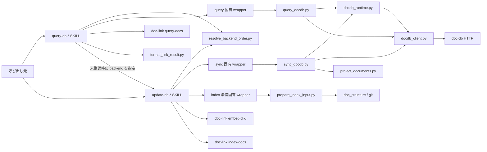

# DES-057 doc-db バックエンド選択 設計書 DLID-vm42nep5js51

## 1. 概要 DLID-32qprg0x4jba

4 つの文書検索 wrapper に、順序リストに基づくバックエンド選択を追加する。
順序は設定（`.claude/.forge.yaml` の `doc_backend.prefer`）から決まり、既定値は doc-link 先位である（§2.5）。
選択者は順序リストの先位から各 backend が所有する可用性判定を呼び、最初に利用可能な backend を利用する。
doc-db との通信は登録済み MCP ツールに依存せず、Python 標準ライブラリによる Streamable HTTP クライアントで行う。

バックエンド固有処理は共有低レベル script に閉じ、各 SKILL は category 固定の薄い wrapper と外部 SKILL の起動だけを担当する。
これにより、選択規則を 4 つの SKILL.md に重複させず、既存の SKILL 名・引数・検索結果形式を維持する。

## 2. 設計方針 DLID-7fxq3xpjcy9t

### 2.1 バックエンド選択境界 DLID-2aht0bdasyc3

doc-db への接続確認、起動試行、再接続、および 1 つの doc-db 操作は、同一の低レベル script 実行内で行う。
複数の操作にまたがる進行（未整備時の承認 → 索引整備 → 再検索、sync の完了待ち）は SKILL が駆動する（§4.2・§4.3）。
script は次のいずれかを確定して返す。

| 結果                  | 意味                                                         | 後続処理                                                   |
| --------------------- | ------------------------------------------------------------ | ---------------------------------------------------------- |
| doc-db 成功           | initialize と対象 operation が完了した                       | 結果を返して終了                                           |
| doc-db 利用不能       | doc-db が未導入、起動不能、または起動後も接続不能            | 選択者（SKILL）が順序リストに従い残る backend の可否を確認 |
| doc-db operation 失敗 | 接続確立後の query / sync が失敗または完了待ち上限に到達した | 明示エラー。別 backend へ切り替えない                      |

script は doc-db の可用性と操作の結果だけを返し、他方の backend・選択順序を知らない（§2.5 の責務分離）。
「利用不能」の結果をどう使うかは選択者が順序リストから決める。
接続確立後の operation 失敗を他方の backend へ切り替えない。
索引内容、入力、サーバ内部処理などの障害を「doc-db が利用不能」と誤分類して隠蔽しないためである。

当該 KEY が未生成、または当該 series が未同期の状態は、上記 3 分類のいずれにも該当しない。障害ではなく **未整備** であり、
他方の backend への切替でも失敗でもない。**利用者の承認を得たうえで索引を整備し、query を継続する**（REQ-014 BL-004）。
doc-link 経路が索引の未構築時に整備してから検索する規定（§5.1）と対称である。
script は未整備を専用の exit code で返し、承認の取得・索引整備・再検索の駆動は SKILL が行う（§4.2・§4.4）。
索引の整備自体が失敗した場合は operation 失敗に分類する。

承認を挟むのは、索引の整備が対象文書数に比例して時間を要し、規模によっては利用者の作業を長時間停止させるためである
（REQ-014 BL-004）。承認が得られない場合は検索を行わず、未整備である事実を報告して終了する。これは利用者の意思による
中断であり、operation 失敗に分類しない。

### 2.2 HTTP 直結 DLID-agqt44r9ntdt

doc-db クライアントは `http://localhost:{port}/mcp` に対し、次の順で JSON-RPC を送信する。

1. `initialize`
2. `notifications/initialized`
3. `tools/call`

`Mcp-Session-Id` を同一 operation 中に保持し、JSON 応答と SSE 応答の両方を解析する。
port は `~/.doc-db/doc-db.yaml` の `port` を読み、未設定または読み取り不能の場合は doc-db の既定 port を使用する。
認証情報を読む処理および出力する処理は持たない。

通信定数は参考実装の契約を引き継ぎ、通常 operation の HTTP timeout と sync 完了待ち上限（SKILL 側のポーリングに適用する上限）を 600 秒、
sync status の poll 間隔を 2 秒、既定 port を 58080 とする。
接続 probe は localhost の起動確認専用として HTTP timeout を 1 秒、起動待ち期限を 10 秒、再試行間隔を 0.25 秒とする。
probe 値は利用者向け性能目標ではなく、未起動判定を長時間ブロックせず選択者へ結果を返すための内部上限である。

### 2.3 on-demand 起動 DLID-5gfqerfxwmbh

初回接続に失敗した場合、`shutil.which("doc-db")` で実行ファイルを解決する。
解決できた場合は `subprocess.Popen` の新規セッションとして起動し、標準入力・標準出力・標準エラーを切り離す。
サーバログは doc-db 自身の設定先に委ね、forge はログファイルを生成しない。

起動後は localhost の MCP initialize を期限付きで再試行する。
別 wrapper が同時に doc-db を起動して一方のプロセスが終了した場合でも、MCP 接続に成功すれば利用可能と判定する。
接続できなければ、実行ファイル不在、プロセス起動失敗、早期終了、再接続不能のいずれかを理由コードとして返す。

この起動は現在の wrapper 実行を完了するための on-demand 起動である。
OS ログイン時の自動起動、サービス登録、停止、再起動監視は行わない。

### 2.4 doc-link の可用性判定 DLID-smecymszrajs

doc-link が所有する可用性判定である。installed / available 判定は、SKILL 実行時の
available-skills を正とする（doc-link は外部プラグインであり、導入有無は SKILL 層でしか
観測できない）。Python script は Claude Code の SKILL registry を推測しない。

選択者は、順序リストで doc-link の番になったとき（先位として最初に、または doc-db 利用不能後の
後位として）、次の 2 つをどちらも満たすかで可用性を判定する。query と update で条件は同じである。

| 条件                | 内容                                                                      |
| ------------------- | ------------------------------------------------------------------------- |
| doc-link の SKILL   | `query-docs`・`index-docs`・`embed-dlid` が available-skills に揃っている |
| doc-link の実行環境 | `uv` を実行できる（doc-link が動作に必要なものとして公開している）        |

query 自身が呼ぶのは `query-docs` だけだが、未整備時に委譲する `update-db-*` が `embed-dlid` と
`index-docs` を要するため、query 経路でも 3 つが揃うことを条件とする。
いずれかを満たさなければ doc-link を利用不能とし、順序リストの残る backend の可否確認へ進む。
利用不能の理由には、満たさなかった条件（揃っていない SKILL の名前、または `uv` を実行できないこと）を書き、
doc-link の導入状態の確認を促す（REQ-014 NFR-002）。未導入と一部の欠落は区別しない。どちらも、何が欠けているかを
伝えれば利用者は対処できるためである。
残る backend も利用不能な場合に、両 backend の利用不能理由を返して失敗する。
grep 検索は実行しない。

#### バージョンを判定に使わない [CRITICAL] DLID-nqkxnw9f5ywn

可用性は上の 2 条件だけで判定する。**doc-link のバージョンを条件にしない。バージョンを推測する
代用品も持たない。**

**特定の SKILL の有無からバージョンを推測しない**（REQ-014 前提条件）。理由は次の 3 点である。

- 「どの版で何が入ったか」は doc-link 側のリリース履歴であり、forge の設計が抱える情報ではない
- 成果物の有無はバージョンではない。fork・部分インストール・提供側の改名で推測が誤り、誤りを検知できない
- 得られるのは「未導入」と「古い版」の通知文の書き分けだけで、対価として跨リポジトリの結合を負う

**forge が doc-link の索引の内部配置・生成日時を解釈する経路を持たない**（REQ-014 BL-002）。索引が現在の内容を
映しているかを forge は推測せず、doc-link が行う現物との照合に委ねる（§5.1）。

### 2.5 優先 backend の指定（REQ-014 BL-001） DLID-xed2t6xbxeh0

利用者は `.claude/.forge.yaml`（汎用設定ファイル。入れ物の規約は DES-061）で
優先 backend を指定できる。**`doc_backend` セクションのスキーマと既定値は本設計が所有する。**

```yaml
doc_backend:
  prefer: doc-db # doc-db | doc-link。省略時は既定値
```

**責務分離**: 可用性判定は各 backend が所有し、選択順序は選択者だけが持つデータである。

- **選択者（SKILL のオーケストレーション）**: 順序リストを解決し、先頭から各 backend の
  可用性判定を呼び、最初に利用可能な backend を選ぶ。判定の中身を知らない
- **doc-db**: 可用性判定（probe・起動試行・再接続 = `docdb_runtime.py`）と操作（query / sync）を所有する。
  **他方の backend・優先指定・選択順序を知らない**（`query_docdb.py` / `sync_docdb.py` は設定を読まない）
- **doc-link**: 可用性判定（検索・索引更新の機能が利用できるか）と操作を所有する。判定は
  SKILL 実行時の available-skills でのみ観測できるため、この判定は SKILL 層で行う（§2.4）

**順序リストの解決**: 専用 CLI `resolve_backend_order.py` が担う。`forge_settings.py` で
`doc_backend` セクションを読み、順序リストを JSON で返す。SKILL は YAML を解釈しない。

| 設定の状態                 | `resolve_backend_order.py` の出力                                                                               |
| -------------------------- | --------------------------------------------------------------------------------------------------------------- |
| 未指定・ファイル不在       | 既定値の順序 `["doc-link", "doc-db"]`（既定値の定義はこの CLI の定数 1 箇所）                                   |
| `prefer: doc-link`         | `["doc-link", "doc-db"]`（既定値の明示に過ぎない）                                                              |
| `prefer: doc-db`           | `["doc-db", "doc-link"]`                                                                                        |
| 不正（許容する形に反する） | exit `20`（`operation_error`）を reason code `settings_invalid` で返す。**推測で既定値に落ちない**（§2.5 末尾） |

**許容する形**: `doc_backend` セクションは mapping であり、キーは `prefer` のみ、値は
`doc-db` / `doc-link` の 2 値とする。次のいずれも設定の不正として扱う。

- セクションが mapping でない（例: `doc_backend: doc-link`、リスト）
- 未知のキーを含む（例: `preffer:` のような綴り誤り。黙って無視すると指定が効いていないことに気づけない）
- `prefer` の値が上記 2 値以外

指定が変えるのは選択順序だけである（REQ-014 BL-001）。可用性判定・索引整備・通知・失敗の扱いは
指定の有無で変わらない。SKILL は順序リストの先位から試し、先位が利用不能なら理由を通知して
後位を試す（REQ-014 FNC-004）。いずれも不能なら明示エラーとする。

不正値・解析不能の設定を黙って無視して既定値で動くことはしない。利用者が意図した backend と
異なる側で静かに動き続けることになるためである（[DES-061][des-061] §2.4 と同じ方針。構文エラーは
`forge_settings.py` が、値域エラーは `resolve_backend_order.py` が検出する）。

## 3. アーキテクチャ DLID-wfpz0e25snfy

### 3.1 コンポーネント図 DLID-kabg8zkb5e83



`query-db-*` から `update-db-*` への辺は、未整備時の索引整備を委譲する経路である（§5.3）。
索引を整備する手順は `update-db-*` 側だけが持ち、`query-db-*` は sync / index 準備の wrapper を持たない。
`query-db-*` は対象文書数を数える wrapper も持たない。承認提示に件数を用いず、doc-db 経路で件数が必要な
場面では `query_docdb.py` が exit 30 の応答に載せて返す（REQ-014 BL-007。§5.1）。

依存方向は `SKILL.md → SKILL 固有 wrapper → 共有低レベル script → 外部 backend / 設定` の一方向とする。
共有低レベル script から SKILL や SKILL 固有 wrapper を呼ばない。
**CLI エントリ script（`query_docdb.py` / `sync_docdb.py` / `prepare_index_input.py` / `format_link_result.py`）は互いを呼び出さない。**
helper モジュール（`docdb_client.py` / `docdb_runtime.py` / `project_documents.py` / `required_documents.py`）の import は同一層内でも許容する。
CLI 相互の呼び出しを禁じることで、複数 operation の進行と進捗報告の位置が SKILL 側に固定される。

SKILL 間の依存は `query-db-* → update-db-*` の一方向に限る（§5.3）。`update-db-*` から `query-db-*` を
呼ばないため循環しない。索引が現在の内容を映しているかの判断は forge script に持たず、
doc-link が行う現物との照合に委ねる（§5.1）。

### 3.2 モジュール一覧 DLID-ned15mzyqgcb

| モジュール                                     | 責務                                                                             | 依存                                                   |
| ---------------------------------------------- | -------------------------------------------------------------------------------- | ------------------------------------------------------ |
| 各 `query-db-*/SKILL.md`                       | backend 選択、検索、未整備時の承認取得と `update-db-*` への委譲、通知            | query 固有 wrapper、doc-link、`update-db-*`            |
| 各 `update-db-*/SKILL.md`                      | backend 選択または指定の受理、索引整備、進捗報告、通知                           | sync / index 準備固有 wrapper、doc-link                |
| `query-db-*/scripts/query_documents.py`        | category を固定し、検索タスク 1 件だけを query 低レベル CLI へ渡す               | `query_docdb.py`                                       |
| `update-db-*/scripts/sync_documents.py`        | category を固定し、同期の `--start` / `--status <job_id>` だけを公開する         | `sync_docdb.py`                                        |
| `update-db-*/scripts/prepare_index_input.py`   | category を固定し、引数なしで索引入力準備 CLI を呼ぶ                             | `prepare_index_input.py`                               |
| `scripts/doc_backend/docdb_client.py`          | MCP session、JSON-RPC、JSON / SSE 応答解析                                       | Python 標準ライブラリ                                  |
| `scripts/doc_backend/docdb_runtime.py`         | 接続 probe、doc-db 起動、再接続、理由コード生成                                  | `docdb_client.py`、`doc-db` executable                 |
| `scripts/doc_backend/project_documents.py`     | category 対象文書、project key、git series の解決                                | 既存 doc-structure resolver、git                       |
| `scripts/doc_backend/required_documents.py`    | 検索結果の出力形式の構築と、パスの実在確認（backend によらず共通）               | Python 標準ライブラリ                                  |
| `scripts/doc_backend/resolve_backend_order.py` | 設定から backend 順序リストを解決（既定値の定義点。値域検証と settings_invalid） | forge settings                                         |
| `scripts/doc_backend/query_docdb.py`           | doc-db query（series 指定）、KEY / series 未整備の検出、既存出力形式の構築       | runtime、client、project documents、required documents |
| `scripts/doc_backend/sync_docdb.py`            | desired-state sync の投入（`--start`）と単発の状態取得（`--status`）             | runtime、client、project documents                     |
| `scripts/doc_backend/prepare_index_input.py`   | dprint 適用と doc-link 用 dirs / exclude 解決                                    | 既存 dprint runner、doc-structure                      |
| `scripts/doc_backend/format_link_result.py`    | doc-link の検索結果のパスから、実在しないものを除いて出力形式を構築する          | required documents                                     |
| `scripts/forge_settings.py`                    | `.forge.yaml` の読み取り（入れ物の規約は DES-061。forge 全体の共有）             | Python 標準ライブラリ                                  |

`format_link_result.py` は category に依らず、複数の SKILL が同じ処理を使う共通 script なので、
SKILL 固有 wrapper を挟まず SKILL から直接呼ぶ。

共有モジュールは `plugins/forge/scripts/doc_backend/` に置く。
4 SKILL が同じ処理を利用するため、いずれか 1 SKILL の配下には置かない。
forge 内に、backend の索引を探索する script や、索引の生成日時を比較する script は置かない。

## 4. doc-db 処理設計 DLID-ab5jfxw0xweq

### 4.1 project key と series DLID-c5sryery8qhz

doc-db の key は `{project_name}-{category}`、series は現在の git branch とする。

| 値             | 解決方法                                                                      |
| -------------- | ----------------------------------------------------------------------------- |
| `project_name` | `git rev-parse --git-common-dir` の親ディレクトリ名。失敗時は project root 名 |
| `category`     | wrapper が固定する `rules` または `specs`                                     |
| `series`       | `git rev-parse --abbrev-ref HEAD`。取得不能または detached HEAD は `main`     |

worktree ごとに key が分裂しないよう、project root の basename より git common dir を優先する。
**query と update はいずれも現在の branch を series として指定する**（REQ-014 BL-005）。読み書きで対象を変えない。

#### series 指定と実在確認 DLID-b6ds9eqyf46d

doc-db は `query` の `series` を任意引数とし、**省略時は KEY 内の全 series を横断検索する**。
これは doc-db 側の設計思想（recall 優先の二層アーキテクチャ。候補プールを広く返し、呼び出し元の
AI agent が本文を読んで判定する）に基づく、doc-db の `query` 自体の既定である。

forge は現在の branch を series として明示指定する（REQ-014 BL-005）。
索引は対象文書の現在の状態を映すもの（REQ-014 FNC-003）であり、他 branch で削除済み・改訂前の文書を
検索結果へ復活させないためである。forge の wrapper は検索結果のパスをそのまま呼び出し元へ返す契約であり、
候補を広く集める利得より、現在の branch に存在しない文書を返さないことを優先する。

series を限定しない検索には、他 branch にのみ存在する文書に加えて、より重い混入がある。
desired-state 同期で当該 series から切り離された文書の record は、doc-db 側の物理削除が済むまで残るため、
**削除済みの文書が全 series 横断検索に現れ得る**（REQ-014 BL-005）。series を指定すればこの経路は閉じる。
doc-db の参考実装 SKILL も同じ理由で、現行版では series 指定を既定にしている。

series を指定した検索が 0 件だった場合、series を外した再検索は行わない。当該 series はその branch の
完全な現在状態であり、0 件は正しい結果である（REQ-014 BL-005・§4.2）。

当該 series が未同期で結果が得られない場合は、検索対象を広げるのではなく索引を同期して解決する
（REQ-014 BL-004・§4.2）。doc-db は同一 KEY 内で同一内容の文書の embedding を series 横断で共有するため、
別 series が既に同期済みであれば、新しい series の初回同期でも embedding の再計算は発生しない。
series を限定する判断が同期コストを増やさない根拠である。

series を限定しても、索引は最後の同期時点の状態である。同期後に削除された文書は索引に残るため、
出力前にパスの実在を確認して除外する（REQ-014 BL-005）。除外は §4.2 で行う。

#### backend 間の残差 DLID-63vdfhdmqxyw

series を現在の branch に限定した結果、両 backend の検索対象は「現在の branch の文書」に揃う。
ただし doc-link は series の概念を持たず、索引を project root の `.doc-link/` に置くため、次の差が残る。

| 軸               | doc-db                                   | doc-link                                                              |
| ---------------- | ---------------------------------------- | --------------------------------------------------------------------- |
| key の範囲       | worktree 間で共通                        | project root 単位（worktree ごとに独立）                              |
| series（branch） | 保持し、query / update とも現在の branch | 概念を持たない。索引を git で追跡するので、branch の状態は git が持つ |
| 対象文書の解決   | forge の doc-structure resolver          | forge が渡した dirs / exclude を doc-link が展開（§5.1）              |

残差から次が生じる。

| 現象                       | 影響                                                  |
| -------------------------- | ----------------------------------------------------- |
| 対象文書の解決規則が異なる | 同一 query でも索引母集団が完全には一致しない（§5.1） |

本設計はこの残差を解消しない。doc-link の series 不在は forge の設計選択では取り除けず、
doc-db の key を worktree ごとに分割すれば同一プロジェクトの索引が分裂するためである。
残差の存在は、backend の切り替えの手引きに記載する。

### 4.2 query DLID-rn8jq1xwd7z7

query は doc-db の `query` tool を `mode=all`、`top_n=20`、`series=現在の branch` で呼び出す（§4.1）。
`top_n=20` は参考実装の recall 優先契約を維持する値であり、forge 側で別の検索品質目標を追加するものではない。
返却された `results[]` の `path` を順位どおりに抽出し、既存契約の文字列を script が決定論的に構築する。
`Required documents:` 配下の各項目には path だけを出力する。
`origin_signals` は出力せず、`warnings` が存在する場合は path リストの後に別の診断情報として通知する。

```text
Required documents:

- docs/rules/example.md
```

#### セッション内変更の確認 DLID-7f21j8n82y4j

doc-db は、索引が現物の文書と合っているかを検査しない。そのため doc-db の番では、検索に先立ち、
SKILL が **当該セッションで自分が検索対象 category の文書を変更したか** を判断する。
変更している場合は `AskUserQuestion` で索引更新の要否を確認し、更新を選ばれた場合は `Skill` ツールで
該当する `update-db-*` を起動してから検索へ進む（REQ-014 BL-002）。変更していない場合は確認しない。

この判断は SKILL が持つ。編集を行ったのは SKILL を実行している AI 自身であり、判断材料は自分の行動履歴に
あるためである。script が観測できる情報ではない。判定対象は当該 category の文書に限る
（`query-db-rules` は rules、`query-db-specs` は specs）。

この時点では doc-db が利用可能かをまだ確かめていないので、`update-db-*` には backend を指定しない。
`update-db-*` は query と同じ順序リストと可用性判定で backend を選ぶので、実際に検索で使われる backend の
索引が更新される。

確認の後で doc-db が利用不能と分かった場合は、順序リストの残る backend の可否確認へ進む（§2.4）。
残る backend が無ければ、両 backend の利用不能理由を返して失敗する（§7）。残る backend が doc-link で、
利用者が更新を見送っていて、doc-link の索引も古ければ、doc-link が再構築の要否をもう一度尋ねる（§5.1）。可用性の判定は
検索の script の中にあり（§2.1）、確認の前に判定だけを行う入口を持たないためである。

**検出できる範囲の限界**: この確認が拾うのは当該セッション内で自分が行った変更だけである。
他セッションでの変更、利用者による直接編集、ブランチ切替や pull による変更は検出できない。
**確認が行われなかったことは索引が最新であることを意味しない。**

doc-link の番では、この確認を行わない。doc-link が現物との照合で同じことを、より広い範囲で行うためである（§5.1）。

#### パスの実在確認 DLID-46kqxtqbs8g4

`results[]` から抽出した path は、出力前に project root 起点で実在を確認し、**実在しないものを除外する**
（REQ-014 BL-005）。除外件数は path リストの後に診断情報として通知する（REQ-014 FNC-004）。
順位は除外後も元の順序を保つ。全件除外された場合も operation は成功とし、空の `Required documents:` を返す。

実在確認はパスの存在判定のみで行い、内容の読み取り・checksum 比較は行わない。

#### KEY / series 未整備時の索引整備 DLID-0snvgzadtwyk

**判定は次の順に行う（REQ-014 BL-004）。**

1. 対象文書数を先に判定する。0 件なら索引に触れず「対象文書なし」として終了する。
2. 1 件以上ある場合に限り、当該 KEY / series の索引の有無を確認する。

索引側の状態からは「一度も同期していない series」と「同期済みだが desired-state が 0 件だった series」を
区別できない。後者に対して同期を促しても状況は変わらないため、対象文書数の判定を先に置いて切り分ける。

**この判定を doc-db 経路が持てるのは、doc-db の desired state を forge が所有しているためである**（§4.1。
対象一覧は `.doc_structure.yaml` から forge が確定させ、`sync_documents` へ渡す）。所有していない
doc-link 経路には同じ判定を置かない（REQ-014 BL-007 / §5.1）。判定は script 内（`query_docdb.py`）で
行われ、SKILL は件数を数えない。

当該 KEY が未生成、または当該 series が未同期の場合、`query_docdb.py` は索引に触れず、
**未整備であることを示す exit code `30`（`index_missing`）で返す**（§4.4）。索引の整備は SKILL が駆動する。
未整備を検出した場合に series を外して横断検索へ切り替えることはしない。

SKILL は次の順に処理する（REQ-014 BL-004）。

1. `AskUserQuestion` で整備の承認を得る。
2. 承認された場合のみ、**選択済みの backend を指定して `update-db-*` を起動する**（§5.3）。
3. 完了後に query を再実行し、通常の成功経路として結果を返す。

承認を挟むのは、索引の整備が対象文書数に比例して時間を要するためである（REQ-014 BL-004）。
承認が得られない場合は検索を行わず、未整備である事実を報告して終了する。失敗として扱わない。

**索引を整備する手順を query 側に持たない**（REQ-014 FNC-002）。同期の投入・完了待ち・進捗報告は
`update-db-*` が既に所有しており、query が同じ手順を再実装すると索引整備の入口が 2 つになる。
backend を指定して起動するため、query が確定させた backend と別の索引が整備されることはない（§5.3）。

索引の整備を伴った事実は結果に含めて通知する（REQ-014 FNC-004）。

同期は 1 回だけ試行する。同期後の `query` がなお 0 件を返す場合は「該当なし」として成功で返し、
再同期や検索対象の拡大は行わない。
対象文書が 0 件の場合、query 経路は索引に触れず「対象文書なし」として**成功で終了する**（本節冒頭の判定順）。
update 経路（§4.3）の 0 件防御は同じ状態を明示エラーとするが、それは利用者が索引の整備そのものを要求した
操作であり、整備すべき対象が無いことを失敗として返す。query 経路の成功終了と混同しない。

#### 成功と障害の区別 DLID-eqgbad36373h

検索結果が 0 件の場合も doc-db operation 自体は成功とし、空の `Required documents:` を返す。

tool error とレスポンス不正は **障害** であり、operation 失敗（exit code 20）として返し、
他方の backend へは切り替えない（§2.1）。KEY / series の未整備それ自体は障害ではないため、この分類に含めない。
索引の整備の失敗は、query の CLI ではなく、委譲先の `update-db-*` の失敗として現れる（§4.3）。SKILL は検索を続行しない。

### 4.3 update DLID-jr765a9zcd77

update は既存 `.doc_structure.yaml` の category 設定から対象 Markdown 一覧を解決し、
各 entry を `{path, local_path}` として doc-db の `sync_documents` に渡す。

**投入と完了待ちは分離する。** 低レベル CLI は 2 つの操作を提供する。

| 操作                | 動作                                                            | 返す内容         |
| ------------------- | --------------------------------------------------------------- | ---------------- |
| `--start`           | 一覧を解決し `sync_documents` を投入して即時に返る              | `job_id`         |
| `--status <job_id>` | `get_sync_status` を 1 回呼び、その時点の進捗を返して即時に返る | job の状態と件数 |

この 2 操作は同一場面で競合する方針ではなく、同一同期ジョブの「投入→観測」という順序付き位相である。
SKILL の各場面では呼び出し全体が一意に決まるため、1 つのローカル操作入口の明示モードとして維持する
（[DES-024][des-024] §2.2）。別 script へ分けても選択対象が mode からファイル名へ移るだけであり、AI の
判断領域は減らない。

SKILL は `--start` で `job_id` を得たあと、`--status` を間隔を空けて繰り返し呼び、**そのたびに進捗を
テキストで報告する**。ポーリングのループを script 内に持たない（理由は §3.1 と §7）。
poll 間隔は §2.2 の値を用い、`done` / `failed` または完了待ち上限で終える。

`sync_documents` は一覧全体を desired state として扱うため、追加・変更・削除・リネームを同じ経路で収束させる。
hash 一致文書の再計算要否は doc-db に委ねる。

対象が 0 件の場合は設定誤りによる全 series 切り離しを避けるため同期せず、明示エラーを返す。
空集合への意図的な同期は wrapper の責務に含めない。
job が失敗した場合、一部文書が失敗した場合、または完了待ち上限に達した場合は update 失敗とする。
ポーリングを打ち切っても doc-db 側の job は継続し、再実行で冪等に収束する。

### 4.4 doc-db 実行結果 DLID-m1mzmedad68v

低レベル CLI は機械判定可能な JSON と exit code を返す。
JSON は少なくとも `status`、`backend`、`operation`、`startup`、`reason_code` を持つ。
query 成功時は構築済みの `Required documents:` 文字列、`--start` 成功時は `job_id`、
`--status` 成功時はその時点の job 進捗を含む。

| exit code | `status`          | SKILL の動作                                                                               |
| --------- | ----------------- | ------------------------------------------------------------------------------------------ |
| 0         | `success`         | doc-db 結果を返して終了                                                                    |
| 10        | `unavailable`     | doc-db は利用不能。SKILL が順序リスト（§2.5）と走査位置から次の処理を決める                |
| 20        | `operation_error` | エラーを返して終了。backend を切り替えない                                                 |
| 30        | `index_missing`   | 承認を得て `update-db-*` へ backend 指定で委譲し、完了後に query を 1 回だけ再実行（§5.3） |

exit `10` は doc-db が所有する可用性判定（§2.3）の失敗のみを意味する。doc-db の CLI は
優先指定・選択順序を知らないため（§2.5 の責務分離）、この結果をどう使うかは選択者（SKILL）が
順序リストから決める。exit code `30` は query 経路でのみ返る。`--status` は job が未完了でも
`0` を返し、状態は JSON の job 進捗で示す（未完了を異常として扱わない）。

SKILL は exit code だけで上記の経路を選択し、JSON field の組合せから状態を再構成しない。
JSON は結果表示と診断情報の取得にだけ使用する。
`startup` は未試行、起動成功、起動失敗を区別する。
エラー本文は URL、port、reason code、doc-db が返した非機密メッセージに限定し、環境変数値や設定本文を含めない。

### 4.5 doc-db MCP tool 契約（依拠スナップショット） DLID-xrws9n10aar2

doc-db の MCP tool I/F の所有は doc-db 側にある。forge は接続する側であり、この I/F を規定しない。
外部の公開契約に依拠する点は同じ扱いである。

**I/F の SoT は doc-db 側の公開文書**（AI 統合ガイド、APP-001 要件定義書、DES-001 設計書）と、
同リポジトリ同梱の SKILL 参考実装である。本設計はそれらを規範として参照する。

以下の表は forge が実装・テストの対象を確定させるための **依拠スナップショット** であり、I/F の規範ではない。
別リポジトリの文書を実装時に必ず参照できるとは限らないため、依拠する時点の契約を記録する。
契約が改訂された場合は、本項の更新とテストの追従を同じ変更で行う（契約の改訂と実装・テストの追従を同じ変更で行う運用）。

応答は `tools/call` 結果の `content[]` のうち `type` が `text` の要素に載る JSON を解析して得る。
doc-db は同一内容を `structuredContent` にも載せるため、どちらから読んでも同じ dict になる（実測。下記「実測結果」）。

| tool              | request                                          | 使用する response field                                                                                                                                |
| ----------------- | ------------------------------------------------ | ------------------------------------------------------------------------------------------------------------------------------------------------------ |
| `query`           | `{key, series, query, mode: "all", top_n: 20}`   | `results[].path`（順位順。**chunk 単位のため同一 path が複数回現れうる**）、`warnings[]`（**正常時は field 自体が存在しない**）                        |
| `sync_documents`  | `{key, series, documents: [{path, local_path}]}` | `job_id`                                                                                                                                               |
| `get_sync_status` | `{job_id}`                                       | `status`（`running` / `done` / `failed`）、`processed`、`skipped`、`failed`、`deleted_paths_marked`、`errors[]`（**正常時は field 自体が存在しない**） |
| `list_indexes`    | `{}`                                             | `indexes[]` の各要素の `key` と `series`（当該 series の登録有無の確認に使う。**`series` は `null` になりうる**）                                      |

- `query` の `series` は任意引数である。forge は現在の branch を必ず指定する（§4.1）。
- 参考実装の CLI は series 未登録を検索前に検証し、未登録なら検索せず専用の exit code で返す。
  全 series 横断へのフォールバックは行わない。forge の未整備検出（§4.2 exit code `30`）はこれに対応する。
- 参考実装の CLI は sync の投入と状態取得を `sync-start` / `sync-status` として分離している。
  forge の `--start` / `--status`（§4.3）はこれに対応する。
- `top_n` の doc-db 既定値は 10 だが、doc-db 側の指針が重要な検索に 20〜30 を推奨しているため 20 を渡す。
- `sync_documents` は `job_id` を即時返す非同期 job であり、完了待ちは呼び出し側が `get_sync_status` を反復して行う（§4.3）。
- 応答に `job_id` が無い場合は operation 失敗として扱う。
- `get_sync_status` の `errors` は、エラーが 0 件の応答では **field 自体が省略される**（doc-db 0.3.3 実測。
  `query` の `warnings` と同じ省略形）。forge は不在・`null` を空リストとして扱い、契約違反にしない。
- `query` の `results[]` は chunk 単位で返るため、同一文書の `path` が複数の要素として現れうる
  （doc-db 0.3.3 実測。§4.2 の path 抽出は順位どおりにそのまま返す現行契約であり、重複除去は規定していない）。
- `results[]` の本文 field は使用しない。forge の出力契約は path のみである（§4.2）。
- `list_indexes` は当該 series が登録済みかを検索前に確認するために使う（§4.2）。参考実装も同じ手段を採る。
  `series[]` は「一度も同期していない」と「同期済みだが対象が 0 件だった」を区別できないため、
  対象文書数 0 の判定を先に行う（§4.2）。
- 上記以外の tool（`upsert_documents`、`schedule_delete_series`、`trash_index` 等）は本 feature では使用しない。

#### 実測結果（doc-db 0.3.2 / 2026-07-31） DLID-9ttx4xcn16sr

実 doc-db に対する読み取り専用の実測で確認した事実。上記表の根拠であり、テストの注入応答はこの形に合わせる。

**error の形は 0.3.3 で変わっている。** 0.3.2 では KEY 不在が `isError: true` + 日本語文言
（`code` / `data` なし）だったが、0.3.3 で JSON-RPC error + 識別子へ変更された（本節末尾の
「KEY 状態に関する doc-db の挙動」が現行契約であり、そちらが正）。以下の表のうち error 以外の
観測点（Content-Type・session・result の担体・field 構成）は 0.3.3 でも変わっていない。

| 観測点               | 実測値                                                                                                 |
| -------------------- | ------------------------------------------------------------------------------------------------------ |
| 応答の Content-Type  | `initialize` / `tools/call` とも **`text/event-stream`（SSE）のみ**。`application/json` は観測されない |
| `Mcp-Session-Id`     | `initialize` の応答ヘッダで返る。以降の `tools/call` の応答ヘッダには含まれない                        |
| notification 応答    | `notifications/initialized` は空 body（Content-Type なし）                                             |
| result の担体        | `content[].text` の JSON と `structuredContent` の両方に同一内容が載る                                 |
| `query` 正常応答     | top-level は `results` / `stage_stats` のみ。`warnings` は **field 自体が存在しない**                  |
| `results[]` の field | `path` / `text` / `heading_path` / `score` / `score_breakdown` / `origin_signals` / `series_keys`      |
| `list_indexes` 応答  | `{"indexes": [{key, series, doc_count, chunk_count, last_updated_at, last_accessed_at}]}`              |
| `series` の型        | 文字列配列、または **`null`**（doc 0 件の KEY で観測）。空配列ではない                                 |

SSE のみが観測されたが、client は JSON 応答も解析できる実装を維持する（§2.2）。
Streamable HTTP はどちらの形式も許容し、応答形式は doc-db 側の実装詳細であるため、
片方だけを前提にすると doc-db の内部変更で壊れる。

`series` が `null` を取り得るため、`series[]` の走査は `null` を空集合として扱う。これは
doc-db 側の契約でもある（`null` は「当該 KEY に現在紐づく series が 0 件」を表し、空配列 `[]`
と同義。意味の異なる状態ではない）。

#### KEY 状態に関する doc-db の挙動 DLID-xzztdan34c8a

| 条件                        | doc-db の挙動                                            | forge の扱い                                       |
| --------------------------- | -------------------------------------------------------- | -------------------------------------------------- |
| KEY が存在しない            | JSON-RPC error（識別子 `KEY_NOT_FOUND`）                 | 未整備。承認を得て整備し、query を継続する（§4.2） |
| KEY がゴミ箱状態            | JSON-RPC error（識別子 `KEY_TRASHED`）。復活操作を促す   | 未整備ではない。復活操作の案内を伴う明示エラー     |
| 既存 KEY の series が未登録 | **error にならず 0 件で成功する**（doc-db 側の安定契約） | 未整備。`list_indexes` で事前に検出する（§4.2）    |

**判別は識別子に依拠する。** doc-db 0.3.3 以降、KEY 不在とゴミ箱状態は
`isError` を伴う tool result ではなく **JSON-RPC error** として届き、識別子が
`error.data.code`（判別の正本）と `message` 先頭の両方に載る。forge は `data.code` の値
（`KEY_NOT_FOUND` / `KEY_TRASHED`）だけで分岐し、**メッセージ文言でも数値 code でも分岐しない**。
文言と数値 code は doc-db 側の公開契約ではなく、変更されても forge に通知されないためである。

`docdb_client.py` は JSON-RPC error を `ToolError(message, code, data)` へ変換し `data` を保持する。
呼び出し側は `ToolError.data["code"]` を読む。識別子を読み取れない error（`data` を持たない、
未知の識別子、0.3.3 未満の doc-db が返す tool error）は、いずれも障害として扱い索引作成を
試みない（§4.2）。この既定により、識別子が得られない環境でも安全側に倒れる。

ゴミ箱状態の KEY へ同期を試みても doc-db 側で拒否されるため、未整備として扱ってはならない。
ゴミ箱からの復活そのものは KEY の運用管理であり、本 feature の対象外（REQ-014 スコープ）である。

series 未登録は query では検出できない。**未登録 series への query が 0 件成功で返ることは
doc-db 側の安定契約であり、将来もエラー化しない**（series は登録状態を検証しない opaque な
絞り込み軸であるため）。したがって未整備（exit code `30`）の判定は `list_indexes` の `series`
による事前確認に依拠し、query の結果からは行わない（§4.2）。

## 5. doc-link 処理設計 DLID-9f7yjc4dktjy

### 5.1 query DLID-0sn6xmd1v741

query は `doc-link:query-docs` を 1 回呼ぶ。渡すのは索引の識別キー（category）と検索のタスクだけである。
対象指定は渡さない。doc-link は、索引を構築したときの対象指定を保存しており、それを使う。

**query wrapper は索引を整備する手順を持たない**（REQ-014 FNC-002）。索引の維持は `update-db-*`（§5.2）の責務である。

#### 鮮度の検査は doc-link が行う DLID-vs1182nr7scf

doc-link は、検索の前に索引と現物の文書を照合する。古いときは、再構築してから検索するか、
既存の索引のまま検索するかを、doc-link が利用者に確認する。再構築を選ばれた場合の再構築も doc-link が行う。
**SKILL は、この検査と確認に手を加えない**（REQ-014 BL-002）。

doc-link の照合は、当該セッションの外で起きた変更（他セッション、利用者の直接編集、ブランチ切替）も拾う。
そのため doc-link の番では、SKILL はセッション内変更の確認（§4.2）を行わない。同じことを 2 回尋ねることになるためである。

この経路の再構築では DLID の付与（§5.2）が走らない。DLID の無い新しい文書は索引に入らず、
doc-link がその文書を報告する。索引に入れるには `update-db-*` を実行する。

#### 応答の扱い DLID-z16gjq9adtqb

SKILL は、`doc-link:query-docs` の応答を次の 3 つに分ける。

| 応答                                             | 扱い                                                                     |
| ------------------------------------------------ | ------------------------------------------------------------------------ |
| 検索結果（文書の一覧。0 件を含む）が返った       | 成功。出力形式へ整えて返す（後述）                                       |
| 索引が未構築で、初回の構築が必要だと返った       | 未整備。承認を得て、doc-link を指定して `update-db-*` を起動する（§5.3） |
| 上のどちらでもない（検索できなかった・失敗した） | 障害。doc-link が返した内容を添えて明示エラーとし、切り替えない          |

この 3 つは、`doc-link:query-docs` が呼び出し元へ返すと公開している結果の種類である。
doc-link の script の出力の項目名や文面に、forge は依存しない。

未整備の整備の失敗時は query を続行しない（REQ-014 BL-003）。承認が得られない場合は検索を行わず、
未整備である事実を報告して終了する（失敗として扱わない）。整備の後の再検索は 1 回だけ行う。

#### 出力形式への変換 DLID-we16vtsgstg2

doc-link の検索結果は、文書ごとに記録されたパスを持つ。SKILL は、そのパスを返された順のまま
`format_link_result.py` へ位置引数で渡す。この CLI が、現在の作業ツリーに実在しないパスを除き
（REQ-014 BL-005）、`Required documents:` 形式の文字列を決定論的に構築する。SKILL は形式を組み立てない。

実在しないパスが生じうるのは、利用者が「既存の索引のまま検索する」を選んだ場合である。
除いた件数は通知する（REQ-014 FNC-004）。doc-link が返した索引の鮮度（最新か、古い可能性があるか）も、
結果とともに利用者へ伝える。

#### 鮮度を推測で判定しない [MANDATORY] DLID-seyb3155ss7n

**forge は索引が古いかどうかを推測しない**（REQ-014 BL-002）。用いてよいのは推測ではなく事実、
すなわち backend が行う現物との照合（doc-link）と、当該セッションで自分が対象文書を変更したかどうか
（照合の手段を持たない doc-db。§4.2）だけである。

次の 2 つを本設計は持たない。

- **経過時間による判定**: 索引が正しいかどうかは対象文書が変わったかどうかで決まり、前回生成からの
  経過時間では決まらない。経過時間を指標にすると、文書が変わっていないのに更新を促し、
  文書が変わっているのに更新を省く二方向の誤りが生じる
- **wrapper が利用者に知らせずに索引を更新して鮮度を回復させる経路**: 古かった事実が消え、
  利用者は索引の更新漏れに気づけない

doc-link の索引のパスや内部ディレクトリ規約を forge に埋め込まない（REQ-014 BL-002）。

#### 索引母集団の差 DLID-kdwtnrw8p66x

**索引に渡す desired state の展開は doc-link 側が所有する。** forge は `root_dirs` / `exclude` を
`--dirs-json` / `--exclude-json` で渡し、ファイル一覧へは展開しない。展開を forge 側で行うと、
doc-link の固定除外が適用されない対象を渡すことになり、desired state の所有者が二重になる。

この委譲により、索引母集団の決定経路は backend ごとに異なる。doc-db 経路は forge の doc-structure resolver が
対象文書一覧を確定させ、doc-link 経路は forge が渡した dirs / exclude を doc-link 側が展開し、
doc-link 固有の除外規則（DLID の無い文書・DLID が重複する文書の除外を含む）が併せて適用される。
したがって**両 backend の索引母集団が一致する保証はない**。

#### 母集団を所有しない側の件数を数えない [MANDATORY] DLID-6cfg3af4vt5r

**forge は doc-link 経路の対象文書数を数えない**（REQ-014 BL-007）。長さだけを取り出す用途であっても、
`project_documents.py` の `resolve_paths()` を doc-link 経路で使わない。

数えた値を「上限」として扱う設計は採らない。上限が成り立つのは doc-link の除外規則が減算のみである
場合に限られ、それは doc-link の公開契約に無い。

件数が必要な場面では、**その母集団を所有する側が返した値だけを使う**。DLID を書き込んだ件数の通知（§5.2）は、
`doc-link:embed-dlid` が返した値を使う。整備の承認は承認そのものだけを求め（§4.2）、0 件の判定は
doc-db 経路の script 内で完結する（§4.1・§4.2）。

### 5.2 update DLID-tjpg492kfnwd

update SKILL が doc-link を用いる場合、次の順に処理する。

1. `prepare_index_input.py` で、dprint の適用と dirs / exclude の解決を行う
2. `doc-link:embed-dlid` を 1 回呼び、対象文書に DLID を付与する
3. `doc-link:index-docs` を 1 回呼び、索引を構築する

2 と 3 には、1 で得た同じ対象指定（`--key {category}`・`--dirs-json`・`--exclude-json`）を渡す。
`doc-link:index-docs` の完了報告は構造変換せず親へ返す。

索引入力準備 CLI は成功時に exit code `0` と `status=success`、dprint、設定解決、入力検証のいずれかが失敗した場合に
exit code `20` と `status=operation_error` を返す。
SKILL は exit code だけで後続へ進むかを選択し、準備失敗時は doc-link の SKILL を呼ばない。

#### DLID の付与 DLID-vxswx6y5mg1k

doc-link は、DLID の無い文書を索引に入れない。そのため索引の構築の前に付与する。
付与は対象文書（frontmatter の `doc_link_id` と、すべての見出しの行末）を書き換える。

- **書き込みの前に承認を求めない**（REQ-014 FNC-003）。`doc-link:embed-dlid` は、起動を書き込みの承認として扱う
- DLID の無い箇所が無ければ、何も書き込まれない。毎回呼んでよい
- 同じ DLID が複数の箇所にあるときだけ、doc-link が原本を利用者に確認する。SKILL はその確認に手を加えない
- 書き込んだ文書と件数は、`doc-link:embed-dlid` が返した値を利用者へ通知する（REQ-014 FNC-004）
- 書き込めなかった文書がある場合、または失敗が返った場合は、索引の構築へ進まず明示エラーとする。
  書き込めなかった文書が索引から黙って落ちるためである

#### 処理の順序 DLID-r5tx9w9v3ntg

**整形は DLID の付与と索引の構築より前に行う。** 索引は構築した時点の文書の内容を記録するため、構築の後に
整形でファイルが変われば、索引は現物と合わなくなる。この順序は準備 CLI が dprint を内包することで
wrapper 経由の経路では自動的に保たれるが、**wrapper の外で整形を追加で走らせる場合は索引の構築より前に
置く必要がある**。

#### 索引の置き場と git DLID-795t8crzw96n

doc-link の索引と管理状態は、project root の `.doc-link/` に置かれる。`.doc-link/` と DLID の入った文書を
git で追跡し、文書の変更と同じコミットに入れることは、REQ-014 FNC-003 が定める。update SKILL は、
この運用を Notes に書いて利用者へ伝える。forge は commit を行わない。

### 5.3 query から update への委譲 DLID-kg9jfkc3ft0e

索引を整備する手順は `update-db-*` だけが持つ（REQ-014 FNC-002 / FNC-003）。query が索引の整備を要する場面は
未整備時（§4.2・§5.1）だけであり、そこでは自ら整備せず `update-db-*` を起動する。

#### backend の指定 [MANDATORY] DLID-g1t64ggj991b

query は **自身が確定させた backend を指定して** `update-db-*` を起動する（REQ-014 BL-006）。
指定を受けた update wrapper は選択を行わず、指定された backend で更新し、
**利用できない場合は他方へ切り替えず明示エラーとする**。

指定が無ければ、update wrapper は自分で backend を選択し直す。その結果が query の確定済み backend と
異なりうるため、query が使う索引とは別の索引を整備してしまう。指定はこの乖離を塞ぐためにある。
優先指定（§2.5）は順序を変えるだけで切替を伴うため、この用途には使えない。

#### Agent / Bash を選べない理由 DLID-aygs8k7saaxz

委譲先が SKILL であって Agent でも Bash でもないのは、次の 2 つが成立しないためである。

- **Agent を選べない**: `update-db-*` は doc-link の SKILL を起動し、`doc-link:index-docs` はさらに Agent を
  起動する。Agent の中から同じ連鎖を成立させられない
- **Bash を選べない**: Skill ツールの起動を伴うため、外部プロセスとして完結しない

渡す `args` は backend 名だけであり、親タスクの指示文・Issue 本文・差分を渡さない。継承型が `args` を
現タスク本体と誤認する経路が成立しないことを、この最小性で担保する
（[Claude Code 作成ガイド][authoring-guide]「継承型 SKILL」）。

#### セッション内変更の確認との違い DLID-e24361n653mk

§4.2 の「セッション内変更の確認」では、指定を渡さない。doc-db が利用可能かをまだ確かめておらず、
確定した backend が無いためである。

## 6. ユースケース設計 DLID-8zaj94bcqck6

### 6.1 ユースケース一覧 DLID-khm7srq9nrjr

| ユースケース                | 説明                                                                              |
| --------------------------- | --------------------------------------------------------------------------------- |
| doc-db で query             | 接続済み doc-db を使い検索結果を返す                                              |
| doc-db 索引整備後に query   | KEY / series 未整備を検出し、承認を得て同期し検索する                             |
| doc-db 起動後に query       | 未起動 doc-db を on-demand 起動して検索する                                       |
| doc-link で query           | doc-link を選択し検索する。鮮度の検査と、古いときの再構築の確認は doc-link が行う |
| doc-link 索引整備後に query | 索引の未構築を検出し、承認を得て索引を構築し検索する                              |
| 索引整備の見送り            | 未整備の整備を利用者が見送り、検索せず事実を報告して終了する                      |
| セッション内変更後の query  | doc-db の番で、自分が対象文書を変更しており、更新の要否を確認してから検索する     |
| doc-db で update            | 現在 branch の文書集合を desired-state 同期する                                   |
| doc-link で update          | doc-link を選択し、DLID を付与して索引を構築する                                  |
| backend 不在                | 両 backend の利用不能理由を返して失敗する                                         |
| backend operation 失敗      | 選択済み backend の処理失敗を隠さず返す                                           |

### 6.2 query シーケンス DLID-srej4vc1vh2h

SKILL は最初に `resolve_backend_order.py` で順序リストを解決し（§2.5。不正は settings_invalid の
明示エラー）、先位から可用性判定を行う。以下の図は **doc-db を先に試す順序**（`prefer: doc-db`）
の経路である。既定値（doc-link 先位）で
doc-link が利用可能な場合は、図中の doc-link 経路（`query-docs` 以降）だけを実行し、
doc-db には触れない。

```mermaid
sequenceDiagram
    actor Caller
    participant Skill as query-db-* SKILL
    participant Script as query_documents.py
    participant Update as update-db-* SKILL
    participant DB as doc-db
    participant Link as doc-link query-docs
    participant Format as format_link_result.py

    Caller->>Skill: query(task)
    Note over Skill: resolve_backend_order.py で順序を解決済み<br/>（この図は doc-db を先に試す経路）
    Note over Skill: doc-db の番では、セッション内で対象文書を変更していれば<br/>先に更新の要否を確認する（§4.2）
    Skill->>Script: task
    Script->>DB: initialize
    alt 接続成功
        Script->>Script: 対象文書数を確認（0 件なら索引に触れない）
        Script->>DB: tools/call list_indexes
        alt KEY と当該 series の索引あり
            Script->>DB: tools/call query
            DB-->>Script: hits
            Script->>Script: 実在しない path を除外
            Script-->>Skill: doc-db success + 除外件数
            Skill-->>Caller: Required documents
        else KEY 不在（KEY_NOT_FOUND）または当該 series が未登録
            Script-->>Skill: exit 30 index_missing
            Skill->>Caller: 整備の承認を求める
            Caller-->>Skill: 承認（見送りなら未整備を報告して終了）
            Skill->>Update: backend=doc-db を指定して起動
            Update->>DB: desired-state 同期と完了待ち
            Update-->>Caller: 進捗を報告
            Update-->>Skill: 整備完了
            Skill->>Script: query 再実行
            Script->>DB: tools/call query
            DB-->>Script: hits
            Script-->>Skill: doc-db success + 除外件数
            Skill-->>Caller: 索引整備の通知 + Required documents
        end
        Note over Script,DB: query / sync が KEY_TRASHED を返した場合は<br/>未整備ではなく exit 20。復活操作を案内して失敗する（§4.5）
    else 接続失敗
        Script->>Script: doc-db 起動と再接続
        alt 再接続成功
            Script->>DB: tools/call query
            DB-->>Script: hits
            Script-->>Skill: doc-db success + startup notice
            Skill-->>Caller: 通知 + Required documents
        else 再接続失敗
            Script-->>Skill: doc-db 利用不能 + 理由
            Skill->>Skill: doc-link の可用性判定（§2.4）
            alt doc-link 利用可能
                Skill->>Link: query-docs
                Note over Link,Caller: 索引が古いときは、doc-link が再構築の要否を<br/>利用者に確認する（§5.1）
                alt 検索結果が返った
                    Link-->>Skill: 文書の一覧と鮮度
                    Skill->>Format: 記録されたパス
                    Format-->>Skill: Required documents + 除外件数
                    Skill-->>Caller: 切替通知 + 鮮度 + result
                else 索引が未構築
                    Link-->>Skill: 初回の構築が必要
                    Skill->>Caller: 整備の承認を求める
                    Caller-->>Skill: 承認（見送りなら未整備を報告して終了）
                    Skill->>Update: backend=doc-link を指定して起動
                    Update-->>Skill: 整備完了（失敗なら明示エラー）
                    Skill->>Link: query-docs 再実行
                    Link-->>Skill: 文書の一覧と鮮度
                    Skill->>Format: 記録されたパス
                    Format-->>Skill: Required documents + 除外件数
                    Skill-->>Caller: 切替・整備通知 + result
                end
            else doc-link 利用不能
                Skill-->>Caller: 明示エラー（両 backend の利用不能理由）
            end
        end
    end
```

### 6.3 update シーケンス DLID-70x1pdqnmsdw

```mermaid
sequenceDiagram
    actor Caller
    participant Skill as update-db-* SKILL
    participant Script as sync_documents.py
    participant DB as doc-db
    participant Prepare as prepare_index_input.py
    participant Link as doc-link

    Caller->>Skill: update
    Note over Skill: resolve_backend_order.py で順序を解決済み<br/>（この図は doc-db を先に試す経路。doc-link 先位で<br/>利用可能なら Prepare 以降だけを実行する）
    Skill->>Script: category 固定で実行
    Script->>DB: initialize / 必要時起動
    alt doc-db 利用可能
        Script->>DB: sync_documents(desired state)
        DB-->>Script: job_id
        Script-->>Skill: job_id
        loop done / failed / 上限まで
            Skill->>Script: --status job_id
            Script->>DB: get_sync_status
            DB-->>Script: 進捗
            Script-->>Skill: 進捗
            Skill-->>Caller: 進捗を報告
        end
        Skill-->>Caller: backend + result
    else doc-db 利用不能
        Script-->>Skill: doc-db 利用不能 + 理由
        Skill->>Skill: doc-link の可用性判定（§2.4）
        alt doc-link 利用可能
            Skill->>Prepare: dprint + dirs / exclude
            alt 準備成功
                Prepare-->>Skill: index args
                Skill->>Link: embed-dlid
                Link-->>Skill: 書き込んだ文書と件数（失敗なら明示エラー）
                Skill->>Link: index-docs
                Link-->>Skill: index result
                Skill-->>Caller: 切替通知 + 書き込んだ件数 + result
            else 準備失敗
                Prepare-->>Skill: error
                Skill-->>Caller: 明示エラー
            end
        else doc-link 利用不能
            Skill-->>Caller: 明示エラー（両 backend の利用不能理由）
        end
    end
```

## 7. エラーハンドリングと通知 DLID-mb7484v7rrzx

エラーの定義と分類（回復可能・回復不能）は、[error_classification_spec.md][error-classification-spec] に従う。
下表は、本設計が回復の手段を持つ条件と、回復不能として停止する条件のうち分類を誤りやすいものを挙げる。
表に無いエラーは回復不能として扱う（REQ-014 BL-003）。

| 条件                                           | 動作                                                                    |
| ---------------------------------------------- | ----------------------------------------------------------------------- |
| 設定が不正で順序を解決できない                 | `settings_invalid` の明示エラー。既定値へ落ちない                       |
| doc-db executable 不在                         | 理由を通知し、順序リストの残る backend の可否確認へ進む                 |
| doc-db 起動失敗 / 再接続不能                   | 理由を通知し、順序リストの残る backend の可否確認へ進む                 |
| doc-db query / sync error                      | doc-db operation 失敗として終了する                                     |
| doc-db sync 完了待ち上限                       | job 情報を返して失敗する。他方の backend へ切り替えない                 |
| doc-link が利用不能（未導入・実行環境なし）    | 残る backend の可否確認へ進む。両方不能なら理由を返して失敗する         |
| doc-link の索引が未構築で、整備に失敗した      | query を呼ばず失敗する                                                  |
| doc-link の検索・DLID の付与・索引の構築の失敗 | doc-link の失敗をそのまま返す。切り替えない                             |
| doc-db query 0 件                              | 成功。空の `Required documents:` を返す                                 |
| 索引が未整備（doc-db / doc-link）              | 承認を得て整備し、完了後に query を継続する（§4.2・§5.1）               |
| 索引整備を利用者が見送った                     | query を行わず、未整備の事実を報告して終了する。失敗としない            |
| 索引の整備が失敗した                           | operation 失敗として終了する。切り替えない（§4.2）                      |
| 検索結果に実在しないパスが含まれた             | 該当パスを除外し件数を通知する。成功として扱う（§4.2・§5.1）            |
| doc-link の索引が現物と合っていない            | doc-link が再構築の要否を利用者に確認する。SKILL は鮮度を伝える（§5.1） |

利用者向け通知は、backend、起動試行結果、切替理由、doc-link を利用できなかった場合の導入状態の確認の案内（§2.4）、索引の整備の有無、doc-link が返した索引の鮮度、
DLID を書き込んだ文書と件数、およびセッション内変更を契機とする索引更新の確認結果（更新した / しなかった）を含める。正常な初回接続時は冗長な警告を出さず、
使用 backend の識別だけを結果に含める。

完了までに時間を要する索引整備（doc-db の sync）では、SKILL が `--status` を呼ぶたびに
その時点の進捗をテキストで報告する（§4.3）。進捗を script の標準エラー出力に委ねない。
SKILL 経由の実行では script の標準エラー出力が利用者に届かないためである（REQ-014 NFR-001）。

## 8. 使用する既存コンポーネント DLID-xrg7vw3g4s2n

| コンポーネント            | ファイルパス / 所在                                             | 用途                                           |
| ------------------------- | --------------------------------------------------------------- | ---------------------------------------------- |
| 4 wrapper SKILL           | `plugins/forge/skills/{query,update}-db-{rules,specs}/SKILL.md` | 公開名・引数・出力契約を維持                   |
| doc-structure resolver    | `plugins/forge/scripts/doc_structure/resolve_doc_structure.py`  | rules / specs の対象解決を再利用               |
| dprint runner             | `plugins/forge/scripts/doc_structure/run_dprint_fmt.sh`         | doc-link の索引の構築前のフォーマットを再利用  |
| HTTP クライアント参考実装 | doc-db-mcp-server の同梱 SKILL（別リポジトリ・配布物外）        | JSON-RPC、SSE、sync、project identity の移植元 |
| doc-db 公開文書           | doc-db-mcp-server の AI 統合ガイド / APP-001 / DES-001          | MCP tool 契約・KEY / series 意味論の規範       |

参考実装と doc-db の公開文書は別リポジトリにあり、本リポジトリの配布物には含まれない。
そのため runtime import せず、配布物からの参照リンクも張らない（参照は開発時に別リポジトリを直接読む）。
実装に必要な tool 契約は §4.5 に依拠スナップショットとして取り込む。I/F の所有と規範は doc-db 側にある。
必要な処理を `plugins/forge/scripts/doc_backend/` へ移植し、forge 側の公開契約とテストに合わせて縮小する。
既存 wrapper SKILL と doc-structure 資産は置換せず拡張する。

## 9. テスト設計 DLID-hg1cnh0d3z05

### 9.1 単体テスト DLID-g619cmf7h62d

| 対象                       | 検証項目                                                                                                                                                                                                   |
| -------------------------- | ---------------------------------------------------------------------------------------------------------------------------------------------------------------------------------------------------------- |
| `docdb_client.py`          | initialize、session header、JSON / SSE、HTTP / tool error                                                                                                                                                  |
| `docdb_runtime.py`         | 接続済み、実行ファイル不在、起動成功、早期終了、再接続不能、秘密値非出力                                                                                                                                   |
| `project_documents.py`     | worktree 共通 key、branch series、detached fallback、対象文書、exclude                                                                                                                                     |
| `resolve_backend_order.py` | 未指定・ファイル不在で既定値の順序、`prefer: doc-db` / `doc-link` の反映、不正（非 mapping / 未知キー / 値域外 / 解析不能）の exit 20 `settings_invalid`（既定値へ落ちない）                               |
| `query_docdb.py`           | path 抽出、順位維持、0 件、`Required documents:` 形式、series 指定、実在しない path の除外と件数通知、KEY / series 未整備の exit code 30 分類、ゴミ箱状態と障害の判別。設定を読まないこと（責務分離 §2.5） |
| `sync_docdb.py`            | desired state、削除追従入力、0 件防御、`--start` の job_id 返却、`--status` の単発取得（未完了で exit 0）。設定を読まないこと（責務分離 §2.5）                                                             |
| `prepare_index_input.py`   | dprint 失敗伝播、dirs / exclude 出力、設定エラー                                                                                                                                                           |
| `format_link_result.py`    | 渡された順の維持、実在しない path・絶対パス・root の外へ出る path の除外と件数通知、0 件、`Required documents:` 形式                                                                                       |

時計、HTTP、process、filesystem は差し替え可能な境界を設け、実サーバや利用者の home 設定に依存しない。

### 9.2 wrapper テスト DLID-ce4wsnmae3b9

各 SKILL 固有 wrapper について、category の固定値、許可された operation、stdout / stderr / exit code の契約を検証する。
`query-db-*` 配下の query wrapper が task を 1 つだけ受理することを確認する。
`update-db-*` 配下の prepare wrapper が利用者入力を受理しないこと、sync wrapper が
`--start` / `--status <job_id>` の両操作を受理し、欠落値・余分な引数・未知 operation を
低レベルへ渡さず拒否することを確認する。
**`query-db-*` 配下に sync / prepare wrapper が存在しないこと**を静的に確認する（索引整備の入口の二重化防止）。
**`query-db-*` 配下に対象文書数を数える wrapper が存在しないこと**も静的に確認する
（母集団を所有しない側の件数を数えないため。REQ-014 BL-007 / §5.1）。

### 9.3 統合テスト DLID-re704gh7z4yy

HTTP 送信境界に応答を注入して次の経路を通す。注入する応答は §4.5 の契約に従う。
socket を開く fake server は用いない。送信は 1 つの関数境界に閉じており（§9.1 の差し替え可能な境界）、
JSON 応答・SSE 応答・tool error・HTTP error はいずれも注入で決定論的に再現できる。
実際に HTTP を話せることの確認は、実 doc-db に対する実行で 1 度行う（テストに含めない）。

- 初回接続成功から query 完了
- 初回接続失敗、起動後接続成功から query 完了
- 対象文書 0 件のとき索引に触れず終了すること（索引側の状態確認より前に判定すること）
- KEY / series 未整備の応答で exit code 30 を返し、索引に触れないこと
- 未整備・0 件のいずれでも series を外した横断検索へ切り替えないこと
- 同期後の query が 0 件でも再同期せず「該当なし」として成功で返すこと
- 実在しない path を含む応答での除外と件数通知
- doc-db 利用不能を示す切替結果
- sync job の accepted → running → done（`--start` が job_id を返し、`--status` が単発で進捗を返すこと）
- `--status` が job 未完了でも exit code 0 を返し、SKILL 側のループで完了判定できること
- MCP JSON 応答と SSE 応答

### 9.4 doc-link 契約テスト DLID-8r40ev2ptje3

doc-link は外部 SKILL のため、HTTP 境界への注入では検証できない。forge 側では次を静的または契約テストする。
契約テストは依拠する外部 I/F に対して書く。I/F の所有は提供側にあるため、
契約が改訂された場合は固定点の更新とテストの追従を同じ変更で行う。

- query が `query-docs` だけを呼び、`embed-dlid`・`index-docs`・索引入力準備の wrapper を呼ばないこと
- 未整備時は、承認 → `update-db-*` を backend 指定で起動、の順になること
- 整備を見送った場合を失敗として扱わないこと。整備が失敗した場合に検索を続行しないこと
- 可用性判定の条件に `query-docs`・`index-docs`・`embed-dlid` の 3 つがあること
- `update-db-*` が backend の指定を受理し、指定時は切り替えないこと

未整備時の承認・委譲・見送り・整備の失敗は、SKILL が進める流れであり、script の境界への注入（§9.3）では通せない。
この流れは doc-link と doc-db で共通の手順なので、上の検査が両方の経路を確かめる。

forge のテストは doc-link の内部判断に依存させない。**索引の差分検出規則に結果が依存するテストを書かない。**
検索品質そのもの、索引の内部の配置は doc-link 側で評価し、forge では重複評価しない。

## 10. 完全性確認 DLID-nsaefbnnv0p5

- REQ-014 FNC-001: 接続、起動、再接続、doc-link との切替、両 backend 不在エラーを §2、§6、§7 に反映した。
- REQ-014 FNC-002: query が索引を整備する手順を持たないこと、鮮度の検査を backend が行うこと、未整備時のみ承認を得て整備すること、出力互換を §4.2、§5、§6.2 に反映した。
- REQ-014 FNC-003: desired-state update と削除・リネーム追従、DLID の付与と承認を求めないことを §4.3、§5.2、§6.3 に反映した。
- REQ-014 FNC-004: 起動、切替、索引の整備、索引の鮮度、DLID の書き込み、セッション内変更を契機とする更新確認の結果、失敗の通知を §4.4、§5、§7 に反映した。
- REQ-014 NFR-001: 長時間の索引整備の進捗報告を SKILL 側のポーリングに置き、着手前の承認と併せて §4.2・§4.3・§7 に定めた。script 内で完了待ちしない。doc-db 側の統合指針（1 プロセス内で待つと進捗が届かない）に従う。
- REQ-014 NFR-001〜005: 可観測性、公開契約維持、不要処理回避、失敗非隠蔽、情報保護を各境界とテストへ反映した。
- REQ-014 前提条件: 可用性を「検索と索引更新の機能が使えるか」だけで判定し、バージョンを条件にしない前提に従い、§2.4 に定めた。
- 決着済み: query は索引を整備する手順を持たない。索引の維持は `update-db-*` が担う（§5.1・§5.3）。未整備時も query は自ら整備せず、確定させた backend を指定して `update-db-*` へ委譲する。doc-link が検索の前に利用者の選択を受けて行う再構築は、doc-link の処理であり、forge の整備の入口には数えない。
- 決着済み: backend の指定（REQ-014 BL-006）は優先指定（§2.5）と別物である。優先指定は順序を変えるだけで利用不能なら切り替えるが、指定は切り替えない。指定された backend が利用できない場合は明示エラーとする。切り替わると query が確定させた backend とは別の索引を整備してしまうためである（§5.3）。
- 決着済み: 鮮度を推測で判定しない。索引の正しさは対象文書が変わったかで決まり経過時間では決まらないため、時間による判定を持たない。用いるのは事実だけである。doc-link の番では doc-link が行う現物との照合に委ね、照合の手段を持たない doc-db の番では、当該セッションで自分が対象文書を変更した場合に限り、検索の前に索引更新の要否を確認する（§4.2・§5.1・REQ-014 BL-002）。後者の確認は他セッション・利用者の直接編集・ブランチ操作による変更を拾えないため、確認が行われないことは索引が最新であることを意味しない。
- 決着済み: doc-db の KEY 未生成および当該 series の未同期は未整備として、利用者の承認を得て索引を整備してから検索を継続する（REQ-014 BL-004）。他方の backend への切替でも失敗でもない。§2.1・§4.2・§6.2・§7 に反映した。doc-link 経路の索引未構築時の扱い（§5.1）と対称である。承認を挟むのは整備が長時間に及びうるためであり、見送りは利用者の意思による中断として失敗に分類しない。
- 決着済み: doc-link の索引の更新は、対象文書に DLID を書き込む。書き込みの前に承認を求めない。索引の更新は明示して起動する操作であり、文書を作るたびに承認を挟むと後続の流れが止まるためである。書き込んだ文書と件数は通知する（§5.2・REQ-014 FNC-003）。
- 決着済み: query は現在の branch を series として指定する（REQ-014 BL-005）。読み書きで対象を変えず、他 series の削除済み・改訂前の文書を復活させない。未同期時は BL-004 に従って同期してから検索する。実在確認は同期後に削除された文書を除くための規定として §4.1・§4.2 に残した。
- 外部依存: doc-db の MCP tool I/F の所有と規範は doc-db 側の公開文書にあり、§4.5 は forge が依拠する時点のスナップショットである。契約改訂時は §4.5 とテストを同じ変更で追従させる。
- 外部依存: doc-db の既定（series 非指定の全 series 横断検索）を forge は採らず series を明示する。判断の根拠と同期コストへの影響を §4.1 に記録した。
- 外部依存: KEY 不在とゴミ箱状態がいずれも致命的エラーとして届くため、両者とその他の障害の判別を §4.5・§4.2 に定めた。ゴミ箱状態は未整備として同期を試みない。
- 非解消として明示: backend 間の残差（§4.1）——対象文書の解決規則の差——は解消せず、存在を §4.1 と切り替えの手引きに記述する。検索対象の範囲は series 指定で揃えたため残差に含まない。
- 外部依存: doc-db の参考実装 SKILL は検索の既定を series 指定とする（0.3.2 以降）。切り離された削除済み文書の混入という理由を §4.1 に、series 未登録検証と `sync-start` / `sync-status` の対応を §4.5 に反映した。
- REQ-014 BL-004 / BL-005: 未整備（承認を得て整備し継続）と障害（切り替えず失敗）の区別、および検索結果のパス実在確認を §2.1・§4.1・§4.2・§6.2・§7・§9 に反映した。

[authoring-guide]: ../../../rules/plugin_claude_code_authoring_guide.md "1b4400f836cd DLID-pvwk8en5c2rq"
[des-024]: ../../forge/design/DES-024_skill_script_layout_design.md "d8aa531bdbaf DLID-ckbysbfdrsv5"
[des-061]: ../../forge/design/DES-061_forge_settings_file_design.md "a90619ea16a5 DLID-6m16v4qqxjf4"
[error-classification-spec]: ../../../../plugins/forge/docs/error_classification_spec.md "04397ae80f5c DLID-5ykqs19cdbks"
