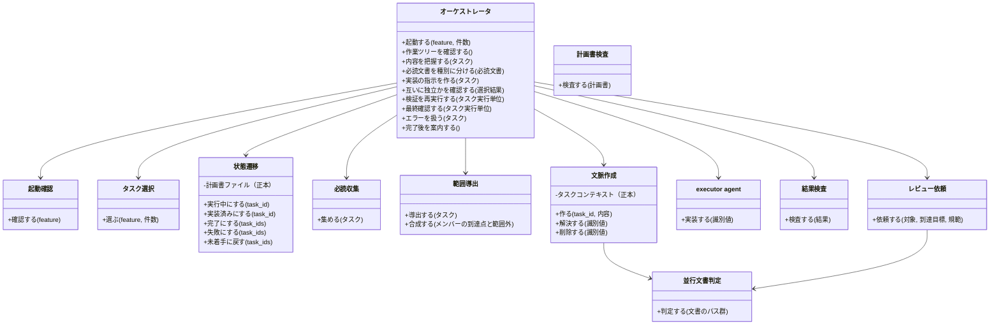
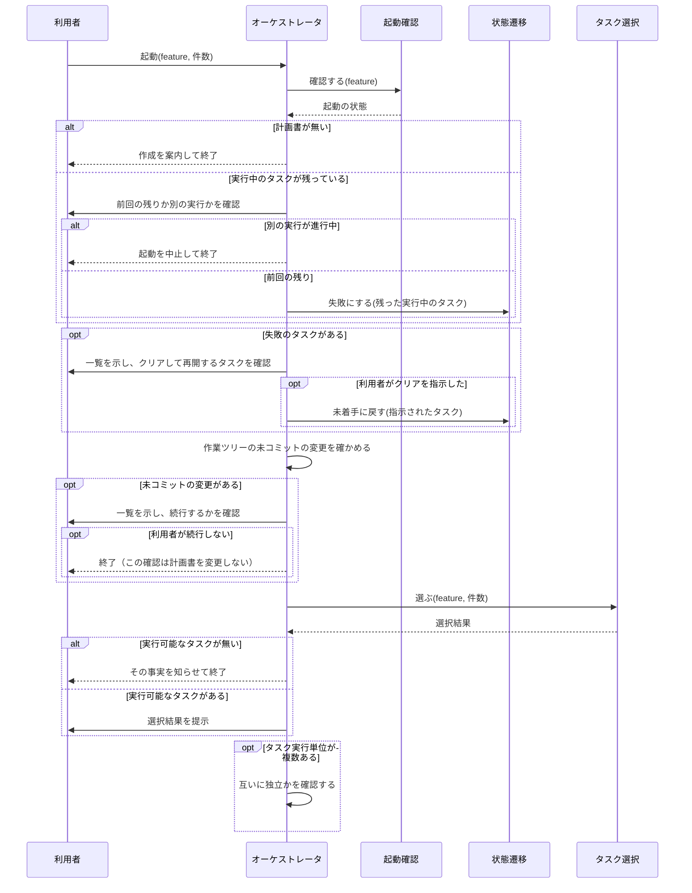
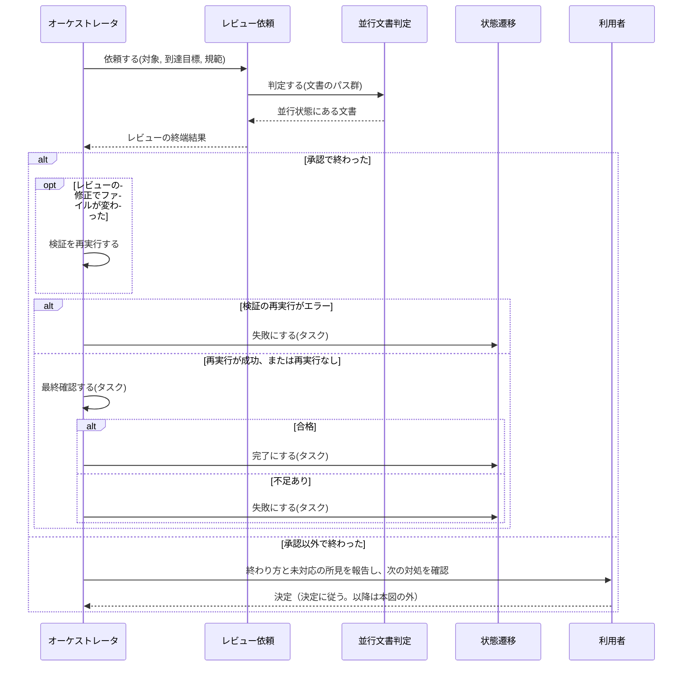
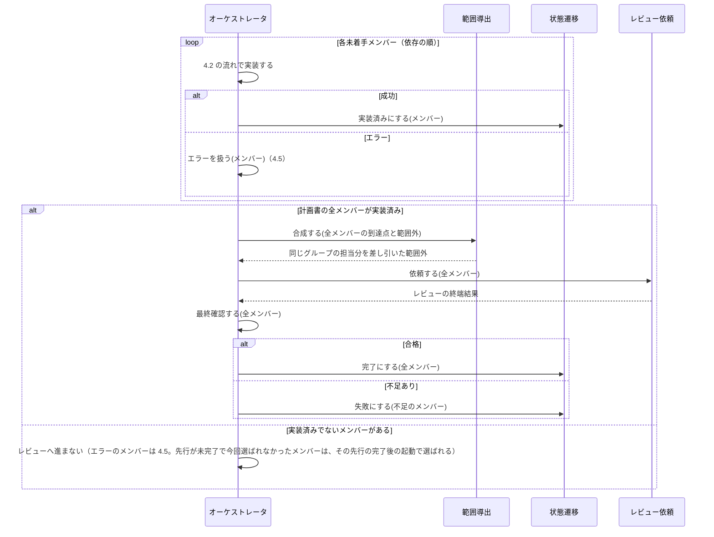
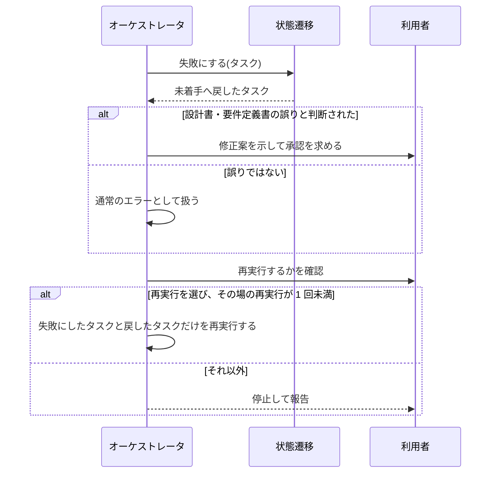
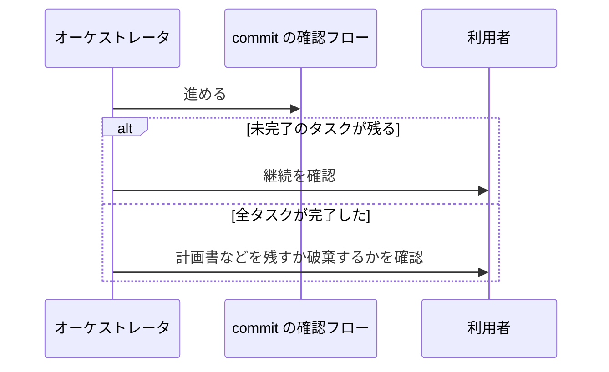
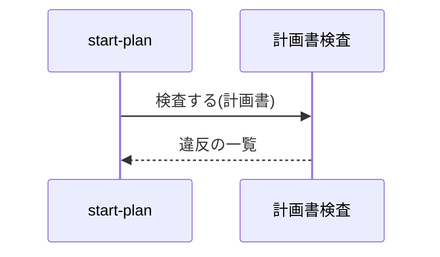
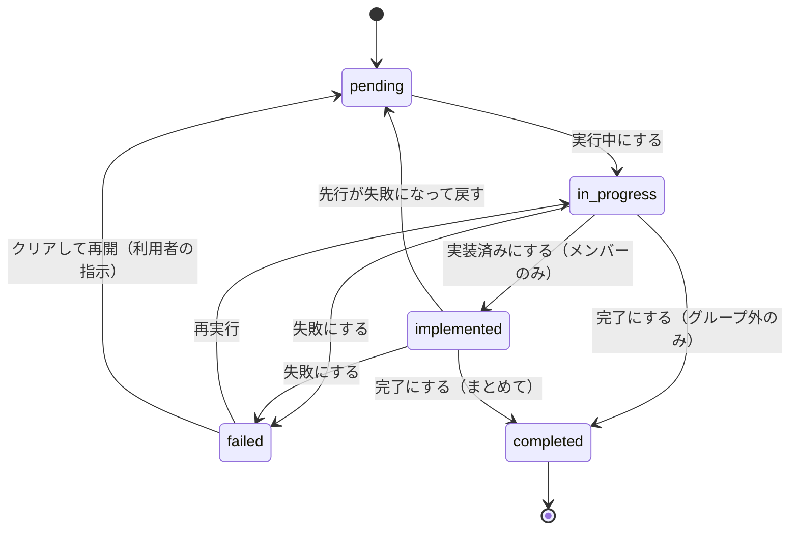

# DES-088 start-implement 設計書

## 1. 設計の範囲と前提

本設計書は、[REQ-034](../requirements/REQ-034_start_implement_spec.md) の FNC-001〜FNC-013・NFR-001・5 節を実現する構造と振る舞いを定める。上流の設計（2〜5 節）は、REQ-034 だけから組み立てた。既存の実装は、その後に調べ、修正せずにそのまま使えるものだけを、6.1 の手段に挙げた。既存の実装をどう扱うか（修正・削除・統合・分割）は、実装戦略書が決める。

範囲外は次のとおり。

- 計画書の作成とタスクの追加（`/forge:start-plan` の責務。REQ-034 §1）
- 計画書を作る側が検査を呼び出す組み込み（`/forge:start-plan` の設計の責務）。本設計は、検査の契約だけを定める（計画書検査）

用語は REQ-034 §3 に従う（オーケストレータ・executor agent・タスクグループ）。加えて、本設計は**タスク実行単位**を使う。タスク実行単位とは、一緒に実装・レビューし、完了にするまとまりであり、タスクグループに属さないタスク 1 件、またはタスクグループ 1 つ（そのメンバー全員）である。並列に実行するのは、異なるタスク実行単位であり、タスクグループの中のメンバーは並列にしない。

**入力で決まっている手段**

- 計画書の書き換えは決定論的な処理が行い、書き換えるのはオーケストレータだけである（REQ-034 FNC-008）
- executor agent の結果は return value で受け取り、受け取る側が 1 か所で検査する（REQ-034 FNC-009）
- 計画書とタスクコンテキストの構造・置き場・書き込みは決定論的な処理が担い、AI は内容だけを決める（REQ-034 FNC-009）
- agent に渡すデータは、識別値だけを運ぶ。データは script が書き、読む側は script が返したパスを直接読む（[agent_data_exchange_rules.md](../../../rules/agent_data_exchange_rules.md)）

## 2. シナリオ表

| ID    | 要件              | 型       | きっかけ／条件                                   | 応答                                                                                                                                                                     |
| ----- | ----------------- | -------- | ------------------------------------------------ | ------------------------------------------------------------------------------------------------------------------------------------------------------------------------ |
| SC-01 | FNC-001           | イベント | 利用者が feature と任意のタスク数で起動する      | 実行可能なタスクを優先度順に選び、実行前に提示する。タスク数を指定しないときは、優先度が最も高い 1 件を選ぶ                                                              |
| SC-02 | FNC-001           | 異常     | 計画書が無い                                     | 作成を案内して終了する                                                                                                                                                   |
| SC-03 | FNC-001           | 異常     | 実行可能なタスクが無い                           | その事実を知らせて終了する                                                                                                                                               |
| SC-04 | FNC-001           | 常時     | 選択のたび                                       | 待つタスクは枠を占めない。実行中・実装済み・失敗・完了は選ばない                                                                                                         |
| SC-05 | FNC-001           | イベント | 選択に同じタスクグループの未着手メンバーがある   | 一緒に選ぶ（先行が満たされないメンバーは、選ばず、未着手のまま残す）                                                                                                     |
| SC-06 | FNC-002           | 異常     | 起動時に実行中のタスクが残っている               | 前回の残りか別の実行かを利用者に確認する。前回の残りなら、実行中のまま残ったタスクだけを失敗にする。別の実行が進行中なら、起動を中止して終了する                         |
| SC-07 | FNC-002           | イベント | 実装を始める前                                   | そのタスクを実行中にする                                                                                                                                                 |
| SC-08 | FNC-004           | イベント | タスクを任せる前                                 | 内容を把握し、必読文書を集めて読み、到達点と範囲外を導出して、指示を作り、検証の要否を決める                                                                             |
| SC-09 | FNC-009・011      | イベント | executor agent にタスクを任せる                  | 1 タスクだけ実装・検証し、結果を return value で返す                                                                                                                     |
| SC-10 | FNC-011           | 異常     | 検証がエラーになる                               | 修正して再検証する（1 回）。再検証もエラーになったら、回復できないエラーとして報告する                                                                                   |
| SC-11 | FNC-009           | 異常     | 結果が契約に反する                               | エラーとして扱い、失敗にする                                                                                                                                             |
| SC-12 | FNC-005・007      | イベント | タスクグループに属さないタスクの実装が成功する   | レビューを依頼し、最終確認に通れば完了にする。紐づくタスクが 1 件以上あり、そのすべてが完了した要件も完了にする                                                          |
| SC-13 | FNC-005           | 異常     | 最終確認に通らない                               | 不足を示し、エラーとして扱い、失敗にする                                                                                                                                 |
| SC-14 | FNC-006           | イベント | タスクグループのメンバーの実装が成功する         | 実装済みにする。全メンバーが実装済みなら、範囲外から同じタスクグループの担当分を差し引いて 1 回レビューし、最終確認に通れば全メンバーをまとめて完了にする                |
| SC-15 | FNC-003           | 異常     | タスクでエラーが起きる、または最終確認に通らない | 失敗にする。推移的に依存する実装済みは未着手へ戻し、依存しない実装済みは残す。タスクグループ内は、失敗にしたものと戻したものだけを再実行する                             |
| SC-16 | FNC-003           | 異常     | 失敗のタスクを再実行する                         | その場で続けて 1 回まで。以降は別の起動で、利用者が選んだときだけ                                                                                                        |
| SC-17 | FNC-003           | 異常     | 実行が中断する                                   | 実行中のタスクだけを失敗にし、実装済みは残す（次の起動の SC-06 で処理される）                                                                                            |
| SC-18 | FNC-007           | イベント | レビューを依頼する                               | 到達目標、規範、並行状態にある文書を渡す。確信のある所見だけを確認なしに修正する形で起動する                                                                             |
| SC-19 | FNC-007           | 異常     | レビューの修正でファイルが変わる                 | 検証を再実行し、成功してから完了にする                                                                                                                                   |
| SC-20 | FNC-007           | 異常     | レビューが承認以外で終わる                       | 自動で完了にせず、終わり方と未対応の所見を報告し、次の対処を利用者が決める                                                                                               |
| SC-21 | FNC-010           | 任意機能 | 依存せず互いに待たないタスクが複数ある           | 起動前に独立を確かめ、並列に実行する                                                                                                                                     |
| SC-22 | FNC-010           | イベント | タスクが完了する                                 | 依存するタスクは、次の選択で選ばれる                                                                                                                                     |
| SC-23 | FNC-012           | 異常     | 設計書・要件定義書の誤りと判断する               | 中断し、修正案を示して承認を得る（変更しない）                                                                                                                           |
| SC-24 | FNC-013           | イベント | 完了後                                           | タスク実行単位を完了にするたびに、commit の確認フローへ進む（並列に実行した組は、全て完了してからまとめて 1 回）。未完了があれば継続を、全完了なら計画書の存廃を確認する |
| SC-25 | FNC-008           | 常時     | 計画書を読み書きする                             | 5.1 形式の JSON とし、書き換えは決定論的な処理だけが行う。依存の構造と設計 ID は計画を作る時点で検出する                                                                 |
| SC-26 | NFR-001           | 常時     | 結果を受け取る                                   | 契約に反する結果と、最終確認に通らない結果を、成功にしない                                                                                                               |
| SC-27 | FNC-005・007・013 | イベント | 起動したとき、作業ツリーに未コミットの変更がある | 一覧を示し、続行するかを利用者に確認する。続行しないなら、終了する（この確認は計画書を変更しない。起動確認が書いた状態は残る）                                           |

## 3. 責務

### 3.1 クラス定義

| 責務名           | 保持データ                                                                 | メソッド                                                                                                                                                                                  | 協調相手                             | 要件                        |
| ---------------- | -------------------------------------------------------------------------- | ----------------------------------------------------------------------------------------------------------------------------------------------------------------------------------------- | ------------------------------------ | --------------------------- |
| オーケストレータ | 選択結果（実質保持。実行中の印が計画書に残る）、タスクごとの到達点と範囲外 | 起動する / 作業ツリーを確認する / 内容を把握する / 必読文書を種別に分ける / 実装の指示を作る / 互いに独立かを確認する / 検証を再実行する / 最終確認する / エラーを扱う / 完了後を案内する | 利用者、以下の全責務                 | FNC-001〜013・NFR-001       |
| 起動確認         | なし                                                                       | 確認する                                                                                                                                                                                  | 計画書                               | FNC-001・002                |
| タスク選択       | なし                                                                       | 選ぶ                                                                                                                                                                                      | 計画書                               | FNC-001・006・010           |
| 状態遷移         | `<<file>>` 計画書（正本）の各タスクと要件の状態                            | 実行中にする / 実装済みにする / 完了にする / 失敗にする / 未着手に戻す                                                                                                                    | 計画書                               | FNC-002・003・005・006・008 |
| 計画書検査       | なし                                                                       | 検査する                                                                                                                                                                                  | 計画書                               | FNC-008                     |
| 必読収集         | なし                                                                       | 集める                                                                                                                                                                                    | 計画書                               | FNC-004                     |
| 範囲導出         | なし                                                                       | 導出する / 合成する                                                                                                                                                                       | 計画書                               | FNC-004・006                |
| 文脈作成         | `<<file>>` タスクコンテキスト（正本）                                      | 作る / 解決する / 削除する                                                                                                                                                                | 計画書、並行文書判定、executor agent | FNC-004・009                |
| executor agent   | なし                                                                       | 実装する                                                                                                                                                                                  | 文脈作成                             | FNC-009・011・012           |
| 結果検査         | なし                                                                       | 検査する                                                                                                                                                                                  | タスクコンテキスト                   | FNC-009・NFR-001            |
| レビュー依頼     | なし                                                                       | 依頼する                                                                                                                                                                                  | 並行文書判定、レビュー               | FNC-005・007                |
| 並行文書判定     | なし                                                                       | 判定する                                                                                                                                                                                  | 文書の一時マーカー                   | FNC-007・004                |

- オーケストレータが自分で行う処理（把握・必読文書の種別分け・独立の確認・最終確認・検証の再実行・エラーの扱い・完了後の案内）は、要件がオーケストレータに割り当てている（REQ-034 FNC-004・005・007・010）。別の責務に切り出さない
- `executor agent` は、REQ-034 の用語であり、10 文字を超えるが責務名として用いる

### 3.2 クラス図



`計画書検査` は、計画書を作る側（`/forge:start-plan`）が呼ぶため、`オーケストレータ` との関係は無い（§1 の範囲外）。

## 4. 振る舞い

### 4.1 起動と選択（SC-01〜07・SC-17・SC-21・SC-27）

起動時の状態の確認は、前段の `起動確認` が 1 回で行い、本体の流れには作り込まない。実行の中断は、プロセスの終了であり、その場で状態を書く処理は走らない。残った実行中の印を、次の起動の確認が拾う。

起動確認のあと、選択の前に、オーケストレータは作業ツリーに未コミットの変更が無いかを確かめる（`git status` の読み取りだけ。SC-27）。レビュー依頼（RV-01）と最終確認（O-06）は未コミットの変更を対象にするため、本スキル以外の変更が混ざると対象を定められない。変更があれば利用者に示し、続行するかを確認する。続行は利用者の判断であり、混ざる変更がレビューの対象に入ることを受け入れたことになる。この確認は、REQ-034 FNC-013 の理由が前提とする「レビューと最終確認が、対象の変更を git の状態から特定できること」を満たすための設計上の手段であり、新しい機能の追加ではない。



完了したタスクに依存するタスクは、完了後の次の選択で、実行可能なタスクとして選ばれる（SC-22）。選択は、起動のたびに計画書の状態から求めるため、完了を覚えておく処理は要らない。

失敗のタスクは選択されず、それに依存するタスクも実行可能にならない（REQ-034 FNC-003）。利用者が原因を調べて直したあと、別の起動で再実行する入口が、上図の「クリアして再開」である（SC-16）。起動確認は失敗のタスクの一覧を返し、オーケストレータが利用者に示す。利用者がクリアを指示したタスクだけを `状態遷移` が未着手に戻し、次の選択の対象にする。実装の取り消し（作業ツリーの変更を戻す等）は利用者が行い、オーケストレータは行わない。

### 4.2 準備と実装（SC-07〜11）

1 つのタスク実行単位（グループに属さないタスク 1 件、またはタスクグループ）ごとに、この図を演じる。互いに独立なタスク実行単位は、並列に演じる（SC-21）。ただし、`done_task_ids` が空でないタスクグループは、並列の組に入れず、単独で演じる（そのメンバーの変更は、今回の結果として残らず、作業ツリーの未コミットの変更としてだけ残るため、他のタスク実行単位の変更が同居すると、レビューの対象を定められない）。また、`状態遷移` の呼び出しは、並列に演じていても、1 回ずつ直列に行う。タスクグループのメンバーは、依存の順（通し番号の順）に演じる。

```mermaid
sequenceDiagram
    participant O as オーケストレータ
    participant RD as 必読収集
    participant PD as 並行文書判定
    participant SC as 範囲導出
    participant CX as 文脈作成
    participant ST as 状態遷移
    participant EX as executor agent
    participant RS as 結果検査
    O->>ST: 実行中にする(タスク)
    O->>RD: 集める(タスク)
    RD-->>O: 必読文書の一覧
    O->>O: 必読文書を種別に分ける
    O->>O: 内容を把握する
    O->>SC: 導出する(タスク)
    SC-->>O: 到達点と範囲外
    O->>O: 実装の指示を作る
    O->>CX: 作る(タスク, 内容)
    CX->>PD: 判定する(必読文書のパス)
    PD-->>CX: 並行状態にある文書
    CX-->>O: タスクコンテキストの識別値
    O->>EX: 実装する(識別値)
    EX->>CX: 解決する(識別値)
    CX-->>EX: タスクコンテキスト
    EX->>EX: 実装して検証する
    alt 検証がエラーになった
        EX->>EX: 修正して再検証する（1 回）
    end
    EX-->>O: 結果（再検証もエラーになったときは FAILURE）
    O->>RS: 検査する(結果)
    RS-->>O: 検査済みの結果（契約違反は FAILURE に置き換え済み）
    O->>CX: 削除する(識別値)
    alt 結果が FAILURE（executor agent のエラー、または契約違反）
        O->>O: エラーを扱う（4.5）
    end
```



準備でエラーが起きたとき（必読文書を読めない、土台の文書が実在しない、文脈作成が拒否した）は、executor agent に任せず、エラーを扱う（4.5）。実行中にしてから準備に入るため、タスクを失敗にできる（ST-04 の事前条件は、実行中または実装済み）。

### 4.3 グループに属さないタスクの完了（SC-12・13・18〜20）



複数のタスク実行単位を並列に実行したときは、全タスク実行単位が完了してから、commit の確認へ、まとめて 1 回進む（4.6）。タスク実行単位が 1 つだけのときは、上の図のとおりである。

### 4.4 タスクグループの完了（SC-14）



- 「全メンバー」は、計画書の `group_id` のグループキーが同じすべてのタスクである。選択結果の `task_ids`（今回実装するメンバー）と `done_task_ids`（以前の実行から実装済みのまま残るメンバー）のほかに、先行が未完了のため今回は選ばれなかったメンバー（`pending` のまま）が含まれうる。`done_task_ids` のメンバーは、実装の流れを演じないが、範囲導出・レビュー依頼・最終確認・完了にするの対象に含める。全メンバーが実装済みになるまで、レビューへ進まない
- レビューが承認以外で終わったときの報告と利用者の決定、レビューの修正による検証の再実行（エラーのときは、タスク実行単位のすべてのタスクを失敗にする）は、4.3 と同じである

### 4.5 エラーと再実行（SC-11・13・15・16・23）

契約に反する結果（SC-11）、最終確認の不合格（SC-13）、executor agent のエラーは、いずれもこの流れに入る。executor agent が、設計書・要件定義書の誤りと判断したときは、変更せずに FAILURE を返す。`error` に、誤りの内容と修正案を書く（SC-23）。



設計書・要件定義書の修正は、本流れの外で行う（REQ-034 FNC-012）。

### 4.6 完了後（SC-24）

タスク実行単位を完了にするたびに、commit の確認フローへ進む。並列に実行した組は、全て完了してからまとめて 1 回進む。



### 4.7 計画書の検査（SC-25）



## 5. 契約

### 5.1 共有データ定義

| データ名              | 意味                                                                                                                                                                        | 正本・書き手                                                                                                       | 読み手                                                                   | ライフサイクル                                                                                        | 同時アクセスの約束                                                                                                                                                                                                                                               |
| --------------------- | --------------------------------------------------------------------------------------------------------------------------------------------------------------------------- | ------------------------------------------------------------------------------------------------------------------ | ------------------------------------------------------------------------ | ----------------------------------------------------------------------------------------------------- | ---------------------------------------------------------------------------------------------------------------------------------------------------------------------------------------------------------------------------------------------------------------- |
| 計画書                | タスクと要件の一覧と、それぞれの進行状態（DES-074）                                                                                                                         | 正本は `{feature}_plan.json`。作成とタスクの追加は `/forge:start-plan`（本設計の外）。状態の更新は `状態遷移` だけ | 起動確認、タスク選択、状態遷移、必読収集、範囲導出、文脈作成、計画書検査 | `start-plan` が作り、実装中に `状態遷移` が更新する。全タスクの完了後、利用者が残すか破棄するかを選ぶ | 書くのは `状態遷移` だけ。executor agent は書かない。別の実行が進行中のときは起動を中止するため、別の実行との同時書き込みは無い。同じ実行の中では、並列に演じるタスク実行単位からでも、オーケストレータが `状態遷移` を 1 回ずつ、前の呼び出しの完了を待って呼ぶ |
| 選択結果              | 今回実行するタスクの一覧。タスク実行単位（グループに属さないタスク 1 件、またはタスクグループ。タスクグループは未着手メンバーと実装済みメンバーを分けて持つ）ごとにまとめる | `タスク選択` の出力                                                                                                | オーケストレータ（以降の各責務へ値を渡す）                               | 起動のたびに作る。実行中の印が計画書に残るため、失われても実行中のタスクを復元できる                  | タスク実行単位ごとに独立                                                                                                                                                                                                                                         |
| タスクコンテキスト    | executor agent に渡す、そのタスク専用の指示・文書・検証の要否（REQ-034 5.2）                                                                                                | `文脈作成` が書く。完成後に 1 回で公開し、上書きしない                                                             | executor agent、結果検査                                                 | 任せる直前に作り、そのタスクの結果を受け取って検査した後に削除する                                    | タスクごとに別の置き場。並列でも衝突しない                                                                                                                                                                                                                       |
| executor agent の結果 | 実装の成否・変更したファイル・検証の結果（REQ-034 5.3）                                                                                                                     | executor agent の応答（return value）                                                                              | 結果検査 → オーケストレータ                                              | タスクごとに 1 回返る。判定して状態の更新と利用者への報告に使った後は保持しない                       | 並列でも、各 executor agent の応答は独立                                                                                                                                                                                                                         |
| 到達点と範囲外        | 今回のタスクが到達すべき範囲と、意図的に含めない項目（`scope_in` / `scope_out`）                                                                                            | `範囲導出` が導出する                                                                                              | 文脈作成、レビュー依頼、オーケストレータ（最終確認）                     | タスクごとに 1 回導出し、完了または失敗で捨てる                                                       | タスク実行単位ごとに独立                                                                                                                                                                                                                                         |
| 必読文書の一覧        | 実装とレビューの根拠になる文書のパス                                                                                                                                        | `必読収集` が作る                                                                                                  | オーケストレータ（読む）、文脈作成、レビュー依頼                         | タスク実行単位ごとに作る                                                                              | タスク実行単位ごとに独立                                                                                                                                                                                                                                         |
| 並行状態にある文書    | 必読文書のうち、差分 feature の一時マーカーを持つもの                                                                                                                       | 正本は各文書の frontmatter の一時マーカー。`並行文書判定` が読み取る                                               | 文脈作成、レビュー依頼                                                   | 判定のたびに求め、保持しない                                                                          | 読み取りだけ                                                                                                                                                                                                                                                     |
| レビューの終端結果    | レビューの終わり方（承認・未対応所見を残した完了・失敗・中断）と、未対応の所見                                                                                              | `/forge:review` が、終端で報告する                                                                                 | オーケストレータ                                                         | レビューごとに 1 回                                                                                   | なし                                                                                                                                                                                                                                                             |

### 5.2 モジュール表

6 列に収めるため、ID の列に要件を併記し、事前条件と事後条件は 1 つの列に前・後で書く。

#### オーケストレータ（種別: AI。`/forge:start-implement` の SKILL.md が手順を持つ）

| ID（要件）               | 処理                                 | 入力                                                                                     | 出力                                                   | 事前／事後                                                                                                                                                                                 | 失敗時                                                                                     |
| ------------------------ | ------------------------------------ | ---------------------------------------------------------------------------------------- | ------------------------------------------------------ | ------------------------------------------------------------------------------------------------------------------------------------------------------------------------------------------ | ------------------------------------------------------------------------------------------ |
| O-01（FNC-001〜013）     | 契約: 起動する（呼び出し元: 利用者） | feature、タスク数（任意）                                                                | 実行結果の報告（完了・失敗・未完了の一覧）             | 前: 引数が不足・曖昧なときは、利用者に確認して補う。選択の前に、作業ツリーの未コミットの変更を確かめ、あれば利用者に続行を確認する。後: 計画書の状態が、実行したタスクの結果を反映している | 途中で中断されても、実行中の印が計画書に残り、次の起動で拾われる                           |
| O-02（FNC-004）          | 内部: 内容を把握する                 | タスクの説明・受け入れ基準、必読文書の一覧（本文を読む）、根拠の設計書と要件定義書       | 把握した内容（実装の指示と最終確認の根拠になる）       | 前: 必読文書の一覧が揃っている。後: 把握しないまま executor agent に任せない                                                                                                               | 必読文書を読めないときは、任せずに、エラーとして扱い、失敗にする                           |
| O-03（FNC-004）          | 内部: 実装の指示を作る               | O-02 の把握した内容、到達点と範囲外                                                      | タスク固有の実装の指示（文字列）                       | 前: O-02 が済んでいる。後: 指示が、把握した内容から作られている                                                                                                                            | なし（作れないときは O-02 が済んでいない）                                                 |
| O-04（FNC-010）          | 内部: 互いに独立かを確認する         | 選択結果の各タスク実行単位の内容                                                         | 並列に実行できるタスク実行単位の組と、順に実行するもの | 前: 選択結果が提示されている。後: 同じ対象への変更が衝突する組が並列に入っていない                                                                                                         | 独立を確かめられないものは、順に実行する                                                   |
| O-05（FNC-007）          | 内部: 検証を再実行する               | タスク実行単位の検証の要否（タスクコンテキストの `verification`）                        | 検証の結果（ビルド・テスト）                           | 前: レビューの修正でファイルが変わった。後: 成功してから完了にする                                                                                                                         | エラーになったときは、完了にせず O-07 に渡す                                               |
| O-06（FNC-005・NFR-001） | 内部: 最終確認する                   | 成果（変更差分・検証結果）、タスクの内容（受け入れ基準を含む）、根拠の設計書・要件定義書 | 合格、または不足の一覧                                 | 前: 結果検査が合格している。後: オーケストレータ自身が書いた実装の指示に照らしていない。レビューの所見は気づきとして参照するだけで、決定にしない                                           | 不足があるときは、不足を示し、エラーとして扱い、失敗にする（O-07）                         |
| O-07（FNC-003・012）     | 内部: エラーを扱う                   | エラーが起きたタスク、エラーの内容                                                       | 再実行の有無                                           | 前: 状態遷移で失敗にしている。後: 再実行は利用者が選んだときだけ。その場の再実行は 1 回まで。設計書・要件定義書の誤りと判断されたときは、修正案を示して承認を得る                          | 再実行しないときは、停止して報告する                                                       |
| O-08（FNC-013）          | 内部: 完了後を案内する               | 計画書の状態                                                                             | commit の確認フローの起動、継続または存廃の確認        | 前: 実行したタスクが完了または失敗している。後: 未完了があれば継続を、全完了なら計画書などの存廃を確認している                                                                             | なし                                                                                       |
| O-09（FNC-004）          | 内部: 必読文書を種別に分ける         | RD-01 の パス文字列の配列（土台と補い）。補いの各パスが既存コードかルールかの判断材料    | `RequiredReading`（REQ-034 5.2）                       | 前: RD-01 が済んでいる。後: RD-01 の一覧のすべてのパスが、ちょうど 1 つの種別に入っている。パスを足さず、変えない                                                                          | 分類できないパスは `additional` に入れる。省略しない。形が合わないときは、CX-01 が拒否する |

#### 起動確認（種別: Script）

| ID（要件）                 | 処理                                           | 入力            | 出力                                                                                                               | 事前／事後                                           | 失敗時                                                                           |
| -------------------------- | ---------------------------------------------- | --------------- | ------------------------------------------------------------------------------------------------------------------ | ---------------------------------------------------- | -------------------------------------------------------------------------------- |
| CK-01（FNC-001・002・003） | 契約: 確認する（呼び出し元: オーケストレータ） | feature、計画書 | 起動の状態（計画書なし / 実行中のタスクあり（タスク ID の一覧） / 残りなし）と、失敗のタスクの一覧（あるときだけ） | 前: feature が与えられている。後: 計画書を変更しない | 計画書を読めない・壊れているときは、エラー（自然文）を返す。フォールバックしない |

#### タスク選択（種別: Script）

| ID（要件）                  | 処理                                       | 入力                                    | 出力                                                                                                                                                          | 事前／事後                                                                                                                                                                                                                                                                                                                                                                     | 失敗時                                       |
| --------------------------- | ------------------------------------------ | --------------------------------------- | ------------------------------------------------------------------------------------------------------------------------------------------------------------- | ------------------------------------------------------------------------------------------------------------------------------------------------------------------------------------------------------------------------------------------------------------------------------------------------------------------------------------------------------------------------------ | -------------------------------------------- |
| SEL-01（FNC-001・006・010） | 契約: 選ぶ（呼び出し元: オーケストレータ） | feature、タスク数（省略時は 1）、計画書 | 選択結果。実行可能なタスクが無いときは空。タスクグループの単位は、未着手のメンバー（`task_ids`）と、実装済みのまま残るメンバー（`done_task_ids`）を分けて持つ | 前: 計画書が存在する。後: 計画書を変更しない。先頭から選んだタスクは、未着手で、先行がすべて完了している（同じタスクグループの先行は実装済みでもよい）。優先度順。待つタスクは枠を占めない。実行中・実装済み・失敗・完了を含まない。タスクグループのタスクを選んだら、その未着手のメンバーのうち、先行が完了・実装済み、または同じ単位の先行メンバーであるものを、すべて含める | 計画書が不正なときは、エラー（自然文）を返す |

#### 状態遷移（種別: Script。計画書を書く唯一の処理）

| ID（要件）            | 処理                                                                                 | 入力             | 出力                       | 事前／事後                                                                                                                                                                      | 失敗時                                               |
| --------------------- | ------------------------------------------------------------------------------------ | ---------------- | -------------------------- | ------------------------------------------------------------------------------------------------------------------------------------------------------------------------------- | ---------------------------------------------------- |
| ST-01（FNC-002）      | 契約: 実行中にする（呼び出し元: オーケストレータ）                                   | タスク ID        | 更新後の状態               | 前: 状態が未着手、または失敗（利用者が再実行を選んだ）。後: そのタスクだけが実行中になる                                                                                        | 遷移が許されない状態なら、変更せずエラーを返す       |
| ST-02（FNC-006）      | 契約: 実装済みにする（呼び出し元: オーケストレータ）                                 | タスク ID        | 更新後の状態               | 前: 実行中で、タスクグループのメンバー。後: そのタスクだけが実装済みになる                                                                                                      | メンバーでない・状態が不正なら、変更せずエラーを返す |
| ST-03（FNC-005・006） | 契約: 完了にする（呼び出し元: オーケストレータ）                                     | タスク ID の一覧 | 更新後の状態               | 前: グループ外は実行中、メンバーは実装済み。後: 指定のタスクが完了になり、紐づくタスクが 1 件以上あり、そのすべてが完了した要件も完了になる（タスクが無い要件は完了にならない） | 一覧のどれかが不正なら、全体を変更せずエラーを返す   |
| ST-04（FNC-003）      | 契約: 失敗にする（呼び出し元: オーケストレータ）                                     | タスク ID の一覧 | 未着手へ戻したタスクの一覧 | 前: 指定が実行中または実装済み。後: 指定が失敗になり、指定に推移的に依存する実装済みが未着手に戻る。依存しない実装済みは残る                                                    | 状態が不正なら、変更せずエラーを返す                 |
| ST-05（FNC-003）      | 契約: 未着手に戻す（呼び出し元: オーケストレータ。利用者がクリアを指示したときだけ） | タスク ID の一覧 | 更新後の状態               | 前: 指定が失敗。後: 指定が未着手になり、次の選択の対象になる。依存するタスクの状態は変えない（失敗にしたときに戻し済み）                                                        | 状態が不正なら、変更せずエラーを返す                 |

#### 計画書検査（種別: Script。呼び出し元: `/forge:start-plan`）

| ID（要件）       | 処理           | 入力   | 出力                                                                                                                                                                                                                | 事前／事後                                             | 失敗時                                        |
| ---------------- | -------------- | ------ | ------------------------------------------------------------------------------------------------------------------------------------------------------------------------------------------------------------------- | ------------------------------------------------------ | --------------------------------------------- |
| CH-01（FNC-008） | 契約: 検査する | 計画書 | 違反の一覧（自己依存・存在しないタスクへの依存・依存の循環・計画書の設計の対応関係に無い設計の識別子・タスクに辿れない要件・`Plan` の型に合わない値（`required_reading` が パス文字列の配列でない等））。無ければ空 | 前: 計画書が JSON として読める。後: 計画書を変更しない | JSON が読めないときは、エラー（自然文）を返す |

#### 必読収集（種別: Script と検索の併用）

| ID（要件）       | 処理                                         | 入力                                                                   | 出力                                                                                                                                           | 事前／事後                                                                                                                                                                                     | 失敗時                                                                                                                                                                         |
| ---------------- | -------------------------------------------- | ---------------------------------------------------------------------- | ---------------------------------------------------------------------------------------------------------------------------------------------- | ---------------------------------------------------------------------------------------------------------------------------------------------------------------------------------------------- | ------------------------------------------------------------------------------------------------------------------------------------------------------------------------------ |
| RD-01（FNC-004） | 契約: 集める（呼び出し元: オーケストレータ） | タスクの必読文書と設計の識別子、設計の対応関係（計画書）、タスクの内容 | パス文字列の配列（土台: 計画書の必読文書と、設計の識別子の設計書と、その設計に対応する要件定義書。補い: 既存コードとタスクに応じた実装ルール） | 前: タスクが選択結果に含まれる。後: 一覧のパスはすべて実在する。土台は必ず含む（要件定義書は、計画書の必読文書に書かれていなくても含む）。補いは、見つからなければ空でよい（探した事実は残す） | 土台の文書（設計書・要件定義書を含む）が実在しない、見つからない、複数見つかるときは、その事実を返す。オーケストレータは、任せる前に、エラーとして扱い、失敗にする。省略しない |

#### 範囲導出（種別: AI と Script の併用）

| ID（要件）            | 処理                                           | 入力                                                                                  | 出力                                                                 | 事前／事後                                                                                                                                                                                                                                                                                                                             | 失敗時                                            |
| --------------------- | ---------------------------------------------- | ------------------------------------------------------------------------------------- | -------------------------------------------------------------------- | -------------------------------------------------------------------------------------------------------------------------------------------------------------------------------------------------------------------------------------------------------------------------------------------------------------------------------------- | ------------------------------------------------- |
| SP-01（FNC-004・006） | 契約: 導出する（呼び出し元: オーケストレータ） | 実装を演じるタスク 1 件（タスクグループのメンバーは、メンバーごとに導出する）、計画書 | 到達点（1 行）と範囲外（項目・担当タスク・分離の理由。各値は単一行） | 前: タスクが選択結果に含まれる。後: 範囲外は、完了でない他のタスクのうち、対象のタスク以外で（同じタスクグループの他メンバーを含む）、同じ設計 ID を持つか、依存の関係にあるもの（設計 ID も依存も共有しないタスクは、今回の変更と関わりが無いため、範囲外に挙げない）。理由が読み取れないときは「計画上分離」と書く。該当が無ければ空 | 単一行でない値は、作成の段階（CX-01）で拒否される |
| SP-02（FNC-006・007） | 契約: 合成する（呼び出し元: オーケストレータ） | タスク実行単位の各メンバーの到達点と範囲外（`done_task_ids` のメンバーを含む）        | レビュー用の本文（到達点と範囲外を複数行にしたもの）                 | 前: 各メンバーの SP-01 の結果が揃っている。後: 範囲外は、全メンバーの範囲外の和集合から、担当タスクが同じ単位のメンバーである項目を差し引いたもの。同じ項目と担当の組は重複を除く。範囲外が無いときは、その旨の 1 文を返す                                                                                                             | 入力の形が合わないときは、エラー（自然文）を返す  |

#### 文脈作成（種別: Script）

| ID（要件）            | 処理                                           | 入力                                                                                                                           | 出力                                   | 事前／事後                                                                                                                                                                                                                                                                                                                      | 失敗時                                                                                                                                                                                                                                     |
| --------------------- | ---------------------------------------------- | ------------------------------------------------------------------------------------------------------------------------------ | -------------------------------------- | ------------------------------------------------------------------------------------------------------------------------------------------------------------------------------------------------------------------------------------------------------------------------------------------------------------------------------- | ------------------------------------------------------------------------------------------------------------------------------------------------------------------------------------------------------------------------------------------ |
| CX-01（FNC-004・009） | 契約: 作る（呼び出し元: オーケストレータ）     | タスク ID、`RequiredReading`、RD-01 のパス文字列の配列（種別分けの検査に使う）、到達点と範囲外、実装の指示、テストの要否と理由 | タスクコンテキストを書き、識別値を返す | 前: タスクが選択結果に含まれる。後: `TaskContext`（REQ-034 5.2）の形で、完成後に 1 回で公開する。他のタスクの情報を含まない。`build` は計画書の `build_check` から決める（`per_task`・`on_group_complete` は必須、`skip` はスキップ）。`spec_authority` は、並行文書判定（PD-01）の結果を、そのまま置く。渡された値を変形しない | `TaskContext` に合わない値（単一行でない、`required` 以外で理由が空、`required_reading` が `RequiredReading` の形でない、RD-01 のパスがどの種別にも無い・複数の種別にある、パスが実在しない 等）は、書かずに拒否し、エラー（自然文）を返す |
| CX-02（FNC-009）      | 契約: 解決する（呼び出し元: executor agent）   | 識別値、計画書パス                                                                                                             | タスクコンテキストの絶対パス           | 前: CX-01 が識別値を返している。後: 返したパスのファイルを、executor agent が直接読む。ファイルの本文は標準出力に載せない                                                                                                                                                                                                       | 識別値に対応するファイルが無いときは、パスを返さず、エラー（自然文）を返す                                                                                                                                                                 |
| CX-03（FNC-009）      | 契約: 削除する（呼び出し元: オーケストレータ） | 識別値、計画書パス                                                                                                             | 削除の結果                             | 前: そのタスクの結果を受け取って検査している。後: 識別値のタスクコンテキストが残らない                                                                                                                                                                                                                                          | ファイルが既に無いときも成功とする                                                                                                                                                                                                         |

#### executor agent（種別: AI）

| ID（要件）                 | 処理                                           | 入力                               | 出力                              | 事前／事後                                                                                                                                                                                                              | 失敗時                                                                                                                                                                                                               |
| -------------------------- | ---------------------------------------------- | ---------------------------------- | --------------------------------- | ----------------------------------------------------------------------------------------------------------------------------------------------------------------------------------------------------------------------- | -------------------------------------------------------------------------------------------------------------------------------------------------------------------------------------------------------------------- |
| EX-01（FNC-009・011・012） | 契約: 実装する（呼び出し元: オーケストレータ） | 識別値（タスクコンテキストを読む） | 結果（5.3）を return value で返す | 前: タスクコンテキストが存在する。後: 1 タスクだけを実装した。範囲外・計画書・設計書・要件定義書を変更していない。他の Agent を起動していない。成功のとき、必須の検証は成功し、スキップ指定の検証はスキップになっている | 検証がエラーになったら、修正して再検証する（1 回）。なおエラーなら、回復できないエラーとして FAILURE を返す。設計書・要件定義書の誤りと判断したときは、変更せずに FAILURE を返し、`error` に誤りの内容と修正案を書く |

#### 結果検査（種別: Script）

| ID（要件）                | 処理                                           | 入力                                      | 出力                                                                                               | 事前／事後                                                                                                                                         | 失敗時                                                            |
| ------------------------- | ---------------------------------------------- | ----------------------------------------- | -------------------------------------------------------------------------------------------------- | -------------------------------------------------------------------------------------------------------------------------------------------------- | ----------------------------------------------------------------- |
| RS-01（FNC-009・NFR-001） | 契約: 検査する（呼び出し元: オーケストレータ） | executor agent の結果、タスクコンテキスト | 検査済みの結果（`TaskResult`。契約違反は、理由を `error` に持つ `FAILURE` の結果に置き換えたもの） | 前: 結果が 1 件ある。後: `TaskResult` の形と、成功のときの検証の整合（失敗を含まない、必須は成功、スキップ指定はスキップ）を、1 か所で検査している | 結果が空・JSON でないときは、契約違反として返す。推測で補完しない |

#### レビュー依頼（種別: SKILL。`/forge:review` を起動する）

| ID（要件）            | 処理                                           | 入力                                                                                               | 出力               | 事前／事後                                                                                                                                                                                                       | 失敗時                                                                                                                                       |
| --------------------- | ---------------------------------------------- | -------------------------------------------------------------------------------------------------- | ------------------ | ---------------------------------------------------------------------------------------------------------------------------------------------------------------------------------------------------------------- | -------------------------------------------------------------------------------------------------------------------------------------------- |
| RV-01（FNC-005・007） | 契約: 依頼する（呼び出し元: オーケストレータ） | 未コミットの変更（`--diff`）、到達目標（到達点と範囲外）、規範（必読文書の一覧のうちルール・仕様） | レビューの終端結果 | 前: タスク実行単位の実装が成功している（タスクグループは全メンバー）。後: 確信のある所見だけを確認なしに修正し、確信の無い所見は利用者に提示する形で起動している。到達目標・規範・並行状態にある文書を渡している | レビューが承認以外（失敗・中断を含む）で終わったときも、終端結果として返る。オーケストレータは完了にせず、報告して、次の対処を利用者が決める |

#### 並行文書判定（種別: Script）

| ID（要件）            | 処理                                                 | 入力             | 出力                                         | 事前／事後                                                                                                                         | 失敗時                                                                               |
| --------------------- | ---------------------------------------------------- | ---------------- | -------------------------------------------- | ---------------------------------------------------------------------------------------------------------------------------------- | ------------------------------------------------------------------------------------ |
| PD-01（FNC-004・007） | 契約: 判定する（呼び出し元: 文脈作成、レビュー依頼） | 文書のパスの一覧 | 並行状態にある文書のパス（無ければ空の一覧） | 前: パスが実在する。後: 文書を変更しない。判定は一時マーカーの有無だけで行い、解釈を混ぜない。「存在しない」ことが空の一覧で伝わる | frontmatter の書式が不正なときは、エラー（自然文）を返す。推測で「持たない」としない |

### 5.3 AI で実現する処理の約束

出力スキーマは 6.4 に書く。

| ID    | 出力に含まれるもの                                                                                                  | 検証方法                                                                                                                    | 結果が揺れたときの対策                                                                               |
| ----- | ------------------------------------------------------------------------------------------------------------------- | --------------------------------------------------------------------------------------------------------------------------- | ---------------------------------------------------------------------------------------------------- |
| O-01  | 実行結果の報告。タスク実行単位ごとの結果（完了・失敗・未完了）とその理由                                            | 報告の各結果が、計画書の状態（状態遷移の出力）と一致すること                                                                | 計画書の状態を正とし、食い違う報告は、状態に合わせて直す                                             |
| O-02  | 把握した内容（タスクの説明・受け入れ基準・範囲・根拠の文書）                                                        | 必読文書を実際に読んだ事実（読んだ文書の一覧）                                                                              | 把握できないときは任せず、利用者に報告する                                                           |
| O-03  | 実装の指示（文字列）。把握した内容と、到達点・範囲外を反映したもの                                                  | 指示が、O-02 の把握した内容と到達点・範囲外の各項目に対応していること                                                       | 項目が欠けたときは、文脈作成（CX-01）へ渡す前に、把握した内容から作り直す                            |
| O-04  | 並列に実行できるタスク実行単位の組と、独立と判断した根拠                                                            | 組に、同じ対象を変更するものが無いこと（根拠で確認）                                                                        | 独立を確かめられないものは、順に実行する                                                             |
| O-05  | 検証の結果（ビルド・テスト。それぞれ `success` / `skipped` / `failed` と理由）                                      | 要否が `required` の検証を、実際に実行した事実（実行したコマンドと終了コード）                                              | 実行できない、またはエラーになったときは、完了にせず O-07 に渡す。成功と推測しない                   |
| O-06  | 合格、または不足の一覧。根拠は、受け入れ基準の項目ごとの照合                                                        | 項目ごとの照合が、基準・設計書・要件定義書に基づくこと（実装の指示を根拠にしない）                                          | 不合格は、エラーとして扱い、失敗にし、不足を利用者に示す。合格の根拠が残るため、利用者が見直せる     |
| O-07  | 再実行の有無と、停止の報告（エラーの内容・戻したタスク）                                                            | 再実行は利用者が選んだときだけ。その場の再実行が 1 回までであること                                                         | 利用者の選択が得られないときは、再実行せず、停止して報告する                                         |
| O-08  | 案内（commit の確認フローの起動、継続または存廃の確認）                                                             | 未完了の有無が、計画書の状態に基づくこと                                                                                    | 状態を読めないときは、案内せず、その旨を報告する                                                     |
| O-09  | `RequiredReading`。RD-01 の一覧のすべてのパスを、設計書・要件定義書・戦略書・ルール・既存コード・その他に分けたもの | すべてのパスが、ちょうど 1 つの種別に入っていること。形が `RequiredReading` と一致すること（CX-01 が検査する）              | 分類できないパスは `additional` に入れる。形が合わないときは、CX-01 が拒否し、エラーとして報告される |
| RD-01 | 補い（既存コードとタスクに応じた実装ルール）の探した結果と、探した事実（探した手段と語）                            | 補いのパスが実在すること（CX-01 が検査する）。探した事実が 1 件以上あること（探していないことと、該当が無いことを区別する） | 見つからなければ、補いは空にし、探した事実を残す。探していないときは、任せる前に探す                 |
| SP-01 | 到達点と範囲外の理由                                                                                                | 各値が単一行であること（文脈作成が検査する）                                                                                | 理由が読み取れないときは「計画上分離」と書く                                                         |
| EX-01 | 結果（5.3）。成否・変更したファイル・検証の結果・要約・注意事項・原因                                               | 結果検査（RS-01）が 1 か所で検査する                                                                                        | 契約に反する結果は、検査が FAILURE の結果に置き換え、エラーとして扱う（再実行は SC-16）              |

## 6. 詳細設計

既存の実装の扱い（修正・削除・統合・分割）は、本設計の範囲外であり、実装戦略書が決める。本節が「既存の使用」と書くのは、修正せずにそのまま使えるものだけである。修正が要るものは、本節に挙げず、契約（5 節）と 6.3 だけを定める。

### 6.1 手段と配置

配置は DES-024 に従い、`SKILL.md → SKILL ローカル実体 → 共有低レベル script` の一方向とする。スクリプトは標準ライブラリだけで書く（外部依存の禁止。PyYAML も要らない）。

| 責務             | 手段                                                                                            | 配置                                      | 既存の使用                                                                           |
| ---------------- | ----------------------------------------------------------------------------------------------- | ----------------------------------------- | ------------------------------------------------------------------------------------ |
| オーケストレータ | 継承型 SKILL（AI）                                                                              | `skills/start-implement/SKILL.md`         | なし                                                                                 |
| 起動確認         | Script                                                                                          | `skills/start-implement/scripts/`         | `plan_contract.py` の `load_plan`                                                    |
| タスク選択       | Script                                                                                          | 同上                                      | `load_plan`、`normalize_group_key`                                                   |
| 状態遷移         | Script（モードで 5 つの遷移を選ぶ）                                                             | 同上                                      | `load_plan`                                                                          |
| 計画書検査       | 検査関数（共有低レベル）。依存の構造の検査は、計画書を知らない純関数に分ける                    | `scripts/plan/`                           | なし                                                                                 |
| 必読収集         | 土台は Script、補いはオーケストレータ（AI）が検索スキルと Grep で行う                           | `skills/start-implement/scripts/`         | `resolve_doc_structure.py --find-in design`・`--find-in requirement`                 |
| 範囲導出         | 候補の列挙とレビュー用の本文の合成は Script、理由の記述はオーケストレータ（AI）                 | 同上                                      | `normalize_group_key`                                                                |
| 文脈作成         | Script（作る・削除するは同じ入口のモード。executor agent が呼ぶ「解決する」は、別の入口にする） | `skills/start-implement/scripts/`         | `read_and_consume_candidate_input`、`feature_marker.py` の `classify_feature_marker` |
| executor agent   | カスタム Agent                                                                                  | `agents/executor.md`                      | なし                                                                                 |
| 結果検査         | Script                                                                                          | `skills/start-implement/scripts/`         | `read_and_consume_candidate_input`                                                   |
| レビュー依頼     | `/forge:review` の呼び出し（SKILL.md に書く）                                                   | 同上                                      | なし                                                                                 |
| 並行文書判定     | Script                                                                                          | `scripts/doc_structure/feature_marker.py` | **そのまま使う**                                                                     |

- **executor agent をカスタム Agent にする理由**: 毎タスク、同じロールで起動する。親の context が肥大する（[claude_code_authoring_guide.md](../../../rules/claude_code_authoring_guide.md)）。手順は agent 定義が持つ
- **状態遷移を 1 つの入口にする理由**: 5 つの遷移は、同じ計画書への順序付き位相であり、各場面の呼び出しが確定している（DES-024 §2.2）。モードは `--to in_progress|implemented|completed|failed|pending` とする
- **新規 script の終了コード**: `0`（完了）・`1`（区別のないエラー）・`2`（引数）だけを返す。エラーの内容は、標準出力の `errors`（自然文の配列）に載せる（[script_error_output_rules.md](../../../rules/script_error_output_rules.md)）

### 6.2 データの具体構造

#### 計画書

`Plan` は、[DES-074](../../forge/design/DES-074_plan_format_design.md) のとおり。

#### タスクコンテキスト

`TaskContext`（REQ-034 5.2）のとおり。次を定める。

- **識別値**: `context_id`。`{task_id}-{8 桁の 16 進}` とし、`文脈作成` が生成する。AI は組み立てない
- **置き場**: 計画書と同じディレクトリの `tasks/{context_id}.json`。パスは計画書パスと識別値から script が決める。script が書き、読む側が script の返したパスを読む型の置き場である（[agent_data_exchange_rules.md](../../../rules/agent_data_exchange_rules.md)）。計画書の隣に置くのは、計画書・実装戦略書と同じライフサイクルで扱うためである。全タスク完了時の存廃の確認（O-08）で 3 つを一緒に残すか消すので、消す場所が 1 か所になり、途中で止まった実行の残骸もそこで消える。識別値を渡す側（オーケストレータ・executor agent）は、計画書パスも識別値として渡す
- **`verification.build`**: 計画書の `build_check` から決める。`per_task` と `on_group_complete` は `required`（`build_reason` は `null`）、`skip` は `skipped`（`build_reason` は「計画書の build_check が skip である」）
- **`verification.tests` と `tests_reason`**: 候補入力の値をそのまま置く。`required` のとき理由は `null`、それ以外は単一行の理由を要する
- **`spec_authority`**: 並行状態にある文書のパスの配列。タスクコンテキストのトップレベルに置く（`implementation_instructions` への文字列連結にしない）。値は分類結果だけであり、行動の指示を含めない（REQ-025 FNC-002）。`scope_in` / `scope_out` は拡張しない（並行状態は、タスクの範囲とは別軸の情報である）
  - **対象**: `required_reading` のうち `requirement_docs` / `design_docs` / `additional` に挙がった文書を `classify_feature_marker` で判定し、並行状態にあるものだけを並べる。設計書を含めるのは、設計書も並行状態の識別子を持つためである（要件定義書だけを分類すると、旧設計書が現在の設計として読まれる経路が残る）。`additional` を含めるのは、文書種別ではなく受け皿であり、要件定義書・設計書が入りうるためである（除外すると、計画書経由で渡された並行状態の文書が、エラーなく空配列になる）。戦略書・ルール・コードは対象にしない（種別が固定で、識別子を持たない）
  - **判定できない文書**: 読めない文書、解析できない文書が 1 つでもあれば、作成をエラーにし、対象のパスと理由を `errors` に載せる。「並行状態にない」と同一視しない（REQ-025 FNC-005）。判定の契約は [DES-074](../../forge/design/DES-074_plan_format_design.md) が定める
  - **該当なし**: 空配列にする（`null` にしない。ほかの空値の表現と揃える）
  - **executor agent による受領**: `agents/executor.md` が、受領する項目に含め、挙がった文書を対象範囲の現在の仕様として扱い、旧仕様の記述を実装の根拠にしないと定める（REQ-025 FNC-004）

AI が候補入力（5.2 の `scope_in` / `scope_out` / `required_reading` / `implementation_instructions` / `verification.tests` / `verification.tests_reason`）を書くファイルは、`.temp/forge/start-implement/` 配下に置く。script が読んだ後に、成否に関わらず削除する。

#### executor agent の結果

`TaskResult`（REQ-034 5.3）のとおり。検査は 6.3 の「結果検査」で定める。

#### 選択結果

タスク選択が標準出力に返す `SelectionResult`（JSON）。要素は `TaskExecutionUnit` である。

```json
{
  "units": [
    {
      "kind": "task",
      "group_key": null,
      "task_ids": ["TASK-010"],
      "done_task_ids": []
    },
    {
      "kind": "group",
      "group_key": "GROUP-001",
      "task_ids": ["TASK-002", "TASK-003"],
      "done_task_ids": ["TASK-001"]
    }
  ]
}
```

- `units` は、実行する順（優先度順）。実行可能なタスクが無ければ空の配列
- `task_ids` は、これから実装する未着手のタスク。`kind` が `group` のとき、依存の順（同順位は通し番号の順）に並べる
- `done_task_ids` は、同じタスクグループの、既に `implemented` のメンバー（以前の実行の結果）。`kind` が `task` のときは空。実装は演じないが、タスクグループ全体の範囲導出・レビュー・最終確認・完了にするの対象になる

`SelectionResult`:

| フィールド | 型                         | 内容                                   |
| ---------- | -------------------------- | -------------------------------------- |
| units      | `TaskExecutionUnit` の配列 | タスク実行単位。実行する順（優先度順） |

`TaskExecutionUnit`:

| フィールド    | 型                | 内容                                                          |
| ------------- | ----------------- | ------------------------------------------------------------- |
| kind          | 列挙              | `task`（グループに属さないタスク）/ `group`（タスクグループ） |
| group_key     | 文字列または null | タスクグループのキー。`kind` が `task` のとき `null`          |
| task_ids      | 文字列の配列      | これから実装する未着手のタスクの ID                           |
| done_task_ids | 文字列の配列      | 既に実装済みのままのメンバーの ID                             |

#### 起動の状態

起動確認が標準出力に返す `StartupState`（JSON）。

```json
{ "state": "no_plan" }
{ "state": "leftover", "in_progress_task_ids": ["TASK-004"] }
{ "state": "clear" }
{ "state": "clear", "failed_task_ids": ["TASK-002"] }
```

`StartupState`:

| フィールド           | 型           | 内容                                                                                                                        |
| -------------------- | ------------ | --------------------------------------------------------------------------------------------------------------------------- |
| state                | 列挙         | `no_plan`（計画書なし）/ `leftover`（実行中のタスクが残っている）/ `clear`                                                  |
| in_progress_task_ids | 文字列の配列 | 残っている実行中のタスクの ID。`state` が `leftover` のときだけ持つ                                                         |
| failed_task_ids      | 文字列の配列 | 失敗のタスクの ID（計画書の順）。`leftover`・`clear` で、1 件以上あるときだけ持つ。クリアして再開するかを利用者が決める材料 |

### 6.3 アルゴリズム

#### 状態の遷移

許される遷移は次のとおり。これ以外は、変更せずにエラーを返す。



#### タスク選択

1. 実行可能なタスクの集合を求める。タスクが次をすべて満たすとき、実行可能とする
   - 状態が `pending`
   - すべての `depends_on` の先行が、`completed`、または、同じタスクグループの `implemented`
2. 実行可能なタスクを、優先度の降順に並べる。同じ優先度は、`task_id` の昇順（判断に解釈を要さないため）
3. 先頭から順に、`件数` 個のタスクを選ぶ。すでに選んだ単位に含まれるタスクは、数えずに飛ばす
4. 選んだタスクがタスクグループに属するとき、同じタスクグループの `pending` のメンバーを、同じ単位へ加える（件数に数えない）。ただし、加えるのは、先行がすべて `completed`・`implemented`、または同じ単位の先行メンバーであるものに限る。満たさないメンバーは、単位に含めず、未着手のまま残す。同じタスクグループの `implemented` のメンバーは、`done_task_ids` に載せる
5. 単位の中は、`depends_on` の順に並べる。同順位は、`group_id` の通し番号の順

`depends_on` の循環は、計画書を作る時点で検出されるため、ここでは再検査しない。

#### 状態遷移

1. 指定されたすべてのタスクが存在し、遷移が許されることを、書く前にすべて確かめる。どれか 1 つでも不正なら、何も書かずに終了する（全か無か）
2. 計画書の状態を更新する
   - `failed` へ遷移させるとき、指定したタスクに、推移的に依存するタスク（依存の逆向きに辿る）のうち、`implemented` のものを、`pending` に戻す。依存しない `implemented` は残す
   - `completed` へ遷移させたあと、各要件について、`design_traceability` から、その要件に紐づくタスクの集合を求める。1 件以上あり、すべてが `completed` なら、要件を `completed` にする。1 件も無い要件は、`completed` にしない
   - `pending` へ戻すとき（失敗のクリア）、依存するタスクの状態は変えない
3. 一時ファイルに書き、名前を変えて置き換える（動作の原理は 6.5）

#### 必読収集の土台

1. 計画書のタスクの `required_reading` を、そのまま加える
2. タスクの `design_id` が `null` でなければ、`resolve_doc_structure.py --find-in design --name {design_id}` で設計書のパスを求め、加える。見つからない、または複数見つかるときは、その事実を返す
3. 同じ `design_id` を持つ `design_traceability` の要素の `requirement_ids` の各要件 ID について、`resolve_doc_structure.py --find-in requirement --name {要件 ID}` で要件定義書のパスを求め、加える。計画書の `required_reading` に要件定義書が書かれていなくても加える。見つからない、または複数見つかるときは、その事実を返す。対応する要件が無いときは、何も加えない
4. 重複を除く。実在しないパスがあれば、その一覧を返す

補い（既存コードと、タスクに応じた実装ルール）は、オーケストレータが、`/forge:query-db-rules`・`/forge:query-db-specs` と Grep で探す。

#### 範囲導出

候補の列挙（`--candidates --unit {task_id}`。対象のタスク 1 件を渡す。タスクグループのメンバーは、メンバーごとに 1 回呼ぶ）:

1. 対象のタスク以外のタスク（同じタスクグループの他メンバーを含む）のうち、`completed` でないものを求める
2. そのうち、対象のタスクと同じ `design_id`（`null` を除く）を持つもの、または対象のタスクが `depends_on` に含めるもの、または対象のタスクを `depends_on` に含めるものを、候補として返す（`task_id`・`title`・`description`）

オーケストレータは、候補から、`scope_out` の各要素（項目・担当タスク・分離の理由。各値は単一行）を書く。`scope_in` も、対象のタスクの `description` から 1 行に要約して書く。

レビュー用の本文の合成（`--review-text`）:

1. 入力は、タスク実行単位の各メンバーの `scope_in` と `scope_out`
2. 範囲外は、全メンバーの `scope_out` の和集合から、`owner_task_id` が同じ単位のメンバーである項目を差し引く。同じ項目と担当の組は、重複を除く
3. 到達点と範囲外を、複数行の本文にして返す。範囲外が無いときは、その旨の 1 文を返す

#### 結果検査

1. 入力（executor agent の結果）が JSON として読めない、または `TaskResult`（REQ-034 5.3）のフィールドの集合と一致しなければ、契約違反とする。入力のファイルそのものが無いときは、executor agent の結果の不備ではなく、呼び出し側（オーケストレータ）の手違いであるため、契約違反にせず、検査の入口の失敗（エラー）として返す
2. `task_id` が起動したタスクと一致し、`status` が `SUCCESS` / `FAILURE`、`files_modified` がプロジェクトルート相対パスで重複が無く、`summary` が 1〜2 行であることを確かめる
3. `verification` の各値が `success` / `skipped` / `failed` で、`success` のとき理由が `null`、それ以外は理由があることを確かめる
4. `status` が `SUCCESS` のとき、`error` が `null`、`verification` に `failed` が無いこと、タスクコンテキストが `required` の検証は `success`、`skipped` の検証は `skipped` であることを確かめる
5. 違反があれば、検査を満たさなかった理由を `error` に持つ `FAILURE` の結果を、成功の結果と同じ形で返す（呼び出し元が、成功と取り違えない）

#### レビュー依頼

`/forge:review` を、次の形で呼び出す。

```text
/forge:review --diff --auto \
  --scope "{到達目標の本文}" \
  --project-rules {ルール文書（カンマ区切り）} \
  --project-specs {設計書・要件定義書（カンマ区切り）}
```

- `--scope`: 範囲導出が合成した到達目標の本文。該当タスクの受け入れ基準が `null` でなければ、その内容を追記する
- `--project-rules`: 必読収集が集めたルール文書
- `--project-specs`: 根拠の設計書・要件定義書。並行文書判定で、並行状態にあると分かった文書は、必ず含める。並行状態であることは、各文書の frontmatter が伝える。戦略書と `required_reading` は渡さない（実装手順の指示であり、規範ではない）
- 対象は、未コミットの変更（`--diff`）とする。タスク実行単位を完了にするたびにコミットするため、次のタスク実行単位の変更だけになる
- タスク実行単位の変更が多く、1 回では精査が浅くなるとオーケストレータが判断したときは、タスクグループのメンバーの境界で分けてよい。分けたときは、メンバーの `files_modified`（executor agent の報告）を `--files` に指定し、各回の `--scope` を、分けた後のメンバーの集合で、範囲導出から取り直す
- 並列に実行した組のタスク実行単位は、同じ作業ツリーに他のタスク実行単位の変更が同居するため、`--diff` の代わりに、そのタスク実行単位の結果の `files_modified` を `--files` に指定する。実装済みのまま残るメンバーを持つタスクグループは、並列の組に入れず単独で実行する（4.2）ため、`--diff` で全メンバーの変更を対象にできる

#### 最終確認（オーケストレータ）

1. タスク実行単位の各タスクについて、受け入れ基準の項目、`scope_in` の各項目を照合の項目に挙げる。根拠の設計書・要件定義書から、そのタスクに関わる記述も加える
2. 各項目を、変更差分と検証結果に照らし、`ok` または `gap`（不足）にする。根拠を 1 つずつ書く
3. `gap` が 1 つも無ければ合格、1 つでもあれば不合格にする。オーケストレータ自身が書いた実装の指示は、照合の根拠にしない
4. レビューの所見は、気づきとして参照するだけで、合否を決めない

#### 並列実行の独立の確認（オーケストレータ）

各タスク実行単位の `description`・`scope_in`・必読文書から、変更する対象（ファイル・型・契約）を推定する。対象が重なる、または一方が他方の成果を前提とするものは、同じ組に入れず、順に実行する。推定できないものも、順に実行する。

### 6.4 AI で実現する処理の出力スキーマ

オーケストレータが会話の中で作る出力であり、ファイルにはしない（読み手は同じオーケストレータである）。

| 処理                           | スキーマ                                                                                                                                                                                             |
| ------------------------------ | ---------------------------------------------------------------------------------------------------------------------------------------------------------------------------------------------------- |
| 実行結果の報告（O-01）         | `{"units": [{"task_ids": ["…"], "result": "completed・failed・pending のいずれか", "reason": "エラー・未完了の理由。完了なら null"}]}`                                                               |
| 内容の把握（O-02）             | `{"read_documents": ["読んだ文書のパス"], "understanding": "タスクの説明・受け入れ基準・範囲・根拠の要旨"}`                                                                                          |
| 実装の指示（O-03）             | 単一の文字列（`implementation_instructions`）。到達点・範囲外・受け入れ基準の各項目に触れる                                                                                                          |
| 独立の確認（O-04）             | `{"batches": [{"units": ["unit-1", "unit-2"], "basis": "対象が重ならない根拠"}]}`。`batches` の中は並列、`batches` の間は順に実行する                                                                |
| 検証の再実行（O-05）           | `{"build": {"status": "success・skipped・failed のいずれか", "command": "実行したコマンド", "exit_code": 0, "reason": "…または null"}, "tests": {同じ形}}`                                           |
| 最終確認（O-06）               | `{"verdict": "pass" または "fail", "checks": [{"item": "…", "source": "acceptance_criteria・scope_in・design・requirement のいずれか", "result": "ok または gap", "evidence": "…"}], "gaps": ["…"]}` |
| エラーの扱い（O-07）           | `{"failed_task_ids": ["…"], "reverted_task_ids": ["…"], "rerun": true または false, "report": "エラーの内容"}`                                                                                       |
| 完了後の案内（O-08）           | `{"next": "continue・disposal のいずれか", "remaining_task_ids": ["…"]}`。`continue` は未完了が残るとき、`disposal` は全完了のとき                                                                   |
| 必読文書の種別分け（O-09）     | `RequiredReading`（REQ-034 5.2）。RD-01 の パス文字列の配列の全要素を、ちょうど 1 つの種別に入れる                                                                                                   |
| 必読文書の補い（RD-01）        | `{"supplements": ["補いのパス"], "searched": [{"means": "query-db-rules・query-db-specs・Grep のいずれか", "query": "探した語"}]}`。該当が無いとき、`supplements` は空で、`searched` は 1 件以上     |
| 到達点と範囲外（SP-01）        | `scope_in`: 単一行の文字列。`scope_out`: `ScopeOutItem` の配列                                                                                                                                       |
| executor agent の結果（EX-01） | `TaskResult`（REQ-034 5.3）。`FAILURE` のとき、`error` に直接の原因を書く。設計書・要件定義書の誤りと判断したときは、誤りの内容と修正案を書く                                                        |

### 6.5 動作の原理

- **進行状態の正本は、計画書の 1 か所である。** 実行中の印が計画書に残るため、中断しても、次の起動の確認（起動確認）が拾える。オーケストレータの記憶に状態を持たない
- **計画書の書き換えは、一時ファイルへ書いてから名前を変えて置き換える。** 途中で止まっても、壊れた計画書が残らない。書くのは状態遷移だけで、別の実行が進行中なら起動を中止するため、別の実行との同時書き込みは無い。同じ実行の中の並列なタスク実行単位は、読み込み・更新・置き換えの途中で互いの更新を取りこぼす（置き換えは破損を防ぐが、後勝ちになる）ため、オーケストレータが状態遷移を 1 回ずつ、前の呼び出しの完了を待って呼ぶ。排他の制御（ロック）は、持たない
- **先行が失敗の状態になったとき、依存する `implemented` を `pending` に戻す。** `implemented` の成果は、先行の成果の上に作られており、先行が失敗の状態になると前提を失うため
- **タスクコンテキストは、完成してから 1 回で公開し、識別値ごとに別のファイルに置く。** 並列に起動しても、衝突しない。処理が途中で終わって残った場合も、識別値を再利用しないので、次のタスクコンテキストと衝突しない。残骸は、置き場（計画書と同じディレクトリの `tasks/`）が計画書と同じライフサイクルであるため、全タスク完了時の存廃の確認で計画書・実装戦略書と一緒に消える。残骸を個別に検知する仕組みは持たない
- **executor agent の結果は、return value で受け、受け取る側が 1 か所で検査する。** 契約に反する結果は、検査が `FAILURE` の結果へ置き換えるため、成功として扱われない

### 6.6 利用ライブラリ

Python の標準ライブラリだけを使う（`json`・`argparse`・`pathlib`・`subprocess`・`os`・`re`）。外部依存を持ち込まない（[implementation_guidelines.md](../../../rules/implementation_guidelines.md)）。YAML も、frontmatter の解析（`feature_marker.py` の正規表現）と `.doc_structure.yaml` の解決（`resolve_doc_structure.py`）が、既に担っている。

### 6.7 executor agent の編集範囲

規約（[claude_code_authoring_guide.md](../../../rules/claude_code_authoring_guide.md)）は、書き込む Agent に、編集可能ファイルの allowlist を課すことを推奨する。本設計は、executor agent に allowlist を課さない。

- **理由**: 計画書のタスクは、変更するファイルの一覧を持たない。新規ファイルの作成も許す必要がある。一覧を AI が推測して作れば、実装できるものを妨げ、または範囲外を許すことになる
- **代わりの拘束**: ① executor agent の Role で、1 タスクだけを実装し、範囲外・計画書・設計書・要件定義書を変更しないことを、否定形で定める ② レビューが、到達目標（範囲外の項目を含む）に照らして、範囲外の変更を所見として挙げる（RV-01・6.3 レビュー依頼）

### 6.8 テスト

`plugins/` 配下の Python script は、すべてテストを持つ（`tests/forge/` に、スキルの名前で分類して置く）。状態遷移の許される遷移と不許可、依存の波及、タスク選択の件数・展開・待機、結果検査の違反の種類、文脈作成の拒否を、それぞれ試す。

## 7. 追跡表

REQ-034 の各要件を満たす設計要素を示す。設計要素が 1 つも無い要件は無い。

| 要件                      | シナリオ      | シーケンス図  | モジュール表                                 | 共有データ・詳細設計                                                             |
| ------------------------- | ------------- | ------------- | -------------------------------------------- | -------------------------------------------------------------------------------- |
| FNC-001                   | SC-01〜05     | 4.1           | O-01、CK-01、SEL-01                          | 選択結果、6.2 選択結果、6.3 タスク選択                                           |
| FNC-002                   | SC-06・07・17 | 4.1、4.2      | O-01、CK-01、ST-01                           | 計画書、6.3 状態の遷移、6.5                                                      |
| FNC-003                   | SC-15・16・17 | 4.5           | CK-01、ST-04、ST-05、O-07                    | 6.3 状態遷移                                                                     |
| FNC-004                   | SC-08         | 4.2           | O-02、O-03、O-09、RD-01、SP-01、CX-01、PD-01 | タスクコンテキスト、必読文書の一覧、到達点と範囲外、6.3 必読収集の土台・範囲導出 |
| FNC-005                   | SC-12・13・27 | 4.1、4.3、4.4 | O-01、O-06、ST-03                            | 6.3 最終確認                                                                     |
| FNC-006                   | SC-14         | 4.4           | SEL-01、SP-01、SP-02、ST-02、ST-03           | 6.3 タスク選択・状態遷移・範囲導出                                               |
| FNC-007                   | SC-18〜20・27 | 4.1、4.3      | O-01、RV-01、SP-02、O-05、PD-01              | レビューの終端結果、6.3 レビュー依頼                                             |
| FNC-008                   | SC-25         | 4.7           | CH-01、ST-01〜05                             | 計画書、6.1 計画書検査、6.2 計画書                                               |
| FNC-009                   | SC-09・11     | 4.2           | CX-01〜03、RS-01、EX-01                      | タスクコンテキスト、executor agent の結果、6.2、6.3 結果検査                     |
| FNC-010                   | SC-21・22     | 4.1           | O-04、SEL-01                                 | 6.3 並列実行の独立の確認                                                         |
| FNC-011                   | SC-09・10     | 4.2           | EX-01                                        | 6.7                                                                              |
| FNC-012                   | SC-23         | 4.5           | EX-01、O-07                                  | 6.4                                                                              |
| FNC-013                   | SC-24・27     | 4.1、4.6      | O-01、O-08                                   | なし                                                                             |
| NFR-001                   | SC-26         | 4.2、4.3      | RS-01、O-06                                  | 6.3 結果検査・最終確認、6.5                                                      |
| 5.1 計画書                | SC-25         | 4.7           | CH-01、ST-01〜05                             | 計画書、6.2                                                                      |
| 5.2 タスクコンテキスト    | SC-08         | 4.2           | CX-01〜03                                    | タスクコンテキスト、6.2                                                          |
| 5.3 executor agent の結果 | SC-09         | 4.2           | EX-01、RS-01                                 | executor agent の結果、6.2、6.3 結果検査                                         |
