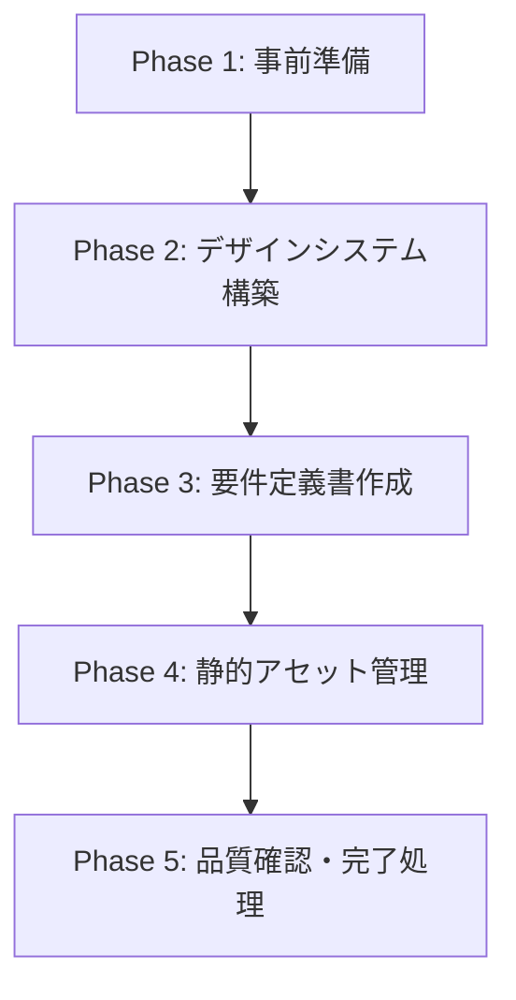

# Figma 要件定義書作成ワークフロー DLID-78kh6rsk7vwc

## 必須文書 DLID-sa3k15bj8mh3

**NEVER skip.** 下記を全て読み込み、深く理解すること

- **`${CLAUDE_PLUGIN_ROOT}/docs/requirement_principles_spec.md`** — 要件定義書の定義（責務・書かないもの・存在期間・改訂）
- **`${CLAUDE_PLUGIN_ROOT}/docs/requirement_format.md`** — 要件定義書テンプレート
- **`${CLAUDE_PLUGIN_ROOT}/docs/error_classification_spec.md`** — エラーの定義・分類（回復可能・回復不能）・原因の扱い
- **`${CLAUDE_PLUGIN_ROOT}/docs/spec_design_boundary_spec.md`** — 要件・設計の境界ガイド（What/How の判断基準）
- **`${CLAUDE_PLUGIN_ROOT}/docs/spec_priorities_spec.md`** — 要件・設計で優先する価値観（構造品質の定量化禁止など）
- **`${CLAUDE_PLUGIN_ROOT}/docs/document_style_guide.md`** — 文書スタイル指針（タグ・見出し・参照記法・用語）

## 目的 DLID-40rwzr1tza7w

Figma デザインファイルから要件を抽出し、デザイントークンと要件定義書を作成する。

## 実行フロー概要 DLID-rpnvxqerw5j9



---

## Phase 1: 事前準備 DLID-wkcv7z52j0g9

### 1.1 Figma MCP の利用可否確認 DLID-g0yvwb6wncj2

利用可能なツール一覧に `mcp__figma` 等が存在するかを確認する。

- **利用可能** → 次へ進む
- **利用不可** → エラーメッセージを表示して終了:
  ```
  Error: Figma MCP が必要です。
  interactive または reverse-engineering モードを使用してください。
  ```

### 1.2 ユーザーへの確認 DLID-p0j6arhc6tzm

以下を AskUserQuestion で確認する:

```
□ Figma ファイルへのアクセス権限はあるか？
□ デザインの最終版か、まだ変更予定があるか？
□ アプリの主要な目的は何か？
□ デザイン以外の隠れた機能要件はあるか？
```

### 1.3 ルール文書・既存仕様の取得 DLID-wh7b94yz3q14

1. **`/forge:query-db-rules`** でルール文書を特定
   - タスク内容: Figma デザインからの要件定義書作成

2. **`/forge:query-db-specs`** で既存要件定義書・設計書を確認
   - タスク内容: Figma デザインからの要件定義書作成

3. 返却された文書を全文読み込み

4. 検索結果（ルール・既存の仕様書）を、そのままユーザーに表示する（5 件以下は全件、6 件以上は先頭 3 件 + `... 他 N 件`）

**Skill が失敗したとき、または検索が行われなかったとき**（索引が未整備で、整備が見送られたとき。検索スキルは失敗として返さない）: 後続へ進まず、その内容をユーザーに報告し、指示を待つ

---

## Phase 2: デザインシステム構築 DLID-r27q7xy0esp2

### 2.1 デザインシステム（2層構造） DLID-zjhdrncb3zbe

デザインシステムは以下の2層構造で構築する:

#### 第1層: デザイントークン（原子的な値） DLID-2y2a6zjjwj1e

- **Colors**: 正確な HEX 値（Figma と一致）
- **Typography**: フォントサイズ、ウェイト、行高
- **Spacing**: スペーシングスケール（4の倍数など）
- **Radius**: ボーダー半径値
- **Shadows**: シャドウスタイル定義

#### 第2層: テーマ（意味的定義） DLID-e12e12twpp8d

- Status 色定義（成功、警告、エラー、情報）
- Button 色定義（プライマリ、セカンダリ、ターシャリ）
- Text 色定義（本文、見出し、キャプション）
- Surface 色定義（背景、カード、オーバーレイ）
- Typography 定義（Title, Body, Button, Caption）
- Layout 定義（Size, Spacing, CornerRadius）

### 2.2 再利用可能コンポーネントの特定 DLID-sg422vfhpt74

- Button（Primary, Secondary, Icon）
- Card（Basic, Elevated）
- Input（TextField, TextArea, Search）
- Navigation（NavigationBar, TabBar）
- Dialog（Alert, BottomSheet）
- Loading（Indicator, Skeleton）

### 2.3 デザイントークン抽出手順 DLID-1mew0zmt2y0g

1. **色の抽出**: Figma のカラーパレットから正確な HEX 値を取得
2. **タイポグラフィの抽出**: フォントファミリー、サイズ、ウェイト、行高を記録
3. **スペーシングとレイアウト**: 一貫したスペーシングシステムを特定

---

## Phase 3: 要件定義書作成 DLID-158c1nz8hr6x

### 3.0 置き場の決定と ID 採番 DLID-stsseyt9d18c

要件定義書のファイルを書く前に、`start-requirements/SKILL.md` の「要件定義書を書く直前の決定」の手順 3〜5（feature・出力先・ファイル名）に従って決める。このワークフローは、差分開発かどうかの判定（手順 2）を行わない。

続けて、使用するプレフィックスごとに、`Skill` ツールで `next-spec-id` を呼び、次の連番を取得する。手動での番号決定は禁止。`args` の第 1 引数に、発行するプレフィックスを渡す（画面要件は `SCR`、UI コンポーネントは `CMP`、機能要件は `FNC`）。

返された `next_id` をファイル名・要件 ID として使用する。`duplicates` が空でない場合は警告を表示する。

### 3.1 画面要件（SCR-xxx）の抽出 DLID-xv5tmrrjryj6

各画面に対して:

- 画面の目的と役割を記述
- UI 要素の配置を ASCII 図で表現
- レイアウト制約を記載
- インタラクション仕様を記載

**重要な原則**:

1. **パーツ名称は画面固有の具体的な名前を使用**
   - ❌ 一般的な名前: 「Title」「List」「Footer」
   - ✅ 画面固有の名前: 「FooListHeader」「BarSelectionList」

2. **レイアウト配置図を含める**
   - ASCII 図で視覚的な配置関係を表現
   - 配置図だけで Figma を見なくてもレイアウトが再現できること

### 3.2 UI コンポーネント（CMP-xxx）の抽出 DLID-kv98ft8z986v

- 再利用される部品を特定
- 状態（通常、押下、無効など）を記録
- プロパティと振る舞いを定義

### 3.3 機能要件（FNC-xxx）の抽出 DLID-nmqpzy77pgjx

- UI から推測される機能を列挙
- 画面に表現されない機能をユーザーに確認

### 3.4 デザインにない要件の補完 DLID-qaddwwqf81qj

Figma デザインには表現されない以下の要件を補完:

```
□ エラーハンドリング（ネットワークエラー、入力エラー等）
□ ローディング状態
□ 空の状態（データがない場合の表示）
□ アクセシビリティ要件
□ パフォーマンス要件
□ データ永続化要件
□ 外部システム連携
```

### 3.5 グロッサリー作成 DLID-7brb6aec23dt

要件で使用する用語を定義・整理する。用語集のファイルは、SKILL.md の「用語集を書く」節に従って作る。

---

## Phase 4: 静的アセット管理 DLID-84q67ed4ca46

### 4.1 画像アセットの洗い出し DLID-tcjwycnz40b8

Figma から抽出した画像の扱い:

- アイコン → システム標準アイコンで代替可能か確認
- イラスト → アセットとして保存予定として記録
- ロゴ → ブランドガイドラインを確認
- 背景画像 → 必要性をユーザーに確認

### 4.2 アセット管理方針の記載 DLID-879pk2jp4260

```markdown
## アセット要件

- アイコン: システム標準アイコン使用（可能な限り）
- カスタム画像: アセット管理に配置予定
- 命名規則: snake_case
```

---

## Phase 5: 品質確認・完了処理 DLID-73wdem49bsnv

### 5.1 デザイントークンの検証 DLID-egj04rw5qs2z

- [ ] 全ての色が Figma と完全一致
- [ ] フォントサイズ・ウェイトが正確
- [ ] スペーシングが一貫している
- [ ] コンポーネントの再利用性が高い

### 5.2 要件定義書の検証 DLID-s8gdrzx4xqwg

- [ ] 全ての画面に要件定義書が存在
- [ ] 要件 ID が正しく付与されている
- [ ] UI で表現されない機能も記載されている
- [ ] エラーケースが考慮されている
- [ ] `requirement_format.md` のフォーマットに従っている

### 5.3 AI レビュー実施 DLID-ekjvz175mqep

Skill ツールで `/forge:review` を起動する:

```
/forge:review --files {作成ファイルパス} --auto
```

対象はこのワークフローで作成・変更したファイル（差分）のみ。

### 5.4 参照の実在性検査 DLID-f7jzry981285

<!-- 未実装: 参照の実在性検査 -->

現時点では本節で行う処理は無い。次の節へ進む。

### 5.5 specs ToC 更新 DLID-5a2syaga91c1

`/forge:update-db-specs` を実行する。

### 5.6 commit/push 確認 DLID-apk7wqb0zy6g

`/anvil:commit` を実行して commit/push を確認する。

### 5.7 完了案内 DLID-dv56gkm2w771

作成したファイルパスとともに、ユーザーが次に実行するコマンド例を案内する:

```
要件定義書を作成しました:
  → {作成ファイルパス}

次のステップ:
  /forge:start-design --requirement {設計する要件定義書のパス}    # 設計書作成へ進む
```
