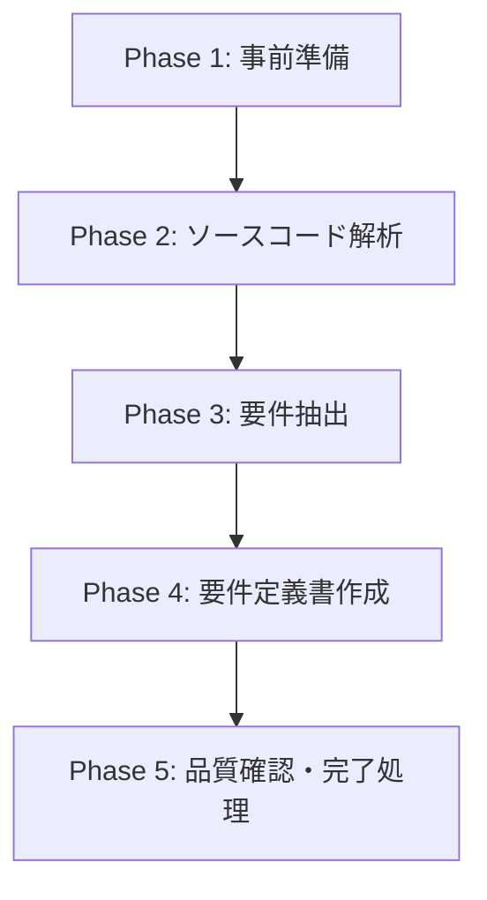
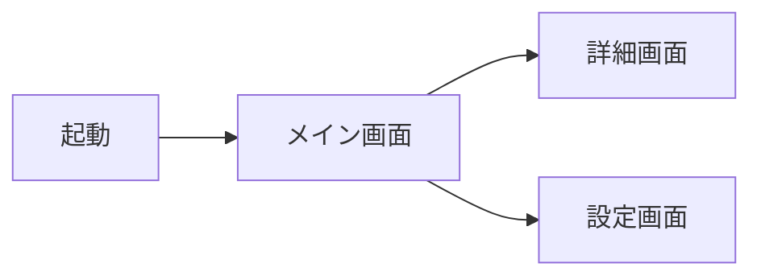

# 要件定義書作成ワークフロー（既存アプリ解析版） DLID-9ht6x2qngyt3

## 必須文書 DLID-22paceet1m5n

**NEVER skip.** 下記を全て読み込み、深く理解すること

- **`${CLAUDE_PLUGIN_ROOT}/docs/requirement_principles_spec.md`** — 要件定義書の定義（責務・書かないもの・存在期間・改訂）
- **`${CLAUDE_PLUGIN_ROOT}/docs/requirement_format.md`** — 要件定義書テンプレート
- **`${CLAUDE_PLUGIN_ROOT}/docs/error_classification_spec.md`** — エラーの定義・分類（回復可能・回復不能）・原因の扱い
- **`${CLAUDE_PLUGIN_ROOT}/docs/spec_design_boundary_spec.md`** — 要件・設計の境界ガイド（What/How の判断基準）
- **`${CLAUDE_PLUGIN_ROOT}/docs/spec_priorities_spec.md`** — 要件・設計で優先する価値観（構造品質の定量化禁止など）
- **`${CLAUDE_PLUGIN_ROOT}/docs/document_style_guide.md`** — 文書スタイル指針（タグ・見出し・参照記法・用語）

## 目的 DLID-bm6v3f5n2kk7

**既存アプリのソースコードが存在する場合、ソースコードから要件を抽出し、要件定義書を作成する**

- **機能は保持、デザインは刷新**が基本方針（変更可能）
- 既存デザインの完全複製は目的ではない

## 実行フロー概要 DLID-4vp8x2hzrgpr



---

## Phase 1: 事前準備 DLID-ryp40jq7yszm

### 1.1 ユーザーへの確認 DLID-29pn25275wxf

以下を AskUserQuestion で確認してから要件定義を開始すること:

| 確認項目         | 内容                           | デフォルト値   |
| ---------------- | ------------------------------ | -------------- |
| デザイン方針     | デザインを刷新するか保持するか | 刷新           |
| 既存ソースコード | 解析対象のソースコードパス     | ユーザーが指定 |

### 1.2 ルール文書・既存仕様の取得 DLID-ppw83kk2wfa3

1. **`/forge:query-db-rules`** でルール文書を特定
   - タスク内容: 既存アプリ解析による要件定義書作成

2. **`/forge:query-db-specs`** で既存要件定義書を確認
   - タスク内容: 既存アプリ解析による要件定義書作成

3. 返却された文書を全文読み込み

**Skill が失敗したとき、または検索が行われなかったとき**（索引が未整備で、整備が見送られたとき。検索スキルは失敗として返さない）: 後続へ進まず、その内容をユーザーに報告し、指示を待つ

### 1.3 既存コード収集 agent の起動 DLID-v8jypevg155y

Agent ツールで以下を起動する。agent の **return value** を main AI コンテキストに直接保持する。プロジェクトのルールは 1.2 で特定済みであり、ここでは集めない。

```
Agent ツール起動: 既存コード収集
prompt:
  解析対象として、以下のソースコード周辺の既存実装を探索する。
  対象パス: {ソースコードのパス}

  検索手順:
  - 上記パス配下のファイルを列挙
  - 同一機能ドメインの import 元・類似命名・テストファイルを分類

  return value として以下の markdown 形式で返す:

  ## 既存コード (N 件)
  - `path/to/file.swift` — 関連理由
```

### 1.4 収集結果の確認 DLID-x7gq60kkg789

agent の完了後、1.2 の検索結果（ルール・既存の仕様書）と agent の return value を、そのままユーザーに表示する（5 件以下は全件、6 件以上は先頭 3 件 + `... 他 N 件`）。

**失敗時の扱い**:

- agent がエラー終了 → 後続の Phase へ進まず、エラーの内容を利用者に報告して指示を待つ
- agent が空結果 → 正常扱い

---

## Phase 2: ソースコード解析 DLID-676f289jefvv

### 2.1 プロジェクト構造の把握 DLID-q8yx9g8m22hb

Phase 1 の既存コード収集 agent の return value を起点に、解析する:

- return value に記載されたファイルを Read して全体構造を把握
- プロジェクト構造の把握（ディレクトリ構成）
- 必要に応じて追加の Grep/Glob 探索で補完

### 2.2 画面・コンポーネントの解析 DLID-d7p17zf8mnss

- View/画面クラスの列挙
- ナビゲーション構造の特定
- 画面遷移マップの作成



### 2.3 デザイン要素の扱い DLID-qncqrwz1k0gm

- **デザイン刷新の場合**: 機能要件のみを抽出（見た目は無視）
- **デザイン保持の場合**: キャプチャー画像があれば解析し、THEME-xxx 要件定義書を作成

---

## Phase 3: 要件抽出 DLID-9jtt11pf7whs

### 3.1 要件抽出の優先順位 DLID-dz5wqqyqgwxr

以下の順番で要件を抽出すること:

1. **APP-001（アプリ全体概要）**: 目的と主要機能
2. **画面要件（SCR-xxx）**: メイン画面から順に抽出
3. **機能要件（FNC-xxx）**: 複数画面にまたがる機能
4. **ビジネスロジック（BL-xxx）**: データ処理ロジック、業務ルール
5. **データ要件（DM-xxx）**: エンティティ定義、保存データ
6. **その他**: CMP, NAV, API, EXT, NFR, SEC, ERR — 必要に応じて

### 3.2 機能抽出の実践手順 DLID-pkva5535xaby

#### ユーザーアクションの特定 DLID-eq8q3fp4s490

ソースコードからボタンタップ、ジェスチャー、入力操作等を検出し、要件化する。

```
例: @IBAction func saveButtonTapped() { ... }
→ 要件化: 「保存ボタンをタップするとデータを保存する」
```

#### 条件分岐の要件化 DLID-7wv0t8303f6h

分岐ロジックを What として記述する（How は記載しない）。

```
例: if items.count > 1 { showSelection() } else { directAction() }
→ 要件化: 「アイテムが複数ある場合は選択画面を表示、1つの場合は直接実行」
```

#### データ永続化の特定 DLID-44hdjj8dnhvm

保存先・内容を特定する。

```
例: UserDefaults.standard.set(sortType, forKey: "sortType")
→ 要件化: 「ソート設定を保存し、次回起動時も維持する」
```

#### エラーハンドリングの抽出 DLID-kt5jqamtc64h

```
例: catch { showAlert("データへのアクセスが拒否されました") }
→ 要件化: 「データアクセス拒否時にエラーメッセージを表示」
```

### 3.3 機能抽出チェックリスト DLID-mh9j0pm2330q

各画面/機能に対して以下を確認:

- [ ] ユーザーアクション（ボタン、入力、ジェスチャー）
- [ ] UI 要素（表示、入力、選択）
- [ ] データ処理（取得、作成、更新、削除、検索）
- [ ] 画面遷移（条件、モーダル、戻る処理）
- [ ] 業務ルール（バリデーション、制約、自動処理）
- [ ] 外部連携（API、システム機能、外部アプリ）

---

## Phase 4: 要件定義書作成 DLID-m7ks0tz3kjgz

### 4.1 置き場の決定と ID 採番 DLID-2nwaprqangzw

要件定義書のファイルを書く前に、`start-requirements/SKILL.md` の「要件定義書を書く直前の決定」の手順 3〜5（feature・出力先・ファイル名）に従って決める。このワークフローは、差分開発かどうかの判定（手順 2）を行わない。

続けて、使用するプレフィックスごとに、`Skill` ツールで `next-spec-id` を呼び、次の連番を取得する。手動での番号決定は禁止。`args` の第 1 引数に、発行するプレフィックスを渡す（アプリ概要は `APP`、画面要件は `SCR`、機能要件は `FNC`）。

返された `next_id` をファイル名・要件 ID として使用する。`duplicates` が空でない場合は警告を表示する。

### 4.2 作成順序 DLID-t8vv5af68gr4

1. **APP-001** — アプリ全体概要
2. **画面要件（SCR-xxx）** — メイン画面から順に
3. **その他の要件** — FNC, BL, DM, CMP 等

### 4.3 記載原則 DLID-z84wq8rqhcb6

- **What に集中**: 「何を実現するか」のみ記載
- **How は記載しない**: 実装方法は設計書の責務
- **判断基準**: 「ユーザーマニュアルに書くか？」→ Yes なら要件、No なら設計

### 4.4 グロッサリー作成 DLID-rv59n0nr6px0

抽出した要件で使用する用語を定義・整理する。用語集のファイルは、SKILL.md の「用語集を書く」節に従って作る。

---

## Phase 5: 品質確認・完了処理 DLID-9jr0061khqwk

### 5.1 品質チェック DLID-yxn3bs8zhg58

**必須ファイルの存在確認**:

- [ ] APP-001（アプリ全体概要）が存在する
- [ ] 全画面の SCR-xxx 要件定義書が存在する
- [ ] 主要機能の FNC-xxx 要件定義書が存在する

**内容の完全性確認**:

- [ ] 全てのユーザーアクションが記載されている
- [ ] 全ての画面遷移が明確である
- [ ] エラー処理が定義されている

**品質基準の確認**:

- [ ] 実装方法（クラス名等）が含まれていない
- [ ] 曖昧な表現がない
- [ ] 要件 ID による相互参照が正しい

### 5.2 AI レビュー実施 DLID-xy762qjf53wn

Skill ツールで `/forge:review` を起動する:

```
/forge:review --files {作成ファイルパス} --auto
```

対象はこのワークフローで作成・変更したファイル（差分）のみ。

### 5.3 参照の実在性検査 DLID-td2eycsxka34

<!-- 未実装: 参照の実在性検査 -->

現時点では本節で行う処理は無い。次の節へ進む。

### 5.4 specs ToC 更新 DLID-8vg3s8zztdvy

`/forge:update-db-specs` を実行する。

### 5.5 commit/push 確認 DLID-1fghx1f2h9qg

`/anvil:commit` を実行して commit/push を確認する。

### 5.6 完了案内 DLID-prjjwpcgwwfx

作成したファイルパスとともに、ユーザーが次に実行するコマンド例を案内する:

```
要件定義書を作成しました:
  → {作成ファイルパス}

次のステップ:
  /forge:start-design --requirement {設計する要件定義書のパス}    # 設計書作成へ進む
```
